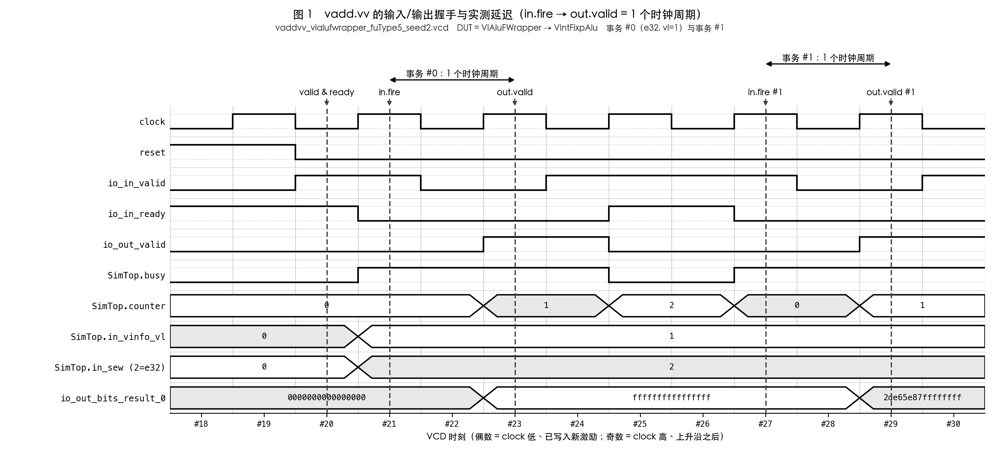
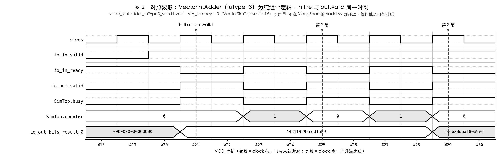
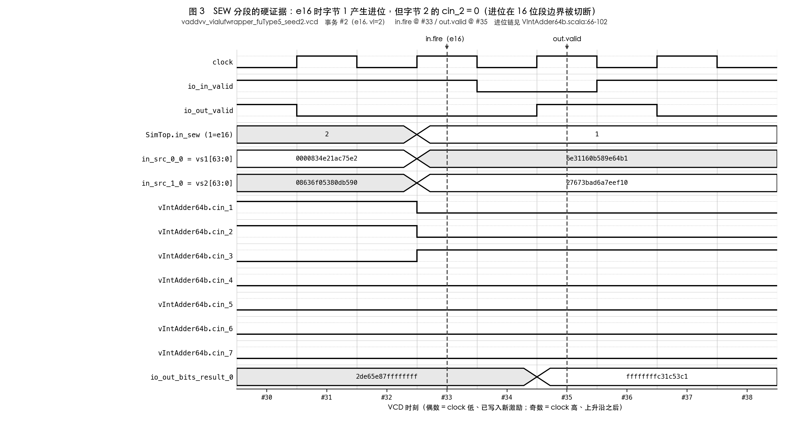
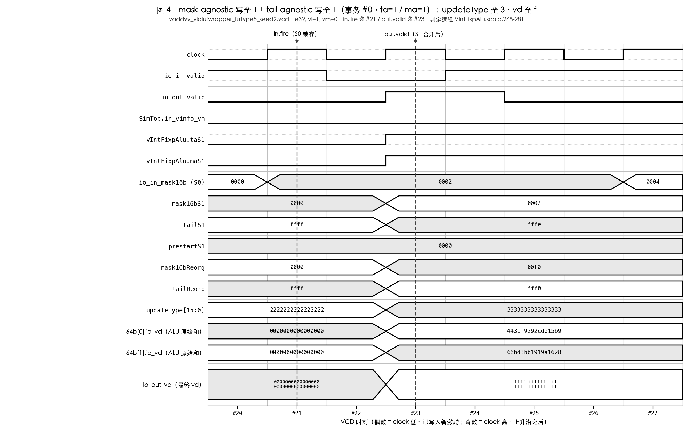
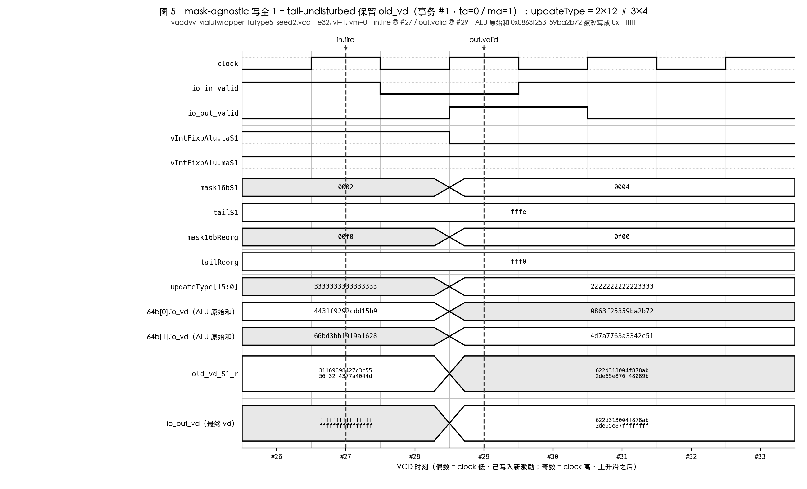
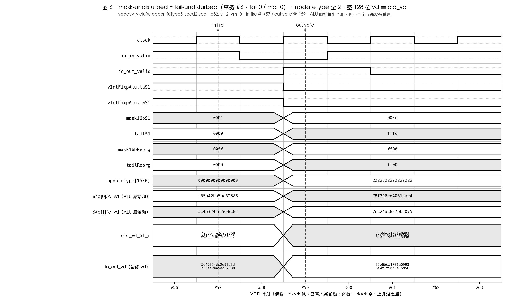

# 阶段一 — `vadd.vv` 在香山昆明湖 V2 中的执行过程分析

| 项 | 值 |
|---|---|
| 目标仓库 | `<仓库根>/work/XiangShan-kmhv2`（由 `scripts/00_setup_env_host.sh` 按 pin 克隆） |
| 分支 / HEAD | `kunminghu-v2` / `a4eeaabb4c12349259094a8b55f3ba1c03a9d993` |
| yunsuan 子模块 HEAD | `955921186e34bb8915806582a238181a6dc3435c`（`build: bump chisel 6.7.0`） |
| VLEN / XLEN | 128 / 64 |
| 波形 1 | `logs/stage1/waveform/vadd_vintadder_fuType3_seed1.vcd`（`VectorIntAdder`，fuType=3） |
| 波形 2 | `logs/stage1/waveform/vaddvv_vialufwrapper_fuType5_seed2.vcd`（`VIAluFWrapper`→`VIntFixpAlu`，fuType=5，**真正的 `vadd.vv` 数据通路**） |
| 抽取脚本 | `scripts/tools/vcd_extract.py`（纯 Python 标准库） |
| 抽取结果存档 | `logs/stage1/waveform/vadd_signal_trace.txt` |
| 波形图 | `docs/stage1/figures/fig1..fig6*.png`（6 张，图索引见 §11.2.1） |
| 绘图脚本 | `scripts/tools/vcd_plot.py` + `scripts/tools/make_stage1_figures.sh`（与抽取脚本共用同一个 VCD 解析器） |

> **阅读本文前必须知道的一件事**：本机无法运行香山全核 Verilator 仿真（官方要求 ~40 GB JVM 堆，本机 16 GB，
> 见 `docs/stage1/03_仿真平台搭建报告.md` §7.1）。因此本文把证据分成两类并**严格区分**：
> * **【波形证据】** —— 来自上述两份真实 VCD，可在 GTKWave 中复现，精确到信号名与时刻。覆盖范围是**功能单元级**。
> * **【源码证据】** —— 来自只读的 `work/XiangShan-kmhv2` 源码树，标注 `文件:行号`。覆盖取指/译码/拆分/重命名/分发/写回/提交。
>
> 全文**没有任何**基于全核波形的断言。局限性集中列在 §10。

---

## 0. 结论速览

| # | 结论 | 证据类型 |
|---|---|---|
| 1 | `vadd.vv` = funct6 `000000` + funct3 `000`(OPIVV) + opcode `1010111`，位模式 `b000000???????????000?????1010111` | 源码 `rocket-chip/src/main/scala/rocket/Instructions.scala:407` |
| 2 | 译码表把它映射到 `FuType.vialuF` / `VialuFixType.vadd_vv` / `UopSplitType.VEC_VVV`（默认值） | 源码 `VecDecoder.scala:189` + `:28-43` |
| 3 | uop 数 = `lmul`；第 i 个 uop 读 `vs1+i, vs2+i, vd+i`，写 `vd+i`，`uopIdx = i` | 源码 `UopInfoGen.scala:201`、`DecodeUnitComp.scala:359-367` |
| 4 | `v0`（掩码）与 `vl` 是**隐式源**，由译码阶段固定写入 `lsrc(3)/lsrc(4)` | 源码 `DecodeUnit.scala:862-863, 1081-1082`；`FuConfig.scala:536-537` |
| 5 | FU 为 `VIAluFix`，内部例化 **2 × `yunsuan.vector.alu.VIntFixpAlu64b`** + `Mgu` + `Mgtu` | 源码 `wrapper/VIAluFix.scala:147-149` |
| 6 | 声明延迟 `CertainLatency(1)`，**实测波形 in.fire → out.valid = 1 个时钟周期**，两者一致 | 源码 `FuConfig.scala:544` + 波形 `#21→#23` 等 8 笔 |
| 7 | RTL 确实按 `sew` 端口分段做加法：8 个 `Adder_8b` 串成链，按 SEW 在段边界切断进位 | 源码 `VIntAdder64b.scala:66-102` + 波形 `cin_1..cin_7`（`#33`、`#21`） |
| 8 | mask-agnostic（`ma=1`）写全 1、tail-undisturbed（`ta=0`）保留 `old_vd` 两种行为都在波形里直接观察到 | 波形 `#23` / `#29` 的 `updateType[15:0]` |
| 9 | 16 笔事务（两份波形各 8 笔）、共 78 个元素逐元素核验，**0 处失配** | `vadd_signal_trace.txt` §2 / §5 |

---

## 1. 指令编码与取指（**源码级，无波形**）

### 1.1 32 位编码

`vadd.vv vd, vs2, vs1` 的位模式（`work/XiangShan-kmhv2/rocket-chip/src/main/scala/rocket/Instructions.scala:407`）：

```scala
def VADD_VV = BitPat("b000000???????????000?????1010111")
```

按 `Riscv32BitInst` / `BitFieldsVec` 的位域定义
（`src/main/scala/xiangshan/backend/decode/isa/bitfield/RiscvInst.scala:12-19, 55-72`）展开：

```
 31      26 25  24      20 19      15 14  12 11       7 6            0
┌──────────┬──┬───────────┬───────────┬──────┬──────────┬──────────────┐
│  funct6  │vm│    vs2    │    vs1    │funct3│    vd    │    opcode    │
│  000000  │ ?│   ?????   │   ?????   │ 000  │  ?????   │   1010111    │
└──────────┴──┴───────────┴───────────┴──────┴──────────┴──────────────┘
   VADD      掩码  RiscvInst   RiscvInst  OPIVV  RiscvInst   OP-V
             位    :66 VS2     :65 VS1    :56    :64 VD      :19
```

* `opcode = 1010111` 由 `OPCODE7Bit.VECTOR_ARITH` 定义（`RiscvInst.scala:196`）；
  5 位形式 `OPCODE5Bit.OP_V = b10_101`（`:181`）。
* `funct3 = 000` 即 OPIVV，判定函数 `isOPIVV`（`RiscvInst.scala:97-100`）。
* `isVecArith` 只看 opcode 是否为 `OP_V`（`RiscvInst.scala:93-95`）——这一点很重要：
  **所有 `opcode=1010111` 的指令一律走复杂译码通路**，见 §3。
* `vm = inst(25)`（`RiscvInst.scala:60`）。`vm=1` 表示无掩码；`vm=0` 表示用 `v0` 逐元素掩码。

汇编器生成的实际编码举例（`vadd.vv v3, v2, v1`，`vm=1`）：
`funct6=000000`、`vm=1`、`vs2=00010`、`vs1=00001`、`funct3=000`、`vd=00011`、`opcode=1010111`
→ `0x0210_80D7`。

### 1.2 前端如何把它送到译码器

这一段**仅有源码证据**，L1 平台没有前端。

```
取指地址 ← NewFtq / BPU
      ↓
NewIFU (src/main/scala/xiangshan/frontend/IFU.scala:130)
      ↓ io.toIbuffer（含 PreDecode 展开 RVC）
IBuffer (src/main/scala/xiangshan/frontend/IBuffer.scala:158)
      ↓ io.out : Vec(DecodeWidth, DecoupledIO(new CtrlFlow))   (IBuffer.scala:45)
DecodeStage (src/main/scala/xiangshan/backend/decode/DecodeStage.scala:83)
```

`vadd.vv` 是 32 位非压缩指令，前端对它没有任何特殊处理：
IFU 取回 cacheline → PreDecode 判定非 RVC、非分支 → 进 IBuffer 队列 →
按 `DecodeWidth` 出队给 `DecodeStage`，`io.enq.ctrlFlow.instr` 即原始 32 位编码
（`DecodeUnit.scala:802-804`）。

---

## 2. 译码（**源码级**）

### 2.1 译码表条目

`DecodeUnit` 把 12 张译码表拼成一张（`src/main/scala/xiangshan/backend/decode/DecodeUnit.scala:806-820`）：

```scala
val decode_table: Array[(BitPat, List[BitPat])] = XDecode.table ++ FpDecode.table ++
  BitmanipDecode.table ++ ScalarCryptoDecode.table ++ XSDebugDecode.table ++ CBODecode.table ++
  SvinvalDecode.table ++ HypervisorDecode.table ++ VecDecoder.table ++ ZicondDecode.table ++
  ZimopDecode.table ++ ZfaDecode.table
require(decode_table.map(_._2.length == 15).reduce(_ && _), "Decode tables have different column size")
```

`VecDecoder` 中匹配 `vadd.vv` 的**那一行**（`src/main/scala/xiangshan/backend/decode/VecDecoder.scala:189`）：

```scala
VADD_VV         -> OPIVV(FuType.vialuF, VialuFixType.vadd_vv, T, F, F),
```

`case class OPIVV` 的完整签名（`VecDecoder.scala:28-43`）决定了**没写出来的那些列取什么默认值**：

```scala
case class OPIVV(
  fu: FuType.OHType,
  fuOp: BitPat,
  vWen: Boolean,
  mWen: Boolean,
  vxsatWen: Boolean,
  uopSplitType: BitPat = UopSplitType.VEC_VVV,   // ← vadd.vv 用默认值
  src1: BitPat = SrcType.vp,                     // ← vs1 是向量
  src2: BitPat = SrcType.vp,                     // ← vs2 是向量
  src3: BitPat = SrcType.vp                      // ← 旧 vd 作为第三源
) extends XSDecodeBase {
  def generate() : List[BitPat] = {
    XSDecode(src1, src2, src3, fu, fuOp, SelImm.X, uopSplitType,
      xWen = F, fWen = F, vWen = vWen, mWen = mWen, xsTrap = F, noSpec = F, blockBack = F, flushPipe = F).generate()
  }
}
```

### 2.2 译出的字段

| 字段 | 取值 | 来源 |
|---|---|---|
| `fuType` | `FuType.vialuF` | `VecDecoder.scala:189`；枚举定义 `fu/FuType.scala:55` |
| `fuOpType` | `VialuFixType.vadd_vv` | `VecDecoder.scala:189` |
| `srcType(0)` | `SrcType.vp`（vs1） | `VecDecoder.scala:35` 默认值 |
| `srcType(1)` | `SrcType.vp`（vs2） | `VecDecoder.scala:36` |
| `srcType(2)` | `SrcType.vp`（old vd） | `VecDecoder.scala:37` |
| `srcType(3)` | `vm==0 ? SrcType.vp : SrcType.DC`（v0 掩码） | `DecodeUnit.scala:1081` |
| `srcType(4)` | `SrcType.vp`（vconfig = vtype & vl） | `DecodeUnit.scala:1082` |
| `vecWen` | `T` | `VecDecoder.scala:189` 第 3 个实参 |
| `mWen` | `F` | 第 4 个实参 |
| `vxsatWen` | `F` | 第 5 个实参 |
| `uopSplitType` | `UopSplitType.VEC_VVV` = `b010010` | 默认值；常量 `src/main/scala/xiangshan/package.scala:771` |

寄存器号的提取（`DecodeUnit.scala:858-866`）：

```scala
decodedInst.lsrc(0) := inst.RS1        // vs1
decodedInst.lsrc(1) := inst.RS2        // vs2
decodedInst.lsrc(2) := Mux(isFMA, inst.FS3, inst.VD)   // 旧 vd
decodedInst.lsrc(3) := V0_IDX.U        // v0（掩码），固定
decodedInst.lsrc(4) := Vl_IDX.U        // vl，固定
decodedInst.ldest   := inst.RD         // vd
```

### 2.3 fuOpType 的数值编码

`VialuFixType` 是 9 位字段（`OpTypeWidth = 9`，`yunsuan/src/main/scala/yunsuan/package.scala:8`），
布局为 `[8:7] format | [6] sign | [5:0] opcode`，由三个访问器定义（`package.scala:191-195`）：

```scala
def getOpcode(fuOpType: UInt) : UInt = fuOpType(5, 0)     // :191
def isSigned (fuOpType: UInt) : Bool = fuOpType(6)        // :193
def getFormat(fuOpType: UInt) : UInt = fuOpType(8, 7)     // :195
```

`vadd.vv` 的常量定义（`package.scala:111-113`）：

```scala
// format:2bits   sign:1bit    opcode:6bits                       （package.scala:111）
def vadd_vv = LiteralCat(FMT.VVV, SINT, VialuOpcode.vadd)         // package.scala:113
```

其中 `FMT.VVV = b00`（`:71`）、`SINT = b1`（`:108`）、`VialuOpcode.vadd = 0`
（`yunsuan/src/main/scala/yunsuan/encoding/Opcode/VialuOpcode.scala:8`），
`LiteralCat` 按声明顺序左移拼接（`yunsuan/src/main/scala/yunsuan/util/LiteralCat.scala:6-12`）。
故 **`VialuFixType.vadd_vv = b00_1_000000 = 0x40 = 64`**：format=VVV（不扩宽）、sign=1（有符号）、opcode=`vadd`。

XiangShan 侧的类型生成（`wrapper/VIAluFix.scala:48-50, 76, 90-95, 109-123`）正是用这三个访问器：

```scala
private val opcode = VialuFixType.getOpcode(io.in.fuOpType)   // VIAluFix.scala:48
private val isSign = VialuFixType.isSigned(io.in.fuOpType)    // :49
private val format = VialuFixType.getFormat(io.in.fuOpType)   // :50
private val intType = Cat(0.U(1.W), isSign)                   // :76
private val addSubSews = Mux1H(Seq(
  (format === VialuFixType.FMT.VVV) -> Cat(vsew, vsew, vsew), ...)).asTypeOf(new Vs2Vs1VdSew)   // :90-95
vs2Type / vs1Type / vdType := Cat(intType, addSubSews.*)      // :109-123
```

即三个 4 位类型字段的格式是 `{0, isSign, sew[1:0]}`，`FMT.VVV` 时 vs2/vs1/vd 的 EEW 都等于 `vsew`，不扩宽。

> **波形与源码的一个对应关系必须说清楚**：L1 测试平台驱动的 `fuOpType = 0`
> （`yunsuan/src/test/csrc/include/vpu_constant.h:57 #define VADD_VV (binstoi("00000000"))`），
> 而 XiangShan 的 `VialuFixType.vadd_vv = 0x40`。两者的**低 6 位 opcode 完全相同（= `VialuOpcode.vadd = 0`）**，
> 差别只在符号位：XiangShan 侧 `isSigned = 1`，L1 侧 `= 0`。
> 该位最终只体现为 `srcType/vdType` 的 bit[2]（有符号/无符号标志），
> 而该标志在 `VIntAdder64b` 中仅用于比较类指令与扩宽符号扩展
> （`VIntAdder64b.scala:49` `signed`、`:54-58` `vs2Widen/vs1Widen`、`:110` `lessThan_vec`），
> **对不扩宽的模加法没有任何影响**。所以波形中观察到的加法行为与 XiangShan 侧的 `vadd.vv` 逐位等价。
> 这一点在波形中可直接核对：`srcType(0)=srcType(1)=vdType`，e32 时为 `0x2`（= `{0,0,10}` 无符号 32 位），
> 见 `vadd_signal_trace.txt` §7 事务 #0。
>
> **上游的一处既有不一致（如实记录）**：L1 用的 `VIAluFWrapper` 走的是
> `VialuFixType.getSrcVdType`（`package.scala:208-234`），它从 `fuOpType(5)` 取 sign、
> `fuOpType(7,6)` 取 format，与 `isSigned`（`:193`，取 bit 6）/ `getFormat`（`:195`，取 bits[8:7]）
> 相差一位；且 `VIAluFWrapper.scala:12` 把 `fuOpType` 声明成 8 位而非 9 位。
> 这是上游两个消费者之间的既有差异，不是本次实验引入的。
> 因为 L1 驱动的 `fuOpType` 恒为 0，这些位全是 0，本次观测不受影响；
> **但下一位同学若要在 L1 平台上驱动非零的 `VialuFixType` 值，必须先理清这处差异。**

### 2.4 vtype 相关控制位

```scala
decodedInst.vpu.vma   := io.enq.vtype.vma        // DecodeUnit.scala:1045
decodedInst.vpu.vta   := io.enq.vtype.vta        // :1046
decodedInst.vpu.vsew  := io.enq.vtype.vsew       // :1047
decodedInst.vpu.vlmul := io.enq.vtype.vlmul      // :1048
decodedInst.vpu.vm    := inst.VM                 // :1049
decodedInst.vpu.vstart:= io.enq.vstart           // :1071
```

`vadd.vv` **不在** `vmaInsts` 等任何特殊列表里，因此
`vpu.isDependOldVd`（`:1069`）与 `vpu.isWritePartVd`（`:1070`）对它都为 `0`——
这正是 §4 中 Dispatch 可以丢弃旧 `vd` 依赖的前提。

### 2.5 非法指令检查

`VecExceptionGen` 对向量算术指令有一条硬性限制（`VecExceptionGen.scala:275`）：

```scala
private val vstartIllegal = isVArith && (io.vstart =/= 0.U)
```

即**昆明湖 V2 对所有向量算术指令，只要 `vstart != 0` 就报 Illegal Instruction**。
`vadd.vv` 的 `fuType = vialuF ∈ vecOPI ⊂ vecArith`（`FuType.scala:55, 127, 130`），受此约束。
对应地，波形中所有事务的 `vinfo_vstart` 恒为 0（测试驱动也写死，`test_driver.cpp:240`）。

---

## 3. uop 拆分与 vl / LMUL 处理（**源码级**）

### 3.1 为什么一定会进复杂译码器

```scala
isComplex := io.in.preInfo.isVecArith || io.in.preInfo.isVecMem || io.in.preInfo.isAmoCAS   // UopInfoGen.scala:248
uopInfoGen.io.in.preInfo.isVecArith := inst.isVecArith                                       // DecodeUnit.scala:1085
```

`isVecArith` 只判 opcode（`RiscvInst.scala:93-95`），所以 `vadd.vv` **总是**被标成 complex，
由 `DecodeStage.scala:104` 的 `decoderComp = Module(new DecodeUnitComp)` 接手，
简单译码器的结果只作为 `latchedInst` 模板。

### 3.2 uop 个数 = LMUL

```scala
val lmul = MuxLookup(vlmul, 1.U(4.W))(Seq(        // UopInfoGen.scala:104-108
  "b001".U -> 2.U,
  "b010".U -> 4.U,
  "b011".U -> 8.U
))
val numOfUop = MuxLookup(typeOfSplit, 1.U(...))(Seq(
  ...
  UopSplitType.VEC_VVV -> lmul,                   // UopInfoGen.scala:201
  ...
))
```

| `vtype.vlmul` | LMUL | `vadd.vv` 的 uop 数 | 每个 uop 处理的元素数（VLEN=128） |
|---|---|---|---|
| `b101` / `b110` / `b111` | 1/8, 1/4, 1/2 | 1 | `VLMAX = (128/SEW) × LMUL` |
| `b000` | 1 | 1 | `128/SEW` |
| `b001` | 2 | 2 | 每 uop `128/SEW` |
| `b010` | 4 | 4 | 每 uop `128/SEW` |
| `b011` | 8 | 8 | 每 uop `128/SEW` |

注意 **LMUL < 1 时 `lmul` 取默认值 1**（`MuxLookup` 的 default），即仍是 1 个 uop，
只是其中有效元素数由 `vl` 决定，多出来的部分走 tail 路径。

### 3.3 拆分规则：`UopSplitType.VEC_VVV`

`DecodeUnitComp` 先把所有 uop 初始化成原指令，再在 `switch` 中按需改写
（`DecodeUnitComp.scala:194-205`）：

```scala
csBundle.foreach { case dst =>
  dst := latchedInst
  dst.numUops := latchedUopInfo.numOfUop
  dst.numWB   := latchedUopInfo.numOfWB
  ...
}
csBundle(0).firstUop := true.B                  // :204
csBundle(numOfUop - 1.U).lastUop := true.B      // :205
```

`vadd.vv` 命中的分支（`DecodeUnitComp.scala:359-367`）：

```scala
is(UopSplitType.VEC_VVV) {
  for (i <- 0 until MAX_VLMUL) {
    csBundle(i).lsrc(0) := src1 + i.U      // vs1 + i
    csBundle(i).lsrc(1) := src2 + i.U      // vs2 + i
    csBundle(i).lsrc(2) := dest + i.U      // old vd + i
    csBundle(i).ldest   := dest + i.U      // vd + i
    csBundle(i).uopIdx  := i.U             // ← uop_idx 的全部语义
  }
}
```

**`uop_idx` 的含义**：它就是「这是 LMUL 组内第几个 128 位寄存器片段」。
功能单元用它做三件事：

1. 从 128 位的 `v0` 里切出本片段对应的掩码位
   —— `maskIdx = vuopIdx`（`wrapper/VIAluFix.scala:229`）、
   `maskUsed = splitMask(maskDataVec(maskIdx), ...)`（`:231`）；
   YunSuan 侧对应 `MaskExtract(mask, maskIdx, eewVm)`（`VIAluFWrapper.scala:77-78`）。
2. 把全局的 `vl` 换算成本片段内的尾部起点
   —— `TailGen(vl, uopIdx, eewVd, narrow)` 里 `nElemRemain = vl - uopIdx × (128/eew)`
   （`yunsuan/.../VAluUtils.scala:70`）。
3. 告诉 `Mgu` 本次写的是 `vd` 组里的第几个寄存器 —— `mgu.io.in.info.vdIdx := outVecCtrl.vuopIdx`
   （`wrapper/VIAluFix.scala:347`）。

### 3.4 `vl` 的流向

`vl` 不是立即数，而是**作为第 5 个源操作数从向量 vl 寄存器堆读出**：

```scala
decodedInst.lsrc(4) := Vl_IDX.U                                   // DecodeUnit.scala:863
decodedInst.srcType(4) := SrcType.vp                              // DecodeUnit.scala:1082
```

```scala
val VialuCfg = FuConfig (
  name = "vialuFix",
  fuType = FuType.vialuF,
  fuGen = (p, cfg) => Module(new VIAluFix(cfg)(p).suggestName("VialuFix")),
  srcData = Seq(
    Seq(VecData(), VecData(), VecData(), V0Data(), VlData()),  // vs1, vs2, vd_old, v0, vtype&vl
  ),
  ...
  vconfigWakeUp = true,
  maskWakeUp = true,
)                                                                  // FuConfig.scala:532-549
```

功能单元侧取用（`fu/vector/VecPipedFuncUnit.scala:48-55`）：

```scala
protected val srcMask: UInt = if(!cfg.maskWakeUp) inCtrl.vpu.get.vmask else {
  MuxCase(inData.getSrcMask, Seq(needClearMask -> allMaskFalse, vm -> allMaskTrue))
}
protected val srcVConfig: VConfig = if(!cfg.vconfigWakeUp) inCtrl.vpu.get.vconfig else inData.getSrcVConfig.asTypeOf(new VConfig)
protected val vl = srcVConfig.vl
```

注意第 51 行的 `vm -> allMaskTrue`：**`vm=1` 时掩码被强制成全 1**，所以后级逻辑不必再区分「有无掩码」。
这一点在波形里得到印证：事务 #2（`vm=1`）的 `mask16bS1 = 0x00e7`，
而 `updateType` 中没有任何一个字节因掩码被改写（见 §6.3）。

---

## 4. 重命名与分发（**源码级**）

### 4.1 向量重命名

`Rename` 为向量侧维护 **3 个独立的 free list**（`src/main/scala/xiangshan/backend/rename/Rename.scala:109-111`）：

```scala
val vecFreeList = Module(new StdFreeList(VfPhyRegs - VecLogicRegs, VecLogicRegs, Reg_V, 31))
val v0FreeList  = Module(new StdFreeList(V0PhyRegs - V0LogicRegs, V0LogicRegs, Reg_V0, 1))
val vlFreeList  = Module(new StdFreeList(VlPhyRegs - VlLogicRegs, VlLogicRegs, Reg_Vl, 1))
```

* `v0` 单独一张表（物理寄存器数 `V0PhyRegs`，逻辑寄存器只有 1 个）——因为几乎每条向量指令都读它，
  独立重命名可以避免 `v0` 成为假依赖瓶颈。
* `vl` 同理单列一张表。
* `vadd.vv` 的每个 uop 申请 1 个向量物理寄存器（`needVecDest`，`Rename.scala:321`、`:334`），
  因为 `vecWen = T`（`RenameTable` 的分配条件 `case Reg_V => x.vecWen`，`Rename.scala:129`）。
* 5 个 free list 的分配是**全或无**的（`Rename.scala:159-166`：任一张表 `canAllocate` 为假则全部不分配）。

### 4.2 分发时丢弃旧 `vd` 依赖

`NewDispatch` 对「第 3 个源 = 旧 vd」做了专门优化（`src/main/scala/xiangshan/backend/dispatch/NewDispatch.scala:310-331`）：

```scala
val isDependOldVd = fromRename(i).bits.vpu.isDependOldVd
val isWritePartVd = fromRename(i).bits.vpu.isWritePartVd
val vlIsVlmax = vlBusyTable.io_vl_read.vlReadInfo(i).is_vlmax
val vlIsNonZero = vlBusyTable.io_vl_read.vlReadInfo(i).is_nonzero
val ignoreTail  = vlIsVlmax && (vm =/= 0.U || vma) && !isWritePartVd
val ignoreWhole = (vm =/= 0.U || vma) && vta
val ignoreOldVd = vlBusyTable.io.read(i).resp && vlIsNonZero && !isDependOldVd && (ignoreTail || ignoreWhole)
```

对 `vadd.vv`：`isDependOldVd = 0`、`isWritePartVd = 0`（§2.4）。
于是只要 (a) `vl` 已就绪且非零，且 (b) `vl == VLMAX` 且无有效掩码（即没有 body-masked 元素），
或者 (c) `vta=1` 且无有效掩码，
**旧 `vd` 的读依赖就会被整体丢弃**，关键路径缩短一跳。
否则（例如波形事务 #1 那种 `vm=0, ta=0` 的情形）必须真正读出旧 `vd`，因为 tail/masked 元素要原样保留。

### 4.3 发射队列绑定

```scala
ExeUnitParams("VFEX0", Seq(VfmaCfg, VialuCfg, VimacCfg, VppuCfg), Seq(VfWB(port = 0, 0), V0WB(port = 0, 0)),
              Seq(Seq(VfRD(0, 0)), Seq(VfRD(1, 0)), Seq(VfRD(2, 0)), Seq(V0RD(0, 0)), Seq(VlRD(0, 0))))  // Parameters.scala:449
ExeUnitParams("VFEX2", Seq(VfmaCfg, VialuCfg), Seq(VfWB(port = 1, 0), V0WB(port = 1, 0)),
              Seq(Seq(VfRD(3, 0)), Seq(VfRD(4, 0)), Seq(VfRD(5, 0)), Seq(V0RD(1, 0)), Seq(VlRD(1, 0))))  // Parameters.scala:453
```

→ **`VialuCfg` 挂在 VFEX0 和 VFEX2 两个执行单元上，是双发射的**（对比 `VimacCfg` 只在 VFEX0、
`VipuCfg` 只在 VFEX1，均为单发射）。每个端口读 3 个向量源 + 1 个 `v0` + 1 个 `vl`，
写 1 个向量端口 + 1 个 `v0` 端口。

向量指令在 DataPath 之后还有一级 OG2 寄存器（`datapath/Og2ForVector.scala:15, 30-45`），
把读到的操作数再打一拍送进 ExeUnit，这是昆明湖 V2 向量侧的时序设计，**不计入 FU 自身的 latency**。

---

## 5. 发射与执行 —— 波形说话

### 5.1 被观测的 DUT 与全核 FU 的关系（**必须先讲清楚**）

```
XiangShan 全核（源码级）                       L1 波形（实测）
──────────────────────────────                ───────────────────────────────
wrapper/VIAluFix.scala:134                     yunsuan VIAluFWrapper.scala:28
  ├─ VIAluSrcTypeModule        (:143)            ├─ VialuFixType.getSrcVdType  (:57)
  ├─ VecDataSplitModule × 3    (:144-146)        └─ VIntFixpAlu               (:39)
  ├─ VIntFixpAlu64b × 2        (:147)  ◄────────────┬─ VIntFixpAlu64b × 2   (VIntFixpAlu.scala:157)
  ├─ Mgu(128)                  (:148)               │    └─ VIntAdder64b / VIntMisc64b / VFixPoint64b
  └─ Mgtu(128)                 (:149)               └─ TailGen/PrestartGen/MaskReorg/updateType
                                                         (VIntFixpAlu.scala:256-304)
```

已核实：

* `grep -rn "VectorIntAdder" src/` 与 `grep -rn "VIAluFWrapper" src/` 在 XiangShan 侧**零命中**
  —— 这两个模块 XiangShan **不例化**，只存在于 YunSuan 自带的测试顶层。
* `wrapper/VIAluFix.scala:16` `import yunsuan.vector.alu.{VIntFixpAlu64b, ...}`、
  `:147` `Seq.fill(numVecModule)(Module(new VIntFixpAlu64b))`
  —— XiangShan 例化的就是波形里 `TOP.SimTop.viaf.vIntFixpAlu.vIntFixpAlu64bs_0/_1` 这同一个 Chisel 类。

**结论**：波形中的 64 位整数加法数据通路（`VIntFixpAlu64b` → `VIntAdder64b`）**与全核中的是同一份 RTL**；
差异只在外层的 mask/tail 合并壳（YunSuan 的 `updateType` vs XiangShan 的 `Mgu`/`Mgtu`），
两者语义等价但实现不同，§6.4 给出逐条对照。
`VectorIntAdder`（fuType=3）则是 YunSuan 的另一份独立实现，**不在 XiangShan 的 `vadd.vv` 路径上**，
本文把它当作一份**独立的参考数据通路**使用（它不含 mask/tail 逻辑，因此能干净地暴露纯加法行为）。

### 5.2 波形采样约定（怎么读时刻号）

`yunsuan/src/test/csrc/emu.cpp:104-139` 的 `single_cycle()` 决定了 VCD 的时刻语义：

```c
dut_ptr->clock = 0;  dut_ptr->eval();
test_driver.assign_input_raising(dut_ptr);   // emu.cpp:110  先写新激励
tfp->dump(cycles); cycles++;                 // emu.cpp:115  偶数时刻
dut_ptr->clock = 1;  dut_ptr->eval();
tfp->dump(cycles);  cycles++;                // emu.cpp:128  奇数时刻（上升沿之后）
test_driver.diff_output_falling(dut_ptr);    // emu.cpp:134  在此比对
```

* **偶数时刻 2k**：`clock=0`，`io_in_bits_*` 已是新激励，`io_in_ready = !busy` 仍是上升沿**之前**的旧值。
  故 `(io_in_valid & io_in_ready) @ 2k` ⟺ **`in.fire` 发生在上升沿 2k+1**。
* **奇数时刻 2k+1**：`clock=1` 求值后，是上升沿**之后**的状态，`io_out_valid` / `io_out_bits_result_*` 在此采样。

`scripts/tools/vcd_extract.py` 的 `collect_transactions()` 就是按这个约定实现的，
并且**事务的输入一律从 SimTop 内部的锁存寄存器 `TOP.SimTop.in_*` 采样**
（`VectorSimTop.scala:93` `val in = Reg(new VSTInputIO)`、`:103` `when (io.in.fire) { in := io.in.bits }`），
因为那才是功能单元真正看到的值。

### 5.3 逐周期事务表 —— `vaddvv_vialufwrapper_fuType5_seed2.vcd`

命令：`python3 scripts/tools/vcd_extract.py --vcd logs/stage1/waveform/vaddvv_vialufwrapper_fuType5_seed2.vcd --transactions`

```
   #  t_fire   t_out  cyc fuT  fuOp  sew  vl vlmul vm ta ma ui
--------------------------------------------------------------
   0      21      23    1   5     0  e32   1     7  0  1  1  0
   1      27      29    1   5     0  e32   1     0  0  0  1  0
   2      33      35    1   5     0  e16   2     1  1  1  1  0
   3      39      41    1   5     0  e64   4     3  0  0  0  0
   4      45      47    1   5     0  e16   2     6  1  1  0  0
   5      51      53    1   5     0  e64   4     3  1  1  1  0
   6      57      59    1   5     0  e32   2     7  0  0  0  0
   7      63      65    1   5     0  e16   3     0  1  1  1  0
```

（`t_fire` / `t_out` 为 VCD 时刻；`cyc = (t_out − t_fire)/2` 为时钟周期数；`ui = uop_idx`。）

逐事务的完整数据通路快照（节选，全部 8 笔见 `vadd_signal_trace.txt` §4）：

| 事务 | t_fire | t_out | sew | vl | vm/ta/ma | `src_0` = **vs1** | `src_1` = **vs2** | `src_2` = **old_vd** | `src_3` = **mask(v0)** | `result` = **vd** |
|---|---|---|---|---|---|---|---|---|---|---|
| 0 | #21 | #23 | e32 | 1 | 0/1/1 | `60b7acd93ab50c2a_000041a710d63af1` | `06058ed856e509fe_4431b7821c06dac8` | `31169898427c3c55_56f32f4377a4044d` | `06d7d4b343cd3747_6a5d128c046cdbe2` | `ffffffffffffffff_ffffffffffffffff` |
| 1 | #27 | #29 | e32 | 1 | 0/0/1 | `416f59b3756a1854_0000834e21ac75e2` | `0c0b1db02dca13fd_08636f05380db590` | `622d313004f878ab_2de65e876f48089b` | `0dafa966079a6e8f_54ba251908d9b7c4` | `622d313004f878ab_2de65e87ffffffff` |
| 2 | #33 | #35 | e16 | 2 | 1/1/1 | `06e4cdeb178b02d6_6e31160b589e64b1` | `33813a0f690ac933_27673bad6a7eef10` | `0c26a2663c6fdcc5_431f692543301e90` | `41a41e1b7db4a047_5407288221f499e7` | `ffffffffffffffff_ffffffffc31c53c1` |
| 3 | #39 | #41 | e64 | 4 | 0/0/0 | `45d052046fb8a86a_21b2d019627c2a97` | `3cdec90846604b70_443900737a4ca102` | `7c8c673865cccd69_5bf8ca282aa03744` | `6797585501286995_68c1dcb50f8124ce` | `82af1b0cb618f3da_5bf8ca282aa03744` |
| 4 | #45 | #47 | e16 | 2 | 1/1/0 | `625723ca46eed536_12e1382a002e5715` | `76e5ebec70e40fef_69eff09b079d8673` | `452c200b53ebd5a7_0cd24dd042f29943` | `303e9b4b5e4571ab_2017f1fc040fe7da` | `ffffffffffffffff_ffffffff07cbdd88` |
| 5 | #51 | #53 | e64 | 4 | 1/1/1 | `1753384158923f5d_59dc22a20365e7c5` | `44f1fa0c6a574d30_697e2018576d3dc3` | `4986bffe2da6e268_098cc0db77c96ec2` | `4d6a7633087635fa_275a31421257f83d` | `5c45324dc2e98c8d_c35a42ba5ad32588` |
| 6 | #57 | #59 | e32 | 2 | 0/0/0 | `3676e21e36f73b81_578fe87528e6863c` | `464b68aa00c494f4_2163ae58174b2488` | `35b6bca1701a0993_6a0f1f9006e15d56` | `514a45646311d1ed_3d6acb642e4f31bc` | `35b6bca1701a0993_6a0f1f9006e15d56` |
| 7 | #63 | #65 | e16 | 3 | 1/1/1 | `17115b9d7495ac3f_1651dccf5877a57b` | `7bb9e20168a4ef1c_0e5f97e525ed42c2` | `408b5b2e7d0f4a1c_244e4cf0109d332f` | `20438e0e332349ae_76cab468760a54c5` | `ffffffffffffffff_ffff74b47e64e83d` |

> `src_0` / `src_1` 到 `vs1` / `vs2` 的映射见 `VIAluFWrapper.scala:61-67`：
> `vs1 = Mux(needReverse, src(1), src(0))`、`vs2 = Mux(needReverse, src(0), src(1))`，
> `needReverse` 只对 `vrsub_vv` 为真（`yunsuan/package.scala:197`），故 `vadd.vv` 时 `vs1 = src(0)`、`vs2 = src(1)`。
> 另：全部 8 笔的 `uop_idx` 都是 0，原因是测试驱动对非置换类 FU 把 `uop_idx` 写死为 0
> （`yunsuan/src/test/csrc/test_driver.cpp:307` `default: input.uop_idx = 0;`）。
> 因此 **`uop_idx != 0` 的多 uop 行为在本波形中无法观测**，只能靠源码论证（§3.3）。

### 5.4 握手时间线（延迟的直接依据）

`vadd_signal_trace.txt` §8（fuType=5；**节选**：只摘 #18–#29，并略去 `has_issued` /
`in_vinfo_ma` / `in_vinfo_ta` 三列，完整的 #18–#38 全列表见 trace 文件原文）：

```
     time       busy    counter   in_vinfo_vl  clock  io_in_ready  io_in_valid  io_out_valid  reset
      #18          0          0            00      0            1            0             0      1
      #19          0          0            00      1            1            0             0      1
      #20          0          0            00      0            1            1             0      0   ← valid&ready
      #21          1          0            01      1            0            1             0      0   ← in.fire（busy 0→1，in 锁存）
      #22          1          0            01      0            0            0             0      0
      #23          1          1            01      1            0            0             1      0   ← out.valid（counter=1 ≥ VIAF_latency=1）
      #24          1          1            01      0            0            1             1      0
      #25          0          2            01      1            1            1             0      0   ← out.fire → busy 0
      #26          0          2            01      0            1            1             0      0   ← valid&ready
      #27          1          0            01      1            0            1             0      0   ← 第 2 笔 in.fire
      #29          1          1            01      1            0            0             1      0   ← 第 2 笔 out.valid
```

握手逻辑的源码依据（`yunsuan/src/test/scala/top/VectorSimTop.scala`）：

```scala
io.in.ready := !busy                                               // :96
when (io.in.fire) { counter := 0.U; busy := true.B; in := io.in.bits
                    latency := LookupTreeDefault(io.in.bits.fuType, 999.U, List(... viaf -> VIAF_latency.U ...)) }  // :100-117
when (busy) { counter := counter + 1.U }                           // :121
val finish_fixLatency = busy && (counter >= latency)               // :122
io.out.valid := Mux(is_uncertain, finish_uncertain, finish_fixLatency)  // :384
```

`VIAF_latency = 1`（`VectorSimTop.scala:17`）。
上升沿 #21 锁存激励并把 `counter` 清 0；上升沿 #23 `counter` 变 1，满足 `counter >= 1`，
`io.out.valid` 拉高。**in.fire → out.valid = 1 个时钟周期**，8 笔事务无一例外。



**图 1　输入/输出握手与实测延迟。**
波形文件 `logs/stage1/waveform/vaddvv_vialufwrapper_fuType5_seed2.vcd`，时刻范围 `#18`–`#30`。
信号（自上而下）：`TOP.clock`、`TOP.reset`、`TOP.io_in_valid`、`TOP.io_in_ready`、`TOP.io_out_valid`、
`TOP.SimTop.busy`、`TOP.SimTop.counter`、`TOP.SimTop.in_vinfo_vl`、`TOP.SimTop.in_sew`、
`TOP.SimTop.io_out_bits_result_0`。
图中三条标记线：`#20` 处 `io_in_valid & io_in_ready` 同时为 1；`#21` 处 `busy` 由 0 变 1（in.fire，激励被锁进
`SimTop.in` 寄存器）；`#23` 处 `counter` 变 1 且 `io_out_valid` 拉高。
`#21 → #23` 跨 1 个时钟周期，第二笔 `#27 → #29` 同样是 1 个周期，与上表数值一致。
本图即 §11.2 的 W2 / W3。

### 5.5 `VectorIntAdder`（fuType=3）的对照波形

命令：`python3 scripts/tools/vcd_extract.py --vcd logs/stage1/waveform/vadd_vintadder_fuType3_seed1.vcd --transactions`

```
   #  t_fire   t_out  cyc fuT  fuOp  sew  vl vlmul vm ta ma ui
--------------------------------------------------------------
   0      21      21    0   3     0  e64   1     2  0  1  1  0
   1      25      25    0   3     0  e64   1     2  0  1  1  0
   2      29      29    0   3     0  e16  17     2  1  0  1  0
   3      33      33    0   3     0  e16  10     1  1  1  0  0
   4      37      37    0   3     0  e64   5     2  1  0  0  0
   5      41      41    0   3     0  e32   2     7  1  1  1  0
   6      45      45    0   3     0  e16   1     7  1  1  1  0
   7      49      49    0   3     0  e32   2     0  0  1  0  0
```

两点观察，都是如实记录：

1. **延迟 0 周期**：`VIA_latency = 0`（`VectorSimTop.scala:16`），`out.valid` 与 `in.fire` 同一个上升沿，
   说明 `VectorIntAdder` 是**纯组合逻辑**，不含流水寄存器。
2. **事务 #0 与 #1 的激励完全相同**。原因是 `io_in_bits_*` 在 VCD 中直到 #26 才变化
   （见 `vadd_signal_trace.txt` §9 的 `in_vinfo_vl` 列），而 #21 与 #25 两次握手锁存到的是同一组激励。
   这是 0 周期延迟下测试驱动的握手节拍产物，**不影响功能比对**（两次结果一致，均通过核验）。



**图 2　对照波形：`VectorIntAdder`（fuType=3）的 0 周期握手。**
波形文件 `logs/stage1/waveform/vadd_vintadder_fuType3_seed1.vcd`，时刻范围 `#18`–`#30`。
信号：`TOP.clock`、`TOP.io_in_valid`、`TOP.io_in_ready`、`TOP.io_out_valid`、`TOP.SimTop.busy`、
`TOP.SimTop.counter`、`TOP.SimTop.io_out_bits_result_0`。
标记线 `#21`：`busy` 与 `io_out_valid` 在**同一时刻**同时拉高（`counter = 0` 即满足 `counter >= VIA_latency = 0`），
所以 `t_out − t_fire = 0`；第 2、3 笔分别在 `#25`、`#29`，形态相同。
此刻 `io_out_bits_result_0 = 0x4431f9292cdd15b9`，与 §5.6 核验 4 的手算结果一致。
本图即 §11.2 的 W4。

### 5.6 逐元素加法手工核验

#### 核验 1 —— e16，事务 #2 @ `out.valid #35`，兼证 **SEW 分段进位链**

输入（低 64 位）：`vs1 = 0x6e31160b589e64b1`，`vs2 = 0x27673bad6a7eef10`；输出 `vd(低 64) = 0xffffffffc31c53c1`。

按 e16 切成元素（低位在前）：

```
元素 0 :  vs1 = 0x64b1 , vs2 = 0xef10
          0x64b1 + 0xef10 = 0x1_53C1   →  截断到 16 位 = 0x53C1
          DUT vd[0] = 0x53C1                                        ✓

元素 1 :  vs1 = 0x589e , vs2 = 0x6a7e
          0x589e + 0x6a7e = 0xC31C
          DUT vd[1] = 0xC31C                                        ✓
```

**关键在于元素 0 产生的进位去了哪里。** 把低 64 位拆成 8 个字节（LSB 在前）：

```
          b7 b6 b5 b4 b3 b2 b1 b0
vs1  :    6e 31 16 0b 58 9e 64 b1
vs2  :    27 67 3b ad 6a 7e ef 10
```

逐字节加（`VIntAdder64b.scala:66-102` 的 8 个 `Adder_8b` 链）：

| i | `vs1[i]` | `vs2[i]` | `cin(i)` | 和 | `cout(i)` | 波形中的 `cin_i` |
|---|---|---|---|---|---|---|
| 0 | b1 | 10 | 0 | `0xc1` | 0 | —（i=0 恒为 `carryIn`） |
| 1 | 64 | ef | 0 | `0x153` → `53` | **1** | `cin_1 = 0` |
| 2 | 9e | 7e | **0** | `0x11c` → `1c` | 1 | `cin_2 = 0` ← **进位在此被切断** |
| 3 | 58 | 6a | 1 | `0xc3` | 0 | `cin_3 = 1` |
| 4 | 0b | ad | 0 | `0xb8` | 0 | `cin_4 = 0` |
| 5 | 16 | 3b | 0 | `0x51` | 0 | `cin_5 = 0` |
| 6 | 31 | 67 | 0 | `0x98` | 0 | `cin_6 = 0` |
| 7 | 6e | 27 | 0 | `0x95` | 0 | `cin_7 = 0` |

波形实测（`vadd_signal_trace.txt` §10，`in.fire @ #33`）：

```
     time   in_sew   cin_1  cin_2  cin_3  cin_4  cin_5  cin_6  cin_7
      #33        1       0      0      1      0      0      0      0
```

**完全吻合**。字节 1 产生了进位（`0x64 + 0xef = 0x153`），但字节 2 的 `cin_2 = 0`
—— 因为 `sew = e16` 时 16 位段边界落在字节 2 上，源码里对应：

```scala
} else if (i % 2 == 0) {
  cin(i) := Mux(eewCin.is64 || eewCin.is32, cout(i-1), carryIn(i))   // VIntAdder64b.scala:92-93
}
```

`eewCin.is64 = is32 = false` ⇒ `cin(2) = carryIn(2) = 0`。
如果进位被错误地传过去，元素 1 会算成 `0xC31D` 而不是 `0xC31C`。
**这是「RTL 真的按 `sew` 端口分段」的硬证据，而不只是数值巧合。**



**图 3　SEW 分段进位链：e16 时进位在 16 位段边界被切断。**
波形文件 `logs/stage1/waveform/vaddvv_vialufwrapper_fuType5_seed2.vcd`，时刻范围 `#30`–`#38`，
对应事务 #2（in.fire `#33` / out.valid `#35`）。
信号：`TOP.clock`、`TOP.io_in_valid`、`TOP.io_out_valid`、`TOP.SimTop.in_sew`、
`TOP.SimTop.in_src_0_0`（= `vs1[63:0]`）、`TOP.SimTop.in_src_1_0`（= `vs2[63:0]`）、
`TOP.SimTop.viaf.vIntFixpAlu.vIntFixpAlu64bs_0.vIntAdder64b.cin_1` … `.cin_7`、
`TOP.SimTop.io_out_bits_result_0`。
`#33` 起 `in_sew` 由 2（e32）变 1（e16），激励变为 `vs1 = 0x6e31160b589e64b1` / `vs2 = 0x27673bad6a7eef10`；
同一时刻 `cin_1` 与 `cin_2` 双双落到 0、`cin_3` 升到 1，即 `cin_1..cin_7 = 0,0,1,0,0,0,0`，与上表逐字节推演一致。
字节 1 明明产生了进位（`0x64 + 0xef = 0x153`），`cin_2` 仍为 0 —— 进位被 16 位段边界切断。
`#35` 的 `io_out_bits_result_0 = 0xffffffffc31c53c1`。
本图即 §11.2 的 W5 / W6。

#### 核验 2 —— e64，事务 #5 @ `out.valid #53`

```
vs1[0] = 0x59dc22a20365e7c5
vs2[0] = 0x697e2018576d3dc3
  逐字节：c5+c3=0x188(进位1) | e7+3d+1=0x125(进位1) | 65+6d+1=0xd3 | 03+57=0x5a
          a2+18=0xba | 22+20=0x42 | dc+7e=0x15a(进位1) | 59+69+1=0xc3
  → 0xC35A42BA5AD32588
DUT vd[0] = 0xC35A42BA5AD32588                                      ✓   （vd 低 64 位）

vs1[1] = 0x1753384158923f5d
vs2[1] = 0x44f1fa0c6a574d30
  0x1753384158923f5d + 0x44f1fa0c6a574d30 = 0x5C45324DC2E98C8D
DUT vd[1] = 0x5C45324DC2E98C8D                                      ✓   （vd 高 64 位）
```

此处 `vm=1, ta=1`，`vl=4` 而 e64 下单 uop 只有 2 个元素，所以两个元素都是 body，无 mask/tail 改写。

#### 核验 3 —— e16 回绕，事务 #7 @ `out.valid #65`

```
vs1(低64) = 0x1651dccf5877a57b , vs2(低64) = 0x0e5f97e525ed42c2 , vl = 3

元素 0 : 0xa57b + 0x42c2 = 0xE83D            DUT = 0xE83D   ✓
元素 1 : 0x5877 + 0x25ed = 0x7E64            DUT = 0x7E64   ✓
元素 2 : 0xdccf + 0x97e5 = 0x1_74B4 → 0x74B4  DUT = 0x74B4   ✓   ← 模 2^16 回绕
元素 3..7 : idx ≥ vl = 3，且 ta=1 → 全 1      DUT = 0xFFFF   ✓
→ vd = 0xffffffffffffffff_ffff74b47e64e83d                   ✓
```

元素 2 的 `0xdccf + 0x97e5 = 0x174b4` 溢出 16 位，RTL 截断为 `0x74b4`，
与 RVV 1.0「整数加法按元素宽度模运算回绕、不饱和」一致。

#### 核验 4 —— e64 + 完整 8 字节进位链，`VectorIntAdder` 事务 #0 @ `#21`

```
vs1 = 0x000041a710d63af1 , vs2 = 0x4431b7821c06dac8
          b7 b6 b5 b4 b3 b2 b1 b0
vs1  :    00 00 41 a7 10 d6 3a f1
vs2  :    44 31 b7 82 1c 06 da c8
```

| i | 计算 | 结果字节 | `cout(i)` |
|---|---|---|---|
| 0 | f1+c8 = `0x1b9` | `b9` | 1 |
| 1 | 3a+da+1 = `0x115` | `15` | 1 |
| 2 | d6+06+1 = `0xdd` | `dd` | 0 |
| 3 | 10+1c+0 = `0x2c` | `2c` | 0 |
| 4 | a7+82+0 = `0x129` | `29` | 1 |
| 5 | 41+b7+1 = `0xf9` | `f9` | 0 |
| 6 | 00+31+0 = `0x31` | `31` | 0 |
| 7 | 00+44+0 = `0x44` | `44` | 0 |

→ `0x4431F9292CDD15B9`，DUT `result_0 = 0x4431f9292cdd15b9` ✓。
e64 时整条链全连通（`cin(4) = Mux(is64, cout(3), carryIn)`，`VIntAdder64b.scala:90-91`），
字节 1 与字节 4 的进位都被正确传递到了下一字节。

> 同一波形中 `vs1`/`vs2` 的高 64 位：`0x60b7acd93ab50c2a + 0x06058ed856e509fe = 0x66BD3BB1919A1628`，
> DUT `result_1 = 0x66bd3bb1919a1628` ✓。

#### 核验 5 —— 自动化全量核验

命令：`python3 scripts/tools/vcd_extract.py --vcd <file> --verify`

脚本把每笔事务的 128 位 payload 按 `sew` 切元素，按
「body → `(vs1+vs2) mod 2^SEW`；masked → `ma? 全1 : old_vd`；tail → `ta? 全1 : old_vd`」
建模并逐元素比对：

| 波形 | 事务数 | 比对元素总数 | 失配 |
|---|---|---|---|
| `vaddvv_vialufwrapper_fuType5_seed2.vcd`（mgu 模型） | 8 | 40 | **0** |
| `vadd_vintadder_fuType3_seed1.vcd`（raw 模型，不含 mask/tail） | 8 | 38 | **0** |

### 5.7 SEW 交叉验证：RTL 真的在看 `sew`

命令：`--sew-crosscheck`。对同一笔事务，分别**假设** sew 为 e8/e16/e32/e64 做切分并逐元素加，
看哪种切分能复现 DUT 的 `vd`。`VectorIntAdder` 不做 mask/tail，所以可以直接比全部 128 位：

```
  事务   真sew   t_out       按e8      按e16      按e32      按e64
   0    e64      21      9/16       6/8       4/4       2/2
   1    e64      25      9/16       6/8       4/4       2/2
   2    e16      29     13/16       8/8       2/4       0/2     ← e16 是唯一的完全匹配
   3    e16      33     14/16       8/8       4/4       2/2
   4    e64      37     11/16       6/8       4/4       2/2
   5    e32      41      9/16       6/8       4/4       2/2
   6    e16      45     13/16       8/8       2/4       0/2     ← e16 是唯一的完全匹配
   7    e32      49      8/16       4/8       4/4       2/2
```

（上表为命令的**完整 8 行**输出，未作删节；原始输出另存于
`logs/stage1/waveform/vadd_signal_trace.txt` 第 3 / 6 节。
事务 #1 的激励与 #0 相同，故两行数值一致，见 §5.5 第 2 点。）

判读：

* **比真 SEW 更窄的切分一定失败**（事务 #2：按 e8 只有 13/16，按 e16 才 8/8）
  —— 因为真实加法会跨越窄切分的边界产生进位。
* **比真 SEW 更宽的切分有时也能对上**（事务 #0：e64 和 e32 都全中）
  —— 当恰好没有进位跨过那条边界时两者不可区分，这是算术本身的性质，不是 RTL 的问题。
* 因此判据是「**能完全复现 `vd` 的最窄切分 = DUT 实际使用的 SEW**」。
  事务 #2 / #6 给出了唯一解（只有 e16 全中），直接证明 RTL 按 `sew` 端口分段。
* 更强的证据是 §5.6 核验 1 的进位链信号 `cin_2 = 0`，那是结构级而非数值级的证据。

---

## 6. 掩码与尾部处理

### 6.1 两套实现的对照

| | XiangShan 全核（源码级） | L1 波形（实测） |
|---|---|---|
| 模块 | `Mgu(128)` + `Mgtu(128)` + `ByteMaskTailGen(128)` | `VIntFixpAlu` 内置的 `TailGen`/`PrestartGen`/`MaskReorg`/`updateType` |
| 位置 | `fu/vector/Mgu.scala:34`、`Mgtu.scala:29`、`ByteMaskTailGen.scala:46` | `yunsuan/.../VIntFixpAlu.scala:256-304`、`VAluUtils.scala:66-110` |
| 粒度 | 字节（16 个） | 字节（16 个） |
| 选择信号 | `activeEn` / `agnosticEn` | `updateType[i] ∈ {0,2,3}` |
| 三选一 | `MuxCase(oldVd, Seq(activeEn -> vd, agnosticEn -> 全1))`（`Mgu.scala:89-94`） | `vd & bitsKeep \| bitsReplace`（`VIntFixpAlu.scala:283-285, 304`） |

### 6.2 波形里能直接看到的内部信号

命令：`python3 scripts/tools/vcd_extract.py --vcd logs/stage1/waveform/vaddvv_vialufwrapper_fuType5_seed2.vcd --internal`

| 层次名 | 含义 | 源码 |
|---|---|---|
| `TOP.SimTop.viaf.vIntFixpAlu.io_in_mask16b` | 由 128 位 `v0` 按 `uop_idx`/EEW 抽出的 16 位掩码 | `VIAluFWrapper.scala:78` |
| `...vIntFixpAlu.tailS1` | `TailGen(vl, uopIdx, eewVd)` 的 16 位结果，打一拍 | `VIntFixpAlu.scala:256-257` |
| `...vIntFixpAlu.prestartS1` | `PrestartGen(vstart, ...)` | `VIntFixpAlu.scala:260-261` |
| `...vIntFixpAlu.{mask16b,tail,prestart}Reorg` | `MaskReorg.splash(·, eewVd)`：把元素位展开成字节位 | `VIntFixpAlu.scala:265-267`；`VAluUtils.scala:108-110` |
| `...vIntFixpAlu.updateType_0..15` | **每字节的最终动作**：`00`=保留运算结果、`10`=写 `old_vd`、`11`=写全 1 | `VIntFixpAlu.scala:268-281` |
| `...vIntFixpAlu64bs_0/1.io_vd` | **未经 mask/tail 处理的原始 64 位加法结果** | `VIntFixpAlu.scala:303` |
| `...vIntFixpAlu.io_out_vd` | 合并后的最终 128 位 `vd` | `VIntFixpAlu.scala:304` |

判定逻辑原文（`VIntFixpAlu.scala:268-281`）：

```scala
val updateType = Wire(Vec(16, UInt(2.W))) // 00: keep result  10: old_vd  11: write 1s
for (i <- 0 until 16) {
  when (prestartReorg(i) || vstart_gte_vl_S1) { updateType(i) := 2.U }
  .elsewhen (tailReorg(i))                    { updateType(i) := Mux(taS1, 3.U, 2.U) }
  .elsewhen (opcodeS1.isAddWithCarry || opcodeS1.isVmerge) { updateType(i) := 0.U }
  .elsewhen (!vmS1 && !mask16bReorg(i))       { updateType(i) := Mux(maS1, 3.U, 2.U) }
  .otherwise                                  { updateType(i) := 0.U }
}
```

### 6.3 四种策略组合，全部在波形中找到

#### (A) mask-agnostic 写全 1 + tail-agnostic 写全 1 —— 事务 #0 @ `out.valid #23`

```
S0（#21）: mask16b = 0x0002      （v0 低 4 位 = 0b0010：元素 0 被掩掉，元素 1 有效）
S1（#23）: taS1 = 1 , maS1 = 1
           mask16bS1    = 0x0002
           tailS1       = 0xfffe   （TailGen: vl=1, e32 → 元素 0 是 body，1..15 是 tail）
           prestartS1   = 0x0000
           mask16bReorg = 0x00f0   （splash(0x0002, e32)：bit1 → 字节 4..7）
           tailReorg    = 0xfff0   （splash(0xfffe, e32)：bit1..3 → 字节 4..15）
           64b[0].vd(raw) = 0x4431f9292cdd15b9   ← ALU 算出来的真实和
           64b[1].vd(raw) = 0x66bd3bb1919a1628
           updateType[15..0] = 3 3 3 3 3 3 3 3 3 3 3 3 3 3 3 3
           out.vd(final)  = 0xffffffffffffffffffffffffffffffff
```

逐字节解释：

* 字节 0–3（元素 0）：`tailReorg = 0`、`prestartReorg = 0`，落到 `!vmS1 && !mask16bReorg(i)` 分支
  （`vm=0` 且 `mask16bReorg[3:0] = 0`）→ `Mux(maS1=1, 3, 2) = 3` → **mask-agnostic 写全 1** ✓
* 字节 4–15（元素 1–3）：`tailReorg(i) = 1` → `Mux(taS1=1, 3, 2) = 3` → **tail-agnostic 写全 1** ✓
* 结果：整个 128 位 `vd` 全 `f`。而 `64b[*].vd(raw)` 显示 ALU 本身算出的和是
  `0x66bd3bb1919a1628_4431f9292cdd15b9`（与 §5.6 核验 4 的 e64 结果数值相同，因为两份波形第一笔激励一致），
  **被 mask/tail 阶段整体覆盖掉了** —— 这正是「算完再合并」的流水结构。



**图 4　策略组合 (A)：mask-agnostic 写全 1 + tail-agnostic 写全 1（事务 #0）。**
波形文件 `logs/stage1/waveform/vaddvv_vialufwrapper_fuType5_seed2.vcd`，时刻范围 `#20`–`#27`，
in.fire `#21`（S0）/ out.valid `#23`（S1）。
信号：`TOP.clock`、`TOP.io_in_valid`、`TOP.io_out_valid`、`TOP.SimTop.in_vinfo_vm`，
以及 `TOP.SimTop.viaf.vIntFixpAlu` 下的 `taS1`、`maS1`、`io_in_mask16b`、`mask16bS1`、`tailS1`、
`prestartS1`、`mask16bReorg`、`tailReorg`、`updateType_15..updateType_0`（图中拼成一行 `updateType[15:0]`，
高字节在左）、`vIntFixpAlu64bs_0.io_vd`、`vIntFixpAlu64bs_1.io_vd`、`io_out_vd`。
在 `#23` 可直接读出：`taS1 = maS1 = 1`、`mask16bS1 = 0x0002`、`tailS1 = 0xfffe`、`prestartS1 = 0x0000`、
`mask16bReorg = 0x00f0`、`tailReorg = 0xfff0`、`updateType[15:0]` 全 `3`、
ALU 原始和 `64b[0] = 0x4431f9292cdd15b9` / `64b[1] = 0x66bd3bb1919a1628`，而最终 `io_out_vd` 全 `f`。
本图即 §11.2 的 W10 / W16。

#### (B) mask-agnostic 写全 1 + **tail-undisturbed 保留 `old_vd`** —— 事务 #1 @ `out.valid #29`

```
S0（#27）: mask16b = 0x0004      （v0 低 4 位 = 0b0100：元素 0 被掩掉）
S1（#29）: taS1 = 0 , maS1 = 1
           mask16bS1    = 0x0004
           tailS1       = 0xfffe
           mask16bReorg = 0x0f00
           tailReorg    = 0xfff0
           64b[0].vd(raw) = 0x0863f25359ba2b72
           64b[1].vd(raw) = 0x4d7a7763a3342c51
           updateType[15..0] = 2 2 2 2 2 2 2 2 2 2 2 2 3 3 3 3
           out.vd(final)  = 0x622d313004f878ab2de65e87ffffffff
```

* 字节 0–3（元素 0，被掩掉，`ma=1`）→ `updateType = 3` → `0xffffffff` ✓
* 字节 4–15（元素 1–3，tail，`ta=0`）→ `updateType = 2` → **写 `old_vd`** ✓

逐元素核对（`old_vd = 0x622d313004f878ab_2de65e876f48089b`）：

| 元素 | `vs1+vs2`（ALU 原始和） | 类别 | `old_vd` | DUT `vd` |
|---|---|---|---|---|
| 0 | `0x21ac75e2 + 0x380db590 = 0x59ba2b72` | masked, ma=1 | `6f48089b` | `ffffffff` ✓ |
| 1 | `0x0000834e + 0x08636f05 = 0x0863f253` | tail, ta=0 | `2de65e87` | `2de65e87` ✓ |
| 2 | `0x756a1854 + 0x2dca13fd = 0xa3342c51` | tail, ta=0 | `04f878ab` | `04f878ab` ✓ |
| 3 | `0x416f59b3 + 0x0c0b1db0 = 0x4d7a7763` | tail, ta=0 | `622d3130` | `622d3130` ✓ |

注意元素 0 的 ALU 原始和 `0x59ba2b72` 可以在波形上直接读到：
`64b[0].vd(raw) = 0x0863f253_59ba2b72` 的低 32 位就是它。
**「算出来了，但被掩码策略改写成全 1」这一过程在波形上是可见的、分两级的。**



**图 5　策略组合 (B)：mask-agnostic 写全 1 + tail-undisturbed 保留 `old_vd`（事务 #1）。**
波形文件 `logs/stage1/waveform/vaddvv_vialufwrapper_fuType5_seed2.vcd`，时刻范围 `#26`–`#33`，
in.fire `#27` / out.valid `#29`。
信号：`TOP.clock`、`TOP.io_in_valid`、`TOP.io_out_valid`，以及 `TOP.SimTop.viaf.vIntFixpAlu` 下的
`taS1`、`maS1`、`mask16bS1`、`tailS1`、`mask16bReorg`、`tailReorg`、
`updateType_15..updateType_0`、`vIntFixpAlu64bs_0.io_vd`、`vIntFixpAlu64bs_1.io_vd`、
`old_vd_S1_r`、`io_out_vd`。
在 `#29` 可直接读出：`taS1 = 0`、`maS1 = 1`、`mask16bS1 = 0x0004`、`tailS1 = 0xfffe`、
`mask16bReorg = 0x0f00`、`tailReorg = 0xfff0`、`updateType[15:0] = 2222222222223333`（高位在左，即字节 0–3 为 3、
字节 4–15 为 2）、ALU 原始和 `64b[0] = 0x0863f25359ba2b72`、
`old_vd_S1_r = 0x622d313004f878ab2de65e876f48089b`、最终 `io_out_vd = 0x622d313004f878ab2de65e87ffffffff`。
把 `old_vd_S1_r` 与 `io_out_vd` 两行对读即可看出：只有最低 4 个字节被改成全 1，其余 12 字节原样取自 `old_vd`。
本图即 §11.2 的 W11 / W15。

#### (C) **mask-undisturbed 保留 `old_vd`** —— 事务 #3 @ `out.valid #41`

```
S0（#39）: mask16b = 0x0002      （e64 下只看低 2 位 = 0b10：元素 0 被掩掉，元素 1 有效）
S1（#41）: taS1 = 0 , maS1 = 0
           mask16bReorg = 0xff00   （splash(0x0002, e64)：bit1 → 字节 8..15）
           tailReorg    = 0x0000   （vl=4 ≥ 本 uop 的 2 个元素 → 无 tail）
           64b[0].vd(raw) = 0x65ebd08cdcc8cb99
           64b[1].vd(raw) = 0x82af1b0cb618f3da
           updateType[15..0] = 0 0 0 0 0 0 0 0 2 2 2 2 2 2 2 2
           out.vd(final)  = 0x82af1b0cb618f3da5bf8ca282aa03744
```

* 字节 0–7（元素 0，被掩掉，`ma=0`）→ `updateType = 2` → 写 `old_vd` 的低 64 位 `0x5bf8ca282aa03744` ✓
  （ALU 原始和是 `0x65ebd08cdcc8cb99`，被丢弃）
* 字节 8–15（元素 1，body）→ `updateType = 0` → 保留 `0x82af1b0cb618f3da` ✓

#### (D) mask-undisturbed + tail-undisturbed，整个 `vd` 等于 `old_vd` —— 事务 #6 @ `out.valid #59`

```
S0（#57）: mask16b = 0x000c    （e32 低 4 位 = 0b1100：元素 0、1 都被掩掉）
S1（#59）: taS1 = 0 , maS1 = 0 , vl = 2
           mask16bS1    = 0x000c
           tailS1       = 0xfffc
           mask16bReorg = 0xff00
           tailReorg    = 0xff00
           64b[0].vd(raw) = 0x78f396cd4031aac4
           64b[1].vd(raw) = 0x7cc24ac837bbd075
           updateType[15..0] = 2 2 2 2 2 2 2 2 2 2 2 2 2 2 2 2
           out.vd(final)  = 0x35b6bca1701a09936a0f1f9006e15d56
           old_vd         = 0x35b6bca1701a09936a0f1f9006e15d56      ← 完全一致
```

元素 0、1 是 body 但被掩掉（`ma=0` → `old_vd`），元素 2、3 是 tail（`ta=0` → `old_vd`），
于是**整个 128 位 `vd` 原样等于 `old_vd`**，而 ALU 照样算出了和。



**图 6　策略组合 (D)：mask-undisturbed + tail-undisturbed，`vd` ≡ `old_vd`（事务 #6）。**
波形文件 `logs/stage1/waveform/vaddvv_vialufwrapper_fuType5_seed2.vcd`，时刻范围 `#56`–`#63`，
in.fire `#57` / out.valid `#59`。信号集与图 5 相同。
在 `#59` 可直接读出：`taS1 = maS1 = 0`、`mask16bS1 = 0x000c`、`tailS1 = 0xfffc`、
`mask16bReorg = 0xff00`、`tailReorg = 0xff00`、`updateType[15:0]` 全 `2`、
ALU 原始和 `64b[0] = 0x78f396cd4031aac4` / `64b[1] = 0x7cc24ac837bbd075`，
而 `old_vd_S1_r` 与 `io_out_vd` 两行**逐位相同**，均为 `0x35b6bca1701a09936a0f1f9006e15d56`
—— 即 ALU 算出的 128 位和一个字节都没被采用。
本图即 §11.2 的 W14。

#### 小结

| 策略组合 | 事务 | `out.valid` 时刻 | `updateType[15:0]` | 现象 |
|---|---|---|---|---|
| masked + `ma=1`，tail + `ta=1` | #0 | **#23** | 全 `3` | vd 全 1 |
| masked + `ma=1`，tail + `ta=0` | #1 | **#29** | `2×12, 3×4` | 低元素全 1，高元素保留 `old_vd` |
| masked + `ma=0`，无 tail | #3 | **#41** | `0×8, 2×8` | 被掩元素保留 `old_vd` |
| body，tail + `ta=1` | #4 | **#47** | `3×12, 0×4` | body 保留和，tail 全 1 |
| masked + `ma=0`，tail + `ta=0` | #6 | **#59** | 全 `2` | vd ≡ `old_vd` |

### 6.4 与全核 `Mgu` 的逐条对应

| YunSuan `VIntFixpAlu`（波形可见） | XiangShan `Mgu` + `ByteMaskTailGen`（源码） | 语义 |
|---|---|---|
| `tailReorg(i) && taS1` → `updateType=3` | `tailAgnosticEn = Mux(vta, tailEnInVd, 0.U)`（`ByteMaskTailGen.scala:76`）→ `agnosticEn` → `byte1s`（`Mgu.scala:92`） | tail-agnostic 写全 1 |
| `tailReorg(i) && !taS1` → `updateType=2` | `activeEn=0 && agnosticEn=0` → `MuxCase` 默认取 `oldVdVecByte(i)`（`Mgu.scala:90`） | tail-undisturbed |
| `!vmS1 && !mask16bReorg(i) && maS1` → `3` | `maskAgnosticEn = Mux(vma, maskOffEn, 0.U) & bodyEnInVd`（`ByteMaskTailGen.scala:74`） | mask-agnostic 写全 1 |
| `!vmS1 && !mask16bReorg(i) && !maS1` → `2` | 同上，`agnosticEn=0` → `oldVd` | mask-undisturbed |
| `prestartReorg(i)` → `2` | `prestartEn`（`ByteMaskTailGen.scala:65`）不进 `bodyEn` → `oldVd` | prestart 保留 |
| `vstart_gte_vl_S1` → 全 `2` | `activeEn = Mux(begin >= end, 0.U, ...)`（`:78`）+ `io.out.bits.res.data := Mux(outVstartGeVl, outOldVd, ...)`（`VIAluFix.scala:358`） | `vstart ≥ vl` 不写 |
| 无对应 | `Mgtu`：`idx >= vl` 的位无条件置 1（`Mgtu.scala:40-42`） | 仅掩码目的指令用，`vadd.vv` 不走 |

**差异点（如实说明）**：`vm=1` 的处理位置不同。
XiangShan 在 `VecPipedFuncUnit.scala:48-52` 就把掩码强制成全 1 再喂给 `Mgu`；
YunSuan 在 `updateType` 里用 `!vmS1 &&` 显式短路。两者等价，但在波形上
`mask16bS1` 仍保留着原始的 `v0` 值（例如事务 #2 `vm=1` 时 `mask16bS1 = 0x00e7`，
`updateType` 却没有任何字节因掩码被改写）。

---

## 7. 写回与提交（**源码级**）

### 7.1 FU 输出

```scala
io.out.bits.res.data := Mux(outVstartGeVl, outOldVd, Mux(dstMask, mgtu.io.out.vd, mgu.io.out.vd))   // VIAluFix.scala:358
io.out.bits.res.vxsat.get := Mux(outVstartGeVl, false.B, (outVxsatReal & mgu.io.out.active).orR)     // :359
io.out.bits.ctrl.exceptionVec.get(ExceptionNO.illegalInstr) := mgu.io.out.illegal && !outVstartGeVl  // :360
```

`vadd.vv` 的 `dstMask = 0`，所以走 `mgu.io.out.vd`。
（波形里对应 `TOP.SimTop.viaf.io_out_bits_data` / `vIntFixpAlu.io_out_vd`。）

### 7.2 写回端口与仲裁

* `VialuCfg` 声明 `writeVecRf = true`、`writeV0Rf = true`、`destDataBits = 128`（`FuConfig.scala:539-547`）。
* 端口绑定：VFEX0 → `VfWB(port=0, 0)` + `V0WB(port=0, 0)`；VFEX2 → `VfWB(port=1, 0)` + `V0WB(port=1, 0)`
  （`Parameters.scala:449, 453`）。
* 仲裁：`WbDataPath` 的 `vfWbArbiter = Module(new RealWBCollideChecker(params.getVfWbArbiterParams))`
  （`datapath/WbArbiter.scala:290`），输出转成寄存器堆写端口
  `toVfPreg = vfWbArbiterOut.map(_.bits.asVfRfWriteBundle(_.fire))`（`:364`）。
* 落到物理寄存器堆：`VfRegFile("VfRegFile", vfSchdParams.numPregs, ...)`（`datapath/DataPath.scala:322`），
  `v0` 另有一份 `VfRegFile("V0RegFile", V0PhyRegs, ...)`（`:325`）。

### 7.3 ROB 提交

每个 uop 携带 `firstUop` / `lastUop` / `numUops` / `numWB`（`DecodeUnitComp.scala:196-205`）。
ROB 按 `numWB` 聚合：只有当一条架构指令的全部 uop 都写回后，该指令才整体提交
（`backend/rob/Rob.scala`，`io.commits.commitValid` 一族）。
提交时 `RAT`（`RenameTable`）把 `vd` 的架构映射更新到新的物理寄存器。

### 7.4 difftest 在哪里看到架构向量寄存器

昆明湖 V2 **不直接导出架构 VRF**，而是导出「物理 VRF + 架构重命名表」，由 difftest 侧重建：

| 导出对象 | C++ 名 | 实例化位置 |
|---|---|---|
| 架构向量重命名表 | `rat_vrf` | `rename/RenameTable.scala:312` `DifftestModule(new DiffArchVecRenameTable(splitVecPregs), delay = 2)` |
| 物理向量寄存器堆 | `pregs_vrf` | `datapath/DataPath.scala:329` `DifftestModule(new DiffPhyVecRegState(vecDiffNumPregs), delay = 2)` |
| 重建目标 | `vrf`（架构 VRF） | `difftest/src/main/scala/Difftest.scala:344-348`、`:392-396`（`archTarget` / `ratTarget`） |

关键细节：**每个 128 位向量寄存器被拆成两个 64 位项**
（`RenameTable.scala:310-311` 注释 + `:316-319` 的 `splitDest = r << 1`），
`ArchVecRegState extends ArchRegState(64)`（`difftest/Bundles.scala:214`）即 64 个 64 位槽 = 32 个 128 位向量寄存器。
difftest 在 ROB 提交事件（`updateDependency = Seq("commit", "event")`）后，
用 `rat_vrf` 把 `pregs_vrf` 映射成架构 `vrf`，再与 NEMU 的向量寄存器逐项比对。
`vstart/vxsat/vxrm/vcsr` 另由 `DiffVecCSRState`（`Difftest.scala:398-400`）导出。

> **本阶段未运行全核 difftest**，上述链路为源码分析结论。`vadd.vv` 的架构效果
> （`vd` 的 128 位最终值）就是 §6 波形中 `io_out_bits_result_{0,1}` 的内容经写回后进入 VRF 的值。

---

## 8. 延迟分析

### 8.1 声明值

```scala
val VialuCfg = FuConfig (
  name = "vialuFix",
  ...
  piped = true,
  latency = CertainLatency(1),        // FuConfig.scala:544
  ...
)
```

`VecPipedFuncUnit` 用它决定流水寄存器级数：

```scala
override def latency: Int = cfg.latency.latencyVal.get      // fu/vector/VecPipedFuncUnit.scala:93
```

`HasPipelineReg`（`fu/FuncUnit.scala:166-211`）据此生成 `latency` 级 `validVec/ctrlVec/dataVec` 寄存器：

```scala
val validVec = valid +: Seq.fill(latency)(RegInit(false.B))   // :175
val ctrlVec  = init.ctrl +: Seq.fill(latency)(Reg(...))       // :176
val dataVec  = init.data +: Seq.fill(latency)(Reg(...))       // :177
```

即 `latency = 1` ⇒ **FU 内部恰好 1 级流水寄存器**。
这与 YunSuan `VIntFixpAlu64b` 的结构一致：`vdAdderS1 = RegEnable(vIntAdder64b.io.vd, fire)`
（`VIntFixpAlu.scala:88`），加法本体是组合逻辑，结果打一拍。
`VIntFixpAlu` 顶层的 mask/tail 合并也在同一个 S1 级完成（`:304` `io.out.vd := vdResult & bitsKeepFinal | bitsReplaceFinal`，
其中 `bitsKeep/bitsReplace` 由 S1 寄存器驱动）。

### 8.2 实测值

| 波形 | DUT | 平台声明延迟 | 实测 `in.fire → out.valid` | 结论 |
|---|---|---|---|---|
| `vaddvv_vialufwrapper_fuType5_seed2.vcd` | `VIAluFWrapper` → `VIntFixpAlu` | `VIAF_latency = 1`（`VectorSimTop.scala:17`） | **1 个时钟周期**（#21→#23, #27→#29, #33→#35, #39→#41, #45→#47, #51→#53, #57→#59, #63→#65，8/8 一致） | 与 `VialuCfg.latency = CertainLatency(1)` **一致** |
| `vadd_vintadder_fuType3_seed1.vcd` | `VectorIntAdder` | `VIA_latency = 0`（`VectorSimTop.scala:16`） | **0 个时钟周期**（#21→#21 … #49→#49，8/8 一致） | 纯组合逻辑；**该 FU 不在 XiangShan 路径上**，仅作参考 |

这两行的波形图分别是 §5.4 的**图 1**（fuType=5，`#21 → #23`）与 §5.5 的**图 2**（fuType=3，`#21 → #21`）。

### 8.3 声明值与实测值是否一致

**一致。** 两者都是 1 个时钟周期。需要说明的是「1」的边界定义：

* L1 平台的 `SimTop` 在 `io.in.fire` 的那个上升沿把激励锁进自己的 `in` 寄存器
  （`VectorSimTop.scala:93, 103`），功能单元从下一拍开始看到数据；
* `VIntFixpAlu` 的 `fire` 被硬接成 `true.B`（`VectorSimTop.scala:344` `viaf.io.in.valid := true.B`），
  所以它的 S1 寄存器每拍都在打拍，组合逻辑 → 1 级寄存器 → 输出；
* `io.out.valid` 由 `counter >= VIAF_latency` 决定（`VectorSimTop.scala:121-122, 384`），
  `counter` 在 fire 时清零、之后每拍 +1，故 `latency=1` 时恰好在 fire 后第 1 个上升沿拉高。

因此「in.fire 后第 1 个上升沿结果可用」= `CertainLatency(1)` = 1 级流水寄存器，三者自洽。

### 8.4 全核视角下的端到端延迟（**源码推算，未实测**）

FU 的 1 周期**不是** `vadd.vv` 在全核中的端到端延迟。完整路径还包括：

| 级 | 内容 | 依据 |
|---|---|---|
| 前端 | IFU → IBuffer | `IFU.scala:130`、`IBuffer.scala:158` |
| 译码 | DecodeStage（简单 + 复杂两条通路） | `DecodeStage.scala:83, 104` |
| 重命名 | Rename | `Rename.scala:109-166` |
| 分发 | NewDispatch | `NewDispatch.scala:310-331` |
| 发射 | IssueQueue（VFEX0 / VFEX2） | `Parameters.scala:449, 453` |
| 读寄存器 | DataPath（OG0/OG1） | `datapath/DataPath.scala` |
| 向量专用一级 | **Og2ForVector** | `datapath/Og2ForVector.scala:30-45` |
| 执行 | `VIAluFix` | `FuConfig.scala:544` = 1 周期 |
| 写回 | WbDataPath 仲裁 → VfRegFile | `WbArbiter.scala:290, 364`、`DataPath.scala:322` |
| 提交 | ROB | `rob/Rob.scala` |

这些级数**本阶段没有波形**，不做数字估计；P7 的加速比分析会基于实测或明确标注的解析模型给出。

---

## 9. 与 `vdot.vv` 的关联（阶段一 → 阶段二的桥）

> 本节只做定性结论；完整设计见 `docs/stage2/10_vdot指令设计文档.md`。
> `vdot.vv` 的落点选择与详细集成清单见 `docs/_recon/kmhv2-vector-integration.md` §3.4 / §11。

### 9.1 可以原封不动复用的部分

| 环节 | 为什么能直接复用 | 依据 |
|---|---|---|
| **取指 / 前端** | `vdot.vv` 同为 32 位 OPIVV 指令，opcode 仍是 `1010111`，前端零改动 | `RiscvInst.scala:93-95` |
| **「是向量算术 → 走复杂译码」的判定** | `isVecArith` 只看 opcode，新指令自动命中 | `RiscvInst.scala:93`、`UopInfoGen.scala:248` |
| **`OPIVV` 译码表模板** | `case class OPIVV` 的 `src3` 默认就是 `SrcType.vp`，即**天然把旧 `vd` 读进来**，`vdotacc.vv` 的第三源无需额外工作 | `VecDecoder.scala:28-43` |
| **寄存器号提取** | `lsrc(0)=RS1, lsrc(1)=RS2, lsrc(2)=VD, lsrc(3)=v0, lsrc(4)=vl` 与 `vadd.vv` 完全相同 | `DecodeUnit.scala:858-866` |
| **`v0` / `vl` 的隐式源通路** | `srcData = Seq(Vec, Vec, Vec, V0Data, VlData)` 已经是 5 源，`vdot` 不新增源 | `FuConfig.scala:536-537`（`VialuCfg`）/ `:555-556`（`VimacCfg`） |
| **重命名与分发** | 向量 free list / `v0` free list / `vl` free list 不随指令种类变化 | `Rename.scala:109-111` |
| **`Mgu` / `ByteMaskTailGen` 的字节级 tail/mask 合并** | `vdot4a.vv` 是逐元素指令，与 `vmacc.vv` 同构，直接接 `Mgu`，只需把 `eew` 置成 e32 | `Mgu.scala:89-94`、`VIMacU.scala:123-150` |
| **写回 / ROB / difftest** | `writeVecRf`/`writeV0Rf`/`destDataBits=128` 与写回端口不变；difftest 的 `rat_vrf`+`pregs_vrf` 重建机制与指令无关 | `FuConfig.scala:539-547`、`DataPath.scala:329` |
| **`VEC_VVV` 的 uop 拆分**（仅 `vdot4a.vv`） | 逐元素语义，`numOfUop = lmul`、`lsrc/ldest = base + i`、`uopIdx = i` 完全适用 | `UopInfoGen.scala:201`、`DecodeUnitComp.scala:359-367` |
| **`vstart != 0` 报非法** | 归约类 `vdot.vv`/`vdotacc.vv` 本就要求 `vstart = 0`（MASTER_PLAN D2.1 S-1），与 V2 的既有行为自洽 | `VecExceptionGen.scala:275` |

### 9.2 必须扩展或新建的部分

| 环节 | 需要做什么 | 风险 / 依据 |
|---|---|---|
| **指令位模式** | 在 `decode/Instructions.scala` 新增 `VDOT_VV = BitPat("b111001???????????000?????1010111")` 等 3 条。funct6 `1110xx` 在本仓库的 OPIVV 空间内**全部空闲**（已枚举核实） | `docs/_recon/kmhv2-vector-integration.md` §7 |
| **译码表** | `VecDecoder.scala` 的 `opivv` 数组加 3 行，指向新的 `FuType` + `fuOpType` + `UopSplitType` | 同 §2.1 的写法 |
| **FU 选择** | `vadd.vv` 走 `FuType.vialuF`（`VIAluFix`，**内部没有乘法器**）。`vdot` 需要 16 路 8×8 乘法阵列，唯一的现成实现在 `VIMacU` → `VIMac64b`，因此 `vdot` 应落在 `FuType.vimac` | `wrapper/VIAluFix.scala:147`（只有 `VIntFixpAlu64b`）；`vectorIMAC/VIMac64b.scala` |
| **数据通路** | `vadd.vv` 的加法器是 8 个 **8 位** `Adder_8b` 串成的 64 位链，按 SEW 切段（本文 §5.6 核验 1 证实）。`vdot` 需要的是**跨段求和**——恰好与 `vadd` 的「段内独立」相反，必须新建 CSA 加法树，不能复用 `VIntAdder64b` | `VIntAdder64b.scala:66-102`；推荐复用 `CSA_Nto2With3to2MainPipeline`（`VectorFloatFMA.scala:1881-1942`） |
| **uop 拆分** | 归约型 `vdot.vv`/`vdotacc.vv` 不能用 `VEC_VVV`；最接近的先例是 `VEC_VWW`（`vwredsum.vs`），但其末 uop 会把 `lsrc(0)` 覆写为 `vs1`（对归约是标量种子，对 `vdot` 是真正的第二向量源），**很可能需要新增 `UopSplitType.VEC_VDOT`** | `DecodeUnitComp.scala:1519-1522`（风险 R1） |
| **尾部语义** | `vadd.vv` 的 tail 是「逐元素」的；`vdot.vv` 只写 `vd.u32[0]`，其余按 `vta`，对应的是 `Reduction.scala:644-647` 的 `red_vd_tail` 而不是 `Mgu` | `yunsuan/.../Reduction.scala:644-647` |
| **掩码语义** | `vadd.vv` 用 `updateType`/`Mgu` 在结果端改写；归约型 `vdot` 必须在**入树之前**把被掩掉的元素乘积清零（加法单位元 0），`Mgu` 的 active/tail 模型不适用 | `Reduction.scala:186-191`（单位元填充的先例） |
| **延迟** | `VialuCfg.latency = 1` 对单级加法够用；`VimacCfg.latency = 2`（`FuConfig.scala:563`）对「16 个 16 位乘积 → 32 位」的额外 CSA 树 + CPA 可能不够，需要从 `VIMac64b` 的 carry-save 中间节点抽头 | `FuConfig.scala:563`；`VIMac64b.scala:178`（风险 R3） |
| **SEW=8 的覆盖** | `vdot.vv` 要求 `vsew = 8`，但 L1 测试驱动对 `fuType=5` 的 `gen_random_sew()` 走 `default` 分支返回 `(rand()%3)+1`，**永远取不到 e8**；新增 vdot 时必须加 `case VDot: return 0;` | `yunsuan/src/test/csrc/test_driver.cpp:146-157` |

### 9.3 一句话总结

**`vadd.vv` 的「译码 → 拆分 → 重命名 → 分发 → 发射 → 5 源读取 → FU → tail/mask 合并 → 写回 → 提交」这条控制骨架，
`vdot.vv` 100% 复用；真正要新建的是 FU 内部「分段乘法 + 跨段归约」的数据通路，以及归约特有的 uop 拆分与尾部定位逻辑。**
本文对 `VIntAdder64b` 进位链的实测恰好说明了问题的本质：
`vadd` 是「**切断**跨段进位」，`vdot` 是「**打通**跨段求和」——同一套 128 位 lane 结构，两种相反的连接方式。

---

## 10. 局限性（必须如实知悉）

### 10.1 哪些环节有真实波形，哪些只有源码

| 环节 | 证据层级 | 说明 |
|---|---|---|
| 指令编码 | **源码** | `rocket-chip/.../Instructions.scala:407` |
| 取指（IFU / IBuffer） | **源码** | L1 平台没有前端，无波形 |
| 译码（DecodeUnit / VecDecoder） | **源码** | 同上 |
| uop 拆分（DecodeUnitComp / UopInfoGen） | **源码** | 同上；波形中 `uop_idx` 恒为 0（见下） |
| 重命名（Rename） | **源码** | 同上 |
| 分发（NewDispatch） | **源码** | 同上 |
| 发射（IssueQueue / VFEX0·2） | **源码** | 同上 |
| **FU 握手与延迟** | **波形** | `#21→#23` 等 8 笔，fuType=5 |
| **逐元素加法数据通路** | **波形** | 含 8 位加法器链进位 `cin_1..cin_7` |
| **SEW 分段** | **波形** | `cin_2=0` + SEW 交叉验证 |
| **mask / tail 合并** | **波形** | `updateType[15:0]`、`tailS1`、`mask16bReorg`、`64b[*].vd(raw)` vs `io_out_vd` |
| 写回仲裁 / 向量寄存器堆 | **源码** | L1 平台没有寄存器堆 |
| ROB 提交 | **源码** | 同上 |
| difftest 观察点 | **源码** | 本阶段未运行全核 difftest |

### 10.2 明确未做 / 做不到的事

1. **没有全核波形。** 本文引用的两份 VCD 的 DUT 都是 `yunsuan.top.SimTop`
   —— 一个「功能单元 + 握手壳」的测试顶层，里面**没有**前端、译码器、重命名、ROB、寄存器堆。
   任何读者都不应从本文推断我们观察到了全核流水线。
   不能跑全核的原因是内存：XiangShan 官方 Makefile 要求 `-Xmx40G`，本机 16 GB
   （`docs/stage1/03_仿真平台搭建报告.md` §7.1、`MASTER_PLAN.md` D3）。

2. **被观测的 `VIAluFWrapper` 不是 XiangShan 例化的那个壳。**
   XiangShan 用 `wrapper/VIAluFix.scala:134` 的 `VIAluFix`。
   两者**共用同一个 `VIntFixpAlu64b` 数据通路类**（`VIAluFix.scala:147` vs `VIntFixpAlu.scala:157`，已核实），
   但外层的 mask/tail 合并实现不同（`Mgu`/`Mgtu` vs `updateType`）。
   §6.4 给出了逐条语义对照，但**`Mgu`/`Mgtu`/`ByteMaskTailGen` 本身没有波形证据**。

3. **`VectorIntAdder`（fuType=3 波形）不在 `vadd.vv` 的全核路径上。**
   `grep -rn "VectorIntAdder" src/` 在 XiangShan 侧零命中。
   它只是 YunSuan 的另一份整数加法实现，本文把它当作独立参考使用，并已在 §5.1 标注。

4. **`uop_idx != 0` 的多 uop 行为未观测。**
   测试驱动对非置换类 FU 把 `uop_idx` 写死为 0（`yunsuan/src/test/csrc/test_driver.cpp:307`），
   所以 16 笔事务的 `uop_idx` 全是 0。LMUL>1 时的 uop 序列（§3.3）完全是源码推论。
   波形中 `vlmul` 倒是取遍了 `0/1/3/6/7`，但由于只驱动 uop 0，它只影响 `Mgu`/`TailGen` 的换算，不产生多拍事务。

5. **SEW=8（e8）未观测。**
   `gen_random_sew()` 对 fuType=5 走 `default` 分支返回 `(rand()%3)+1`，取不到 e8
   （`test_driver.cpp:146-157`）；fuType=3 虽然 `rand()%4` 可以取到 e8，但 seed=1 的这 8 笔里没有出现。
   本文观测到的是 e16 / e32 / e64。
   **这对 `vdot.vv`（要求 `vsew=8`）是一个已知缺口**，补齐需要重新构建带 `EMU_TRACE=1` 的 emu。
   本次**未执行该重建**：同一台 16 GB 机器上当时有并行的 NEMU Docker 构建在跑
   （`scripts/21_build_nemu_vdot.sh`，19:21 启动），重建 Verilator 工程会与之争抢内存/CPU，
   且会把共享的 `work/` 工作树切到 trace 模式（影响同事的日常回归，见 `03_仿真平台搭建报告.md` §6.1）。
   复现方法已记录：`WAVE=1 SEED=<n> bash scripts/10_build_yunsuan_sim.sh`。

6. **`vstart != 0` 未观测。**
   测试驱动对算术指令把 `vstart` 写死为 0（`test_driver.cpp:240`）；
   全核侧更是直接报非法指令（`VecExceptionGen.scala:275`）。
   波形中 `prestartS1` 恒为 `0x0000`，`vstart_gte_vl` 恒为 0，
   所以 `updateType` 的 prestart 分支（`VIntFixpAlu.scala:270-271`）**从未被激活过**。

7. **本文未运行任何构建。** 只读取了 `work/` 下的源码并解析了既有 VCD。
   `scripts/tools/vcd_extract.py` 是新增文件，位于交付仓库而非 `work/` 内。

---

## 11. 证据索引

### 11.1 源码证据

| # | 结论 | `文件:行号`（相对 `work/XiangShan-kmhv2/`） |
|---|---|---|
| S1 | `vadd.vv` 位模式 `b000000???????????000?????1010111` | `rocket-chip/src/main/scala/rocket/Instructions.scala:407` |
| S2 | 指令位域 `FUNCT6/VM/VS2/VS1/VD` 定义 | `src/main/scala/xiangshan/backend/decode/isa/bitfield/RiscvInst.scala:60, 64-68` |
| S3 | `OPCODE7Bit.VECTOR_ARITH = b1010111`、`OPCODE5Bit.OP_V = b10_101` | 同上 `:196`、`:181` |
| S4 | `isOPIVV`（funct3=000）、`isVecArith`（只看 opcode） | 同上 `:97-100`、`:93-95` |
| S5 | 前端 IFU / IBuffer / DecodeStage | `src/main/scala/xiangshan/frontend/IFU.scala:130`、`IBuffer.scala:45,158`、`backend/decode/DecodeStage.scala:83` |
| S6 | 12 张译码表合并 + 15 列约束 | `backend/decode/DecodeUnit.scala:806-820` |
| S7 | **`VADD_VV -> OPIVV(FuType.vialuF, VialuFixType.vadd_vv, T, F, F)`** | `backend/decode/VecDecoder.scala:189` |
| S8 | `case class OPIVV` 默认值（`VEC_VVV` / 三个 `SrcType.vp`） | `backend/decode/VecDecoder.scala:28-43` |
| S9 | `lsrc(0..4)` / `ldest` 的提取 | `backend/decode/DecodeUnit.scala:858-866` |
| S10 | `srcType(3)=v0`、`srcType(4)=vconfig` | `backend/decode/DecodeUnit.scala:1081-1082` |
| S11 | `vpu.{vma,vta,vsew,vlmul,vm,vstart}` 来自 vtype | `backend/decode/DecodeUnit.scala:1045-1049, 1071` |
| S12 | `isDependOldVd` / `isWritePartVd` 生成 | `backend/decode/DecodeUnit.scala:1069-1070` |
| S13 | `vstart != 0` → Illegal Instruction | `backend/decode/VecExceptionGen.scala:275` |
| S14 | `FuType.vialuF` 枚举、`vecOPI`、`vecArith` | `backend/fu/FuType.scala:55, 127, 130` |
| S15 | `VialuFixType.vadd_vv = LiteralCat(FMT.VVV, SINT, VialuOpcode.vadd)` | `yunsuan/src/main/scala/yunsuan/package.scala:113`（`FMT.VVV`=`:71`，`SINT`=`:108`） |
| S16 | `VialuOpcode.vadd = 0` | `yunsuan/src/main/scala/yunsuan/encoding/Opcode/VialuOpcode.scala:8` |
| S17 | `getOpcode = fuOpType(5,0)`、`getSrcVdType` | `yunsuan/src/main/scala/yunsuan/package.scala:191, 208-234` |
| S18 | `needReverse` 只对 `vrsub_vv` 为真 | `yunsuan/src/main/scala/yunsuan/package.scala:197` |
| S19 | 复杂指令判定 `isComplex := isVecArith \|\| ...` | `backend/decode/UopInfoGen.scala:248` |
| S20 | `lmul` 查找表 | `backend/decode/UopInfoGen.scala:104-108` |
| S21 | **`VEC_VVV -> lmul`（uop 个数）** | `backend/decode/UopInfoGen.scala:201` |
| S22 | `UopSplitType.VEC_VVV = b010010` | `src/main/scala/xiangshan/package.scala:771` |
| S23 | uop 默认继承 + `firstUop`/`lastUop` | `backend/decode/DecodeUnitComp.scala:194-205` |
| S24 | **`VEC_VVV` 拆分：`lsrc/ldest = base + i`，`uopIdx = i`** | `backend/decode/DecodeUnitComp.scala:359-367` |
| S25 | `VialuCfg`：`srcData` 5 源、`latency = CertainLatency(1)`、`destDataBits = 128` | `backend/fu/FuConfig.scala:532-549`（latency 在 `:544`） |
| S26 | `VecPipedFuncUnit` 的 `srcMask`（`vm=1`→全 1）与 `vl` 取自 `srcVConfig` | `backend/fu/vector/VecPipedFuncUnit.scala:48-55` |
| S27 | `override def latency = cfg.latency.latencyVal.get` | `backend/fu/vector/VecPipedFuncUnit.scala:93` |
| S28 | `HasPipelineReg` 按 `latency` 生成寄存器级 | `backend/fu/FuncUnit.scala:166, 175-177` |
| S29 | 向量 free list（vec / v0 / vl 各一张） | `backend/rename/Rename.scala:109-111, 159-166, 321, 334` |
| S30 | `ignoreOldVd` 优化 | `backend/dispatch/NewDispatch.scala:310-331` |
| S31 | **`VialuCfg` 绑定 VFEX0 与 VFEX2（双发射）** | `src/main/scala/xiangshan/Parameters.scala:449, 453` |
| S32 | 向量专用 OG2 级 | `backend/datapath/Og2ForVector.scala:15, 30-45` |
| S33 | **`VIAluFix` 例化 2×`VIntFixpAlu64b` + `Mgu` + `Mgtu`** | `backend/fu/wrapper/VIAluFix.scala:147-149`（import 在 `:16`） |
| S34 | `maskIdx = vuopIdx`、`maskUsed = splitMask(...)` | `backend/fu/wrapper/VIAluFix.scala:229, 231` |
| S35 | `mgu.io.in.info.vdIdx := outVecCtrl.vuopIdx`、`eew`、`ta`、`ma` | `backend/fu/wrapper/VIAluFix.scala:339-347` |
| S36 | FU 输出三路选择 | `backend/fu/wrapper/VIAluFix.scala:358-360` |
| S37 | `Mgu` 的逐字节三选一 | `backend/fu/vector/Mgu.scala:89-94` |
| S38 | `ByteMaskTailGen` 的 `activeEn` / `agnosticEn` | `backend/fu/vector/ByteMaskTailGen.scala:65-79` |
| S39 | `Mgtu`：`idx >= vl` 无条件置 1 | `backend/fu/vector/Mgtu.scala:40-42` |
| S40 | 写回仲裁 `vfWbArbiter` → `toVfPreg` | `backend/datapath/WbArbiter.scala:290, 364` |
| S41 | 向量物理寄存器堆 `VfRegFile` / `V0RegFile` | `backend/datapath/DataPath.scala:322, 325` |
| S42 | difftest：`pregs_vrf` 实例化 | `backend/datapath/DataPath.scala:329` |
| S43 | difftest：`rat_vrf` 实例化 + 128 位拆成 2×64 位 | `backend/rename/RenameTable.scala:310-319` |
| S44 | difftest：`vrf` 由 `archTarget` / `ratTarget` 重建 | `difftest/src/main/scala/Difftest.scala:344-348, 392-396`；`Bundles.scala:214` |
| S45 | **`VIntAdder64b` 的 8×`Adder_8b` 链与按 SEW 断进位** | `yunsuan/src/main/scala/yunsuan/vector/VectorALU/VIntAdder64b.scala:66-102`（断链规则 `:88-96`） |
| S46 | `signed` 只用于比较/扩宽，不影响模加法 | 同上 `:49, 54-58, 110` |
| S47 | `VIntFixpAlu64b`：加法组合 → S1 寄存器 | `yunsuan/.../VectorALU/VIntFixpAlu.scala:88, 105` |
| S48 | **`updateType` 的 5 路判定** | `yunsuan/.../VectorALU/VIntFixpAlu.scala:268-281` |
| S49 | `bitsKeep` / `bitsReplace` / 最终合并 | 同上 `:283-285, 304` |
| S50 | `TailGen` / `PrestartGen` / `MaskReorg.splash` | `yunsuan/.../VectorALU/VAluUtils.scala:66-82, 86-103, 106-110` |
| S51 | `VIAluFWrapper` 的 `vs1/vs2` 映射与 `MaskExtract` | `yunsuan/.../VectorALU/VIAluFWrapper.scala:61-67, 77-78, 85` |
| S52 | L1 顶层握手：`in` 锁存、`counter`、`finish_fixLatency` | `yunsuan/src/test/scala/top/VectorSimTop.scala:93, 96, 100-122, 384` |
| S53 | `VIA_latency = 0`、`VIAF_latency = 1`、`viaf.io.in.valid := true.B` | `yunsuan/src/test/scala/top/VectorSimTop.scala:16, 17, 344` |
| S54 | VCD 采样约定（先写激励后 dump） | `yunsuan/src/test/csrc/emu.cpp:104-139`（尤其 `:110, 115, 128, 134`） |
| S55 | 测试驱动把 `uop_idx` / `vstart` 写死为 0 | `yunsuan/src/test/csrc/test_driver.cpp:307, 240` |
| S56 | `gen_random_sew()` 对 fuType=5 取不到 e8 | `yunsuan/src/test/csrc/test_driver.cpp:146-157` |
| S57 | C++ 侧 `VADD_VV` 宏 = `0b00000000` | `yunsuan/src/test/csrc/include/vpu_constant.h:57` |
| S58 | XiangShan **不例化** `VectorIntAdder` / `VIAluFWrapper` | `grep -rn "VectorIntAdder\|VIAluFWrapper" --include="*.scala" src/` → 0 命中 |

### 11.2 波形证据

全部可用 `scripts/tools/vcd_extract.py` 复现，原始输出见 `logs/stage1/waveform/vadd_signal_trace.txt`。

| # | 结论 | 波形 | 信号 | 时刻 |
|---|---|---|---|---|
| W1 | `vadd.vv` 事务 1：e32, vl=1, vm=0, ta=1, ma=1 | fuType5 | `TOP.SimTop.in_sew/in_vinfo_*` | `#21` |
| W2 | **in.fire → out.valid = 1 个时钟周期** | fuType5 | `TOP.io_in_valid`&`io_in_ready` @偶数时刻，`TOP.io_out_valid` @奇数时刻 | `#20/#21 → #23`；另 7 笔 `#27→#29, #33→#35, #39→#41, #45→#47, #51→#53, #57→#59, #63→#65` |
| W3 | `busy`/`counter`/`finish_fixLatency` 的行为 | fuType5 | `TOP.SimTop.busy`, `TOP.SimTop.counter` | `#18`–`#38` 时间线 |
| W4 | `VectorIntAdder` 延迟 = 0 周期（纯组合） | fuType3 | `TOP.io_out_valid` | `#21→#21` … `#49→#49` |
| W5 | **e16 逐元素加法**：`0x64b1+0xef10=0x53c1`，`0x589e+0x6a7e=0xc31c` | fuType5 | `TOP.SimTop.in_src_0_0/in_src_1_0`, `TOP.io_out_bits_result_0` | `#33` / `#35` |
| W6 | **SEW 分段进位链**：字节 1 产生进位但 `cin_2 = 0` | fuType5 | `...vIntFixpAlu64bs_0.vIntAdder64b.cin_1..cin_7` = `0,0,1,0,0,0,0` | `#33` |
| W7 | e64 逐元素加法：`0x59dc22a20365e7c5+0x697e2018576d3dc3=0xc35a42ba5ad32588` | fuType5 | `in_src_0_0/in_src_1_0`, `io_out_bits_result_0` | `#51` / `#53` |
| W8 | e16 模 2^16 回绕：`0xdccf+0x97e5=0x74b4` | fuType5 | `in_src_0_0/in_src_1_0`, `io_out_bits_result_0` | `#63` / `#65` |
| W9 | e64 完整 8 字节进位链：`cin_1..cin_7 = 1,1,0,0,1,0,0` | fuType5 | `...vIntAdder64b.cin_1..cin_7` | `#21` |
| W10 | **mask-agnostic 写全 1 + tail-agnostic 写全 1**：`updateType[15:0]` 全 `3`，`vd` 全 `f` | fuType5 | `...vIntFixpAlu.updateType_0..15`, `...io_out_vd` | `#23` |
| W11 | **tail-undisturbed 保留 `old_vd`**：`updateType = 2×12 ∥ 3×4`，`vd[31:0]=ffffffff`，`vd[127:32]` 取自 `old_vd` | fuType5 | `updateType_0..15`, `...old_vd_S1_r`, `...io_out_vd` | `#29` |
| W12 | **mask-undisturbed 保留 `old_vd`**（e64，`ma=0`）：`updateType = 0×8 ∥ 2×8` | fuType5 | `updateType_0..15`, `...io_out_vd` | `#41` |
| W13 | body + tail-agnostic：`updateType = 3×12 ∥ 0×4` | fuType5 | `updateType_0..15` | `#47` |
| W14 | `ma=0 && ta=0` 时 `vd ≡ old_vd`（整 128 位） | fuType5 | `updateType_0..15` 全 `2`，`io_out_vd` = `in_src_2_*` | `#59` |
| W15 | **ALU 原始和与最终 `vd` 可分别观测**（证明两级结构） | fuType5 | `...vIntFixpAlu64bs_0.io_vd` = `0x0863f25359ba2b72` vs `...io_out_vd` = `0x622d...ffffffff` | `#29` |
| W16 | `TailGen`/`MaskReorg` 的中间结果可验算 | fuType5 | `tailS1=0xfffe`, `tailReorg=0xfff0`, `mask16bS1=0x0002`, `mask16bReorg=0x00f0` | `#23` |
| W17 | `prestartS1` 恒为 0（`vstart` 恒 0，prestart 分支从未激活） | fuType5 | `...vIntFixpAlu.prestartS1` / `prestartReorg` | `#23`–`#65` 全部 8 笔 |
| W18 | `uop_idx` 恒为 0 | 两份 | `TOP.SimTop.in_uop_idx` | 全部 16 笔 |
| W19 | SEW 交叉验证：e16 事务只有按 e16 切分能完全复现 `vd` | fuType3 | `--sew-crosscheck` 输出 | 事务 #2 `#29`、#6 `#45` |
| W20 | 16 笔事务逐元素核验 0 失配 | 两份 | `--verify` 输出 | 全部 |
| W21 | `fuOpType = 0`、`srcType(0)=srcType(1)=vdType`（不扩宽） | fuType5 | `TOP.SimTop.in_fuOpType`, `...vIntFixpAlu.io_in_srcType_0/_1/io_in_vdType` | `#21`（e32 时为 `0x2`） |

### 11.2.1 波形图索引

6 张图全部由 `scripts/tools/vcd_plot.py` 直接渲染自上表所依据的同两份 VCD，没有任何人工重绘；
渲染器与 `vcd_extract.py` 共用同一个 VCD 解析器，所以图上的值与 `vadd_signal_trace.txt` 必然同源。
一键重建：`bash scripts/tools/make_stage1_figures.sh`。

| 图 | 文件 | 所在小节 | 波形 | 时刻 | 对应波形证据 |
|---|---|---|---|---|---|
| 图 1 | `docs/stage1/figures/fig1_handshake_latency.png` | §5.4 | fuType5 | `#18`–`#30` | W2、W3 |
| 图 2 | `docs/stage1/figures/fig2_latency_vintadder.png` | §5.5 | fuType3 | `#18`–`#30` | W4 |
| 图 3 | `docs/stage1/figures/fig3_sew_carry_boundary.png` | §5.6 核验 1 | fuType5 | `#30`–`#38` | W5、W6 |
| 图 4 | `docs/stage1/figures/fig4_mask_tail_agnostic.png` | §6.3 (A) | fuType5 | `#20`–`#27` | W10、W16 |
| 图 5 | `docs/stage1/figures/fig5_tail_undisturbed.png` | §6.3 (B) | fuType5 | `#26`–`#33` | W11、W15 |
| 图 6 | `docs/stage1/figures/fig6_mask_tail_undisturbed.png` | §6.3 (D) | fuType5 | `#56`–`#63` | W14 |

> 其中 fuType5 = `vaddvv_vialufwrapper_fuType5_seed2.vcd`，fuType3 = `vadd_vintadder_fuType3_seed1.vcd`，
> 两份文件都在 `logs/stage1/waveform/` 下随仓库交付，可用 GTKWave 打开逐点复核图中的每一个取值。

### 11.3 复现命令

```bash
cd <仓库根>

# 事务表 + 明细
python3 scripts/tools/vcd_extract.py --vcd logs/stage1/waveform/vaddvv_vialufwrapper_fuType5_seed2.vcd --transactions

# 逐元素 + mask/tail 语义核验
python3 scripts/tools/vcd_extract.py --vcd logs/stage1/waveform/vaddvv_vialufwrapper_fuType5_seed2.vcd --verify

# SEW 交叉验证
python3 scripts/tools/vcd_extract.py --vcd logs/stage1/waveform/vadd_vintadder_fuType3_seed1.vcd --sew-crosscheck

# VIntFixpAlu 内部 mask/tail/updateType
python3 scripts/tools/vcd_extract.py --vcd logs/stage1/waveform/vaddvv_vialufwrapper_fuType5_seed2.vcd --internal

# 任意信号的逐时刻表（示例：握手时间线）
python3 scripts/tools/vcd_extract.py --vcd logs/stage1/waveform/vaddvv_vialufwrapper_fuType5_seed2.vcd \
  --signals TOP.clock TOP.reset TOP.io_in_valid TOP.io_in_ready TOP.io_out_valid \
            TOP.SimTop.busy TOP.SimTop.counter --at 18 19 20 21 22 23 24 25

# 列出某个 scope 下的全部信号名
python3 scripts/tools/vcd_extract.py --vcd logs/stage1/waveform/vaddvv_vialufwrapper_fuType5_seed2.vcd \
  --list --scope TOP.SimTop.viaf

# GUI 查看
gtkwave logs/stage1/waveform/vaddvv_vialufwrapper_fuType5_seed2.vcd    # DUT 在 TOP.SimTop

# 重新生成本文的 6 张波形图（只读 VCD，不重跑仿真）
bash scripts/tools/make_stage1_figures.sh

# 单独渲染任意一张（示例：图 1 的握手时间线）
python3 scripts/tools/vcd_plot.py \
  --vcd logs/stage1/waveform/vaddvv_vialufwrapper_fuType5_seed2.vcd \
  --out /tmp/fig.png --from 18 --to 30 \
  --signal 'TOP.clock|clock' --signal 'TOP.io_in_valid|io_in_valid' \
  --signal 'TOP.io_in_ready|io_in_ready' --signal 'TOP.io_out_valid|io_out_valid' \
  --mark '21|in.fire' --mark '23|out.valid' --span '21|23|1 个时钟周期'
```

---

## 附录 A：完整流水线路径图（标注实际经过的模块）

```
  vadd.vv  0x0210_80D7
  funct6=000000 | vm | vs2 | vs1 | funct3=000(OPIVV) | vd | opcode=1010111(OP-V)
  [rocket-chip/.../Instructions.scala:407]
        │
        │ ===================  以下为【源码级】，本阶段无波形  ===================
        ▼
 ┌─────────────────────────────────────────────────────────────────────────────┐
 │ FRONTEND                                                                     │
 │   NewFtq → BPU → ICache → NewIFU          frontend/IFU.scala:130             │
 │   → PreDecode（非 RVC，直通）                                                 │
 │   → IBuffer                               frontend/IBuffer.scala:158         │
 │   → io.out : Vec(DecodeWidth, CtrlFlow)   IBuffer.scala:45                   │
 └─────────────────────────────────────────────────────────────────────────────┘
        ▼
 ┌─────────────────────────────────────────────────────────────────────────────┐
 │ DecodeStage                               decode/DecodeStage.scala:83        │
 │  ├─ DecodeUnit × DecodeWidth              DecodeStage.scala:106              │
 │  │    decode_table = XDecode ++ … ++ VecDecoder.table ++ …  DecodeUnit:806   │
 │  │    命中 VecDecoder.scala:189                                              │
 │  │      VADD_VV -> OPIVV(FuType.vialuF, VialuFixType.vadd_vv, T, F, F)       │
 │  │    输出 fuType=vialuF, fuOpType=0x40, srcType(0..2)=vp,                   │
 │  │         srcType(3)=v0, srcType(4)=vl, vecWen=1,                           │
 │  │         uopSplitType=VEC_VVV           VecDecoder.scala:34                │
 │  │    lsrc(0)=RS1 lsrc(1)=RS2 lsrc(2)=VD lsrc(3)=v0 lsrc(4)=vl  DU:858-863   │
 │  ├─ UopInfoGen   numOfUop = lmul          UopInfoGen.scala:201               │
 │  ├─ VecExceptionGen  vstart!=0 → illegal  VecExceptionGen.scala:275          │
 │  └─ DecodeUnitComp  is(VEC_VVV):          DecodeUnitComp.scala:359-367       │
 │        csBundle(i).lsrc = {vs1+i, vs2+i, vd+i}, ldest = vd+i, uopIdx = i     │
 │        csBundle(0).firstUop / csBundle(n-1).lastUop   DecodeUnitComp:204-205 │
 └─────────────────────────────────────────────────────────────────────────────┘
        ▼  N = LMUL 个 uop
 ┌─────────────────────────────────────────────────────────────────────────────┐
 │ Rename                                    rename/Rename.scala:109-166        │
 │   vecFreeList / v0FreeList / vlFreeList（三张独立 free list，全或无分配）        │
 │ RAT 更新                                   rename/RenameTable.scala           │
 └─────────────────────────────────────────────────────────────────────────────┘
        ▼
 ┌─────────────────────────────────────────────────────────────────────────────┐
 │ NewDispatch                               dispatch/NewDispatch.scala:310-331 │
 │   isDependOldVd=0, isWritePartVd=0 → 条件满足时丢弃旧 vd 读依赖                 │
 └─────────────────────────────────────────────────────────────────────────────┘
        ▼
 ┌─────────────────────────────────────────────────────────────────────────────┐
 │ vfScheduler IssueQueue                    Parameters.scala:445-465            │
 │   IQ0 → VFEX0 [VfmaCfg, VialuCfg, VimacCfg, VppuCfg]        :449             │
 │   IQ1 → VFEX2 [VfmaCfg, VialuCfg]                           :453             │
 │   读端口 VfRD×3 + V0RD + VlRD（vs1 / vs2 / old_vd / v0 / vl）                  │
 └─────────────────────────────────────────────────────────────────────────────┘
        ▼
 ┌─────────────────────────────────────────────────────────────────────────────┐
 │ DataPath (OG0/OG1) → Og2ForVector         datapath/Og2ForVector.scala:30-45  │
 └─────────────────────────────────────────────────────────────────────────────┘
        │
        │ ===============  以下【波形可见】（同一份 VIntFixpAlu64b RTL）  ==============
        ▼
 ┌─────────────────────────────────────────────────────────────────────────────┐
 │ VIAluFix  extends VecPipedFuncUnit(VialuCfg)   wrapper/VIAluFix.scala:134     │
 │   latency = CertainLatency(1)                  FuConfig.scala:544             │
 │                                                 ↕ 实测 1 周期 (#21→#23)        │
 │  ┌───────────────────────────────────────────────────────────────────────┐   │
 │  │ VIAluSrcTypeModule   vsew → vs1Type/vs2Type/vdType   VIAluFix:143     │   │
 │  │ VecDataSplitModule × 3（vs2 / vs1 / oldVd 切 64b）   VIAluFix:144-146 │   │
 │  └───────────────────────────────────────────────────────────────────────┘   │
 │  ┌───────────────────────────────────────────────────────────────────────┐   │
 │  │ VIntFixpAlu64b × 2             VIAluFix:147 ≡ VIntFixpAlu.scala:157   │   │
 │  │   ├─ VIntAdder64b    ← vadd 走这里          VIntFixpAlu.scala:65      │   │
 │  │   │    8 × Adder_8b 链，按 SEW 断进位        VIntAdder64b:66-102       │   │
 │  │   │    【波形】cin_1..cin_7 @#33 = 0,0,1,0,0,0,0                       │   │
 │  │   ├─ VIntMisc64b（逻辑/移位，vadd 不走）     VIntFixpAlu.scala:78      │   │
 │  │   └─ VFixPoint64b（定点饱和，vadd 不走）     VIntFixpAlu.scala:95      │   │
 │  │   ── RegEnable(vd, fire) ──  ← 唯一的流水寄存器  VIntFixpAlu.scala:88  │   │
 │  │   【波形】vIntFixpAlu64bs_0/1.io_vd = 未处理的原始和                    │   │
 │  └───────────────────────────────────────────────────────────────────────┘   │
 │  ┌───────────────────────────────────────────────────────────────────────┐   │
 │  │ 尾部/掩码合并                                                          │   │
 │  │   全核： Mgu(128) + Mgtu(128)        VIAluFix:148-149                  │   │
 │  │           ByteMaskTailGen → activeEn/agnosticEn  ByteMaskTailGen:65-79 │   │
 │  │           逐字节 MuxCase(oldVd, active→vd, agnostic→0xff)  Mgu:89-94   │   │
 │  │   波形： TailGen/PrestartGen/MaskReorg → updateType[16]                │   │
 │  │                                       VIntFixpAlu.scala:256-281        │   │
 │  │   【波形】updateType @#23 全 3（mask/tail agnostic → 全 1）             │   │
 │  │   【波形】updateType @#29 = 2×12∥3×4（tail undisturbed → old_vd）       │   │
 │  │   【波形】updateType @#41 = 0×8∥2×8（mask undisturbed → old_vd）        │   │
 │  └───────────────────────────────────────────────────────────────────────┘   │
 │  io.out.bits.res.data := … mgu.io.out.vd        VIAluFix:358                  │
 │  【波形】TOP.SimTop.viaf.io_out_bits_data / io_out_bits_result_{0,1}          │
 └─────────────────────────────────────────────────────────────────────────────┘
        │
        │ ===================  以下为【源码级】，本阶段无波形  ===================
        ▼
 ┌─────────────────────────────────────────────────────────────────────────────┐
 │ WbDataPath  vfWbArbiter (RealWBCollideChecker)  datapath/WbArbiter.scala:290 │
 │   → toVfPreg                                    WbArbiter.scala:364          │
 │   → VfRegFile / V0RegFile                       DataPath.scala:322, 325      │
 └─────────────────────────────────────────────────────────────────────────────┘
        ▼
 ┌─────────────────────────────────────────────────────────────────────────────┐
 │ ROB：按 numWB 聚合 N 个 uop，全部写回后整条指令提交   rob/Rob.scala            │
 │   RAT 架构映射更新                                  rename/RenameTable.scala  │
 └─────────────────────────────────────────────────────────────────────────────┘
        ▼
 ┌─────────────────────────────────────────────────────────────────────────────┐
 │ difftest 观察点（本阶段未运行）                                               │
 │   rat_vrf   ← RenameTable.scala:312                                          │
 │   pregs_vrf ← DataPath.scala:329                                             │
 │   两者重建出架构 vrf    difftest/Difftest.scala:344-348, 392-396             │
 │   （128 位寄存器拆成 2×64 位：RenameTable.scala:310-319）                     │
 └─────────────────────────────────────────────────────────────────────────────┘
```

---

## 附录 B：`scripts/tools/vcd_extract.py` 使用说明

纯 Python 标准库实现，无第三方依赖。支持的模式：

| 选项 | 作用 |
|---|---|
| `--list [--scope PREFIX]` | 列出 VCD 中的信号名、VCD 标识符、位宽 |
| `--transactions` | 按 §5.2 的采样约定解码 `in.fire`/`out.valid` 事务，输出汇总表 + 每笔明细 |
| `--verify [--policy auto\|raw\|mgu]` | 按 `sew` 逐元素核验 `vd`；`raw` 只验纯加法（`VectorIntAdder`），`mgu` 还验 mask/tail（`VIntFixpAlu`），`auto` 按 `fuType` 自动选 |
| `--sew-crosscheck` | 分别按 e8/e16/e32/e64 切分做加法，证明 RTL 依 `sew` 分段 |
| `--internal` | dump `VIAluFWrapper`/`VIntFixpAlu` 内部的 `mask16b`/`tailS1`/`prestartS1`/`*Reorg`/`updateType[16]`/原始 `vd` |
| `--signals A B C [--at T1 T2 …] [--changes-only]` | 任意信号的逐时刻表 |

实现要点：

* VCD 是纯文本：`$var <type> <width> <id> <name>` 声明，`#<time>` 给时刻，
  `0<id>`/`1<id>` 为 1 位信号，`b<bits> <id>` 为多位信号。
* Verilator 把同一个端口在多个层次 scope 下重复声明，但**共享同一个 VCD 标识符**，
  因此按最短层次名索引即可。
* 流式按行解析，1.4 MB 的波形解析时间 < 0.2 s，不会把整个文件读进内存。
