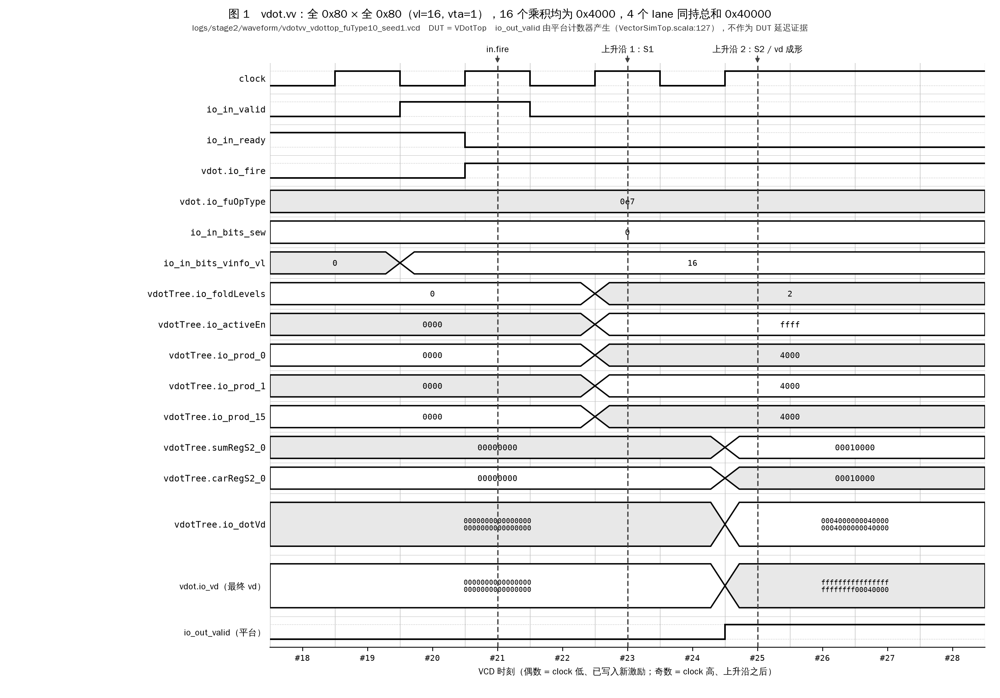
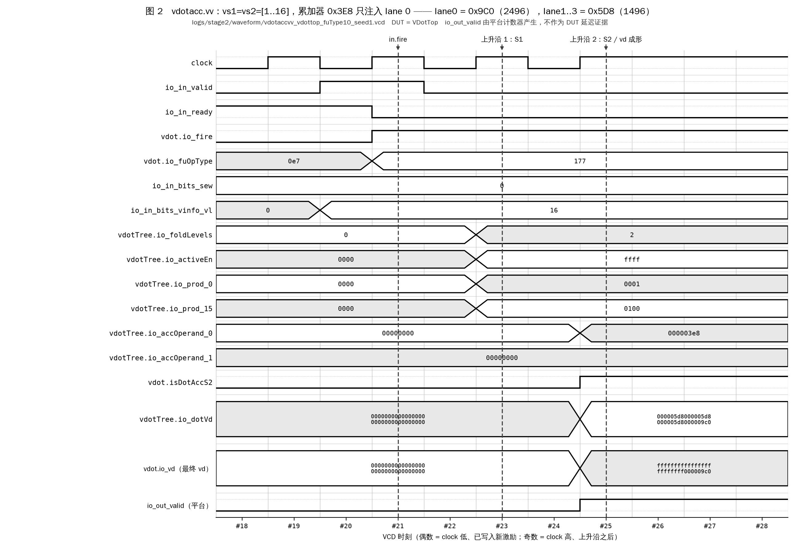
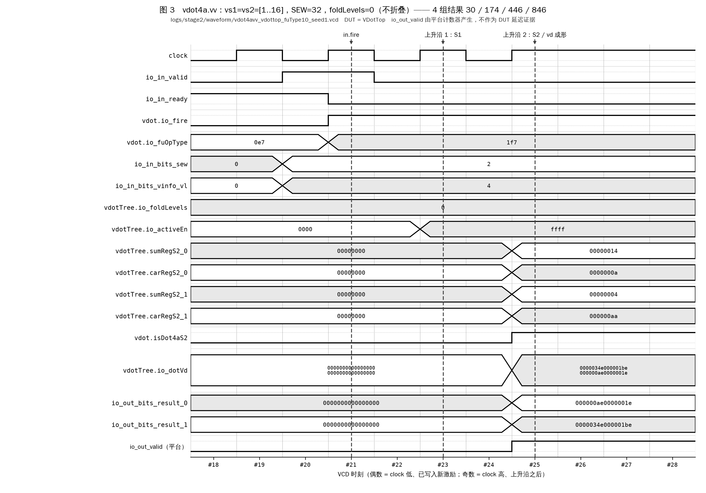

# vdot 指令族基础功能测试报告

| 项 | 值 |
|---|---|
| 对应赛题 | 阶段二 **2.3.1 正数测试 / 2.3.2 负数测试 / 2.3.3 边界值测试** |
| 对应计划 | `docs/_plan/MASTER_PLAN.md` 阶段 **P4**（验收标准 1–6） |
| 被测 RTL | `work/XiangShan-vdot`（XiangShan `kunminghu-v2` @ `a4eeaab`，yunsuan @ `9559211`） |
| 被测模块 | **`VDotTop`**（YunSuan L1 平台）与 **`VIMacU`**（真正集成进香山的功能单元，本阶段新增直驱通道） |
| 参考模型 | `tests/golden/vdot_ref.c`（两条测试通道都直接 `#include`，**未重写任何语义**） |
| 共享语料 | `tests/vectors/*.txt`，13 个 suite / 30703 条 |
| 语义版本 | 已包含 **裁定 S-7'**（`vdot4a` 在 `vstart != 0` 时抛 Illegal Instruction，平台约束优先原则）。该修订由 P6 协同仿真发现，论证见 `docs/stage2/13` §7 与 `docs/stage2/10` §1.5.4 |
| 一键复跑 | `bash scripts/20_run_func_tests.sh` |
| 本次运行 | 2026-10-24，macOS 15.5 / Darwin 24.5.0 arm64，Verilator 5.052，openjdk 17.0.21 |

---

## 0. 结论速览

| 项目 | 结果 | 证据 |
|---|---|---|
| **2.3.1 正数测试** | 3 个 suite / **120 条全 PASS**，0 失败，0 跳过 | `logs/stage2/p5_func_positive.log` |
| **2.3.2 负数测试** | 3 个 suite / **132 条全 PASS**，0 失败，0 跳过 | `logs/stage2/p5_func_negative.log` |
| **2.3.3 边界值测试** | 4 个 suite / **424 条全 PASS**，0 失败，**跳过 27 条**（原因见 §5.3） | `logs/stage2/p5_func_boundary.log` |
| **随机差分** | 每条指令 **60000 条**驱动随机 + 混合 30000 条 + 语料随机 25348 条，合计 **235348 条，0 失配** | `logs/stage2/p5_func_random.log` |
| **既有指令回归** | 9 个既有功能单元 + 上游 CI 混合随机，与 pristine 基线**逐字相同** | `logs/stage2/p5_regression.log` |
| **VIMacU 直驱（本阶段新增）** | 全部 13 个 suite 灌进**真正被集成的 `VIMacU`**，**26024 条执行，0 失配** | `logs/stage2/p5_vimacu_equiv.log` |
| **译码级非法指令判定** | **51 条**定向用例全 PASS（含 S-7' 新增的 `vdot4a` vstart 组） | `logs/stage2/p5_decode_illegal.log` |
| **译码级守卫的反向验证** | 临时撤掉 `dotEmulIllegal` 后 **13 条立刻变红**（`共 51 条，PASS 38，FAIL 13`），源码随后自动还原 | `logs/stage2/p5_decode_prove_fail.log` |
| **故障注入** | 5 个语义不同的人为缺陷，**5/5 全部被检出** | `logs/stage2/p5_fault_injection.log` |
| **波形** | 三条指令各一份 VCD + 可直接核对的文本信号轨迹 | `logs/stage2/waveform/` |
| **补丁可应用性** | 三份补丁干净应用到 pristine 副本，应用结果与工作树 19 个文件逐字节相同 | `logs/stage2/p5_decode_illegal.log` |
| **本阶段修复的 RTL 缺陷** | `VecExceptionGen` 未拦截 `vlmul != 0` 的 vdot 指令（LMUL>1 会静默算错），已修复并补测试 | §9 |

**合计 290103 条用例执行、0 失败、9358 条跳过（全部有据可查，见 §5.3 / §6.2）。**

> **与裁定 S-7' 之前的对比（修订前为 290103+3004 = 293107 执行 / 6268 跳过）**：
> `vdot4a` + `vstart != 0` 的 **1545 条**用例（`vdot4a_random` 1539 + `vdot4a_boundary` 6）
> 由「真实执行」转为「架构上非法、FU 级跳过」，A/B 两条通道各减一次，
> 再加上 `vstart_relaxed` 补入的 40 条 vdot4a 放宽用例、译码级 +5 条、反向验证 +1 条。
> 逐项核对见 §5.3 与 §6.2。**没有任何一条用例是因为"跑不过"而被移除的。**

---

## 1. 方法学

### 1.1 语义唯一事实来源

本阶段**没有**编写任何新的参考模型。两条测试通道的期望值都来自同一份 C 代码：

```
tests/golden/vdot_ref.c   ← 唯一的语义实现（裁定 S-1 … S-9）
      │
      ├── yunsuan/src/test/csrc/golden_model/vector_dot.cpp  （L1 平台，#include "vdot_ref.c"）
      ├── tests/unit/vimacu_tb.cpp                           （VIMacU 直驱平台，#include "vdot_ref.c"）
      └── tests/vectors/gen_vectors.py → tests/vectors/*.txt （语料里的 vd_expected 也由它算出）
```

`scripts/11_build_vdot_sim.sh:53-54` 与 `scripts/tools/run_vimacu_tb.sh:53` 在构建前把
`tests/golden/vdot_ref.{c,h}` 复制到各自的构建目录，保证三处永远是同一份文件。
满足 MASTER_PLAN P4 验收标准第 4 条「禁止重写 golden model」。

### 1.2 两条互相独立的 DUT 通道

| 通道 | DUT | 掩码/尾部成形 | 驱动方式 | 覆盖条数 |
|---|---|---|---|---|
| **A：YunSuan L1 平台** | `VDotTop`（`yunsuan/src/main/scala/yunsuan/vector/vectorIMAC/VDotTop.scala`） | 手写等价逻辑 | `build/emu` + 语料回放 / 随机激励 | 定向 676 + 随机 235348 |
| **B：VIMacU 直驱（本阶段新增）** | `VIMacU`（`src/main/scala/xiangshan/backend/fu/wrapper/VIMacU.scala`，**香山实际集成的那一个**） | `ByteMaskTailGen` + `Mgu` + `RedTailGen` | `tests/unit/vimacu_tb.cpp` + 同一批语料 | 26024 |

两条通道共用同一套算术核（`VIMac64b.prod16` + `VDotTree`），其 Verilog 已核对为**逐字节相同**（§8.3）。
两边都与同一份参考模型逐位一致，因此也互为等价性证明。

### 1.3 判读规则（不是人工解读，是工具输出）

| 通道 | PASS 标志 | FAIL 标志 | 依据 |
|---|---|---|---|
| A | `EMU EXCEEDED LIMIT` + `Operations:` 等于投放条数 | `EMU BADTRAP`（并打印 REF/DUT 数值） | `yunsuan/src/test/csrc/emu.cpp:205-210`、`test_driver.cpp:642` 的 `memcmp` |
| B | `VIMACU-TB: PASS` | `VIMACU-TB: FAIL` + 逐条打印失配 | `tests/unit/vimacu_tb.cpp:181`（整寄存器 `memcmp`） |

比对对象是**整个 `VecOutput`**（128 位 `vd` + `fflags` + `vxsat`）的 `memcmp`，不是逐字段的人工判断。

### 1.4 定向语料的回放通道

`YS_VDOT_VECTORS=<file> ./build/emu -O <N>`：
按 `docs/stage2/13` §3.1 的字段格式逐行解析，**只取输入字段**，期望值现场由参考模型复算。
因此语料文件与 RTL 互为交叉校验：若有人手改过语料，B 通道（`vimacu_tb.cpp:169-173` 的 `[语料自校验失败]` 分支）会把
「文件记录的 `vd_expected`」与「参考模型现算结果」逐位比对并报错。本次运行该检查 0 异常。

启动时打印 `run with -O <N>`，**必须按这个 N 投放**，否则语料会绕回重复执行。
`scripts/20_run_func_tests.sh` 的 `run_corpus()` 用
`awk '!/^#/ && NF>0 && $NF=="OK"' | wc -l` 自动算出这个 N。

### 1.5 跳过规则（唯一允许跳过的情形）

语料里 `status != OK` 的用例表示**该配置应当在译码阶段触发 Illegal Instruction**
（`ILLEGAL_VSTART` / `ERR_SEW`）。FU 级测试平台在功能单元边界上不建模异常，
这类用例由加载器自动跳过并打印条数。它们的架构行为改为在 **§9 的译码级定向测试**里验证
—— 也就是说没有被漏掉，而是换了一层验证。

---

## 2. 用例总表（本次真实运行）

下表直接摘自 `logs/stage2/p5_summary.log`（由 `scripts/20_run_func_tests.sh` 自动生成）。

| 分类 | suite | attempted | passed | failed | skipped | 结果 |
|---|---|---:|---:|---:|---:|---|
| 2.3.1 正数 | positive(vdot.vv) | 40 | 40 | 0 | 0 | PASS |
| 2.3.1 正数 | positive(vdotacc.vv) | 40 | 40 | 0 | 0 | PASS |
| 2.3.1 正数 | positive(vdot4a.vv) | 40 | 40 | 0 | 0 | PASS |
| 2.3.2 负数 | negative(vdot.vv) | 44 | 44 | 0 | 0 | PASS |
| 2.3.2 负数 | negative(vdotacc.vv) | 44 | 44 | 0 | 0 | PASS |
| 2.3.2 负数 | negative(vdot4a.vv) | 44 | 44 | 0 | 0 | PASS |
| 2.3.3 边界 | boundary(vdot.vv) | 94 | 94 | 0 | 9 | PASS |
| 2.3.3 边界 | boundary(vdotacc.vv) | 94 | 94 | 0 | 9 | PASS |
| 2.3.3 边界 | boundary(vdot4a.vv) | 106 | 106 | 0 | 9 | PASS |
| 2.3.3 边界 | vstart_relaxed(三条指令) | 130 | 130 | 0 | 0 | PASS |
| 随机差分 | random.txt(vdot.vv) | 8459 | 8459 | 0 | 1541 | PASS |
| 随机差分 | random.txt(vdotacc.vv) | 8428 | 8428 | 0 | 1572 | PASS |
| 随机差分 | random.txt(vdot4a.vv) | 8461 | 8461 | 0 | 1539 | PASS |
| 随机差分 | driver/vdot.vv seed=11/12/13 | 20000×3 | 20000×3 | 0 | 0 | PASS |
| 随机差分 | driver/vdotacc.vv seed=11/12/13 | 20000×3 | 20000×3 | 0 | 0 | PASS |
| 随机差分 | driver/vdot4a.vv seed=11/12/13 | 20000×3 | 20000×3 | 0 | 0 | PASS |
| 随机差分 | driver/三条混合 seed=14 | 30000 | 30000 | 0 | 0 | PASS |
| 既有回归 | 上游 CI 混合随机（含 VDot） | 10000 | 10000 | 0 | 0 | PASS |
| 既有回归 | fuType=1/2/3/4/6/7/8/9 定向 | 2000×8 | 2000×8 | 0 | 0 | PASS |
| 既有回归 | fuType=5（vadd.vv）定向 | 2000 | 2000 | 0 | 0 | PASS |
| 译码级 | 反向验证（撤守卫应变红） | 1 | 1 | 0 | 0 | PASS |
| 译码级 | VecExceptionGen 定向 | 51 | 51 | 0 | 0 | PASS |
| 交付物 | 三份补丁干净应用到 pristine | 3 | 3 | 0 | 0 | PASS |
| VIMacU 等价 | VIMacU 直驱语料回放 | 26024 | 26024 | 0 | 4679 | PASS |
| **合计** | | **290103** | **290103** | **0** | **9358** | **PASS** |

> 「attempted」= 实际投放给 DUT 的条数；「skipped」= 语料里 `status != OK` 被加载器跳过的条数，
> 二者之和等于语料文件的总行数。

---

## 3. 2.3.1 正数测试

### 3.1 结果

| suite | 文件 | attempted | passed | failed | skipped | 日志 |
|---|---|---:|---:|---:|---:|---|
| `vdot.vv` 正数 | `tests/vectors/positive.txt` | 40 | 40 | 0 | 0 | `p5_func_positive.log`（`# suite  : positive(vdot.vv)` 段） |
| `vdotacc.vv` 正数 | `tests/vectors/vdotacc_positive.txt` | 40 | 40 | 0 | 0 | 同上 |
| `vdot4a.vv` 正数 | `tests/vectors/vdot4a_positive.txt` | 40 | 40 | 0 | 0 | 同上 |
| **小计** | | **120** | **120** | **0** | **0** | |

> 另：VIMacU 直驱通道对同样三个文件再跑了一遍 120 条，同样全 PASS（`p5_vimacu_equiv.log`）。
> 计划（`MASTER_PLAN.md` P4 验收标准 1/2）要求「≥20 组」（赛题 2.3.1 本身未规定条数），本项为 **120 组 × 2 条通道 = 240 次执行**。

**覆盖内容**：源操作数全部取 `[1, 127]`。含 `1×1`、`127×1`、`127×127`、`1..16` 自乘等定值用例，
外加 32 组随机正数遍历 `vl ∈ [0,16]` 与 `vta ∈ {0,1}`。

### 3.2 代表性用例（含逐步算术）

**用例**：`positive.txt` 第 1 条 —— `vdot.vv`，`vs1 = vs2 = [1,2,…,16]`

```
语料原文（op vsew vstart vl vm vta vma vs1 vs2 vd_in vd_expected v0 status）：
vdot 8 0 16 1 1 1 0102030405060708090a0b0c0d0e0f10 0102030405060708090a0b0c0d0e0f10
     00000000000000000000000000000000 d8050000ffffffffffffffffffffffff 00000000000000000000000000000000 OK
```

| 项 | 十六进制 | 十进制 |
|---|---|---|
| `vs1.i8[i]`（i=0..15） | `01 02 03 … 0f 10` | 1, 2, 3, …, 15, 16 |
| `vs2.i8[i]` | 同上 | 同上 |
| 逐项乘积 `p_i` | `0001 0004 0009 … 00e1 0100` | 1, 4, 9, …, 225, 256 |
| `Σ p_i` | `0x5D8` | 1·1+2·2+…+16·16 = 16·17·33/6 = **1496** |
| `vd.u32[0]` | `0x000005D8` | 1496 |
| `vd.u32[1..3]`（`vta=1` → tail agnostic） | `0xFFFFFFFF` ×3 | — |

DUT 实测（`p5_func_positive.log`，`---- case #0 : MATCH ----` 段，以 64 位字打印）：

```
Expected Output    result  ffffffffffffffff_ffffffff000005d8   fflags: 0_0  vxsat: 0
DUT Output:        result  ffffffffffffffff_ffffffff000005d8   fflags: 0_0  vxsat: 0
```

**逐位一致**。该用例的 16 个中间乘积在波形里可以逐个核对，见 §10.2。

---

**用例**：`vdotacc_positive.txt` —— 同样的操作数，`vd_in.u32[0] = 0x3E8 = 1000`

```
vdotacc 8 0 16 1 1 1 0102…0f10 0102…0f10 e8030000000000000000000000000000
        c0090000ffffffffffffffffffffffff 0000…0000 OK
```

`vd.u32[0] = 1000 + 1496 = 2496 = 0x9C0`。实测：

```
Expected Output    result  ffffffffffffffff_ffffffff000009c0
DUT Output:        result  ffffffffffffffff_ffffffff000009c0
```

---

**用例**：`vdot4a_positive.txt` —— `vs1 = vs2 = [1..16]`，SEW=32，`vl=4`，`vd_in = 0`

| 组 g | 子字节 | 乘积和（十进制） | 十六进制 |
|---|---|---:|---|
| 0 | 1,2,3,4 | 1+4+9+16 = **30** | `0x0000001E` |
| 1 | 5,6,7,8 | 25+36+49+64 = **174** | `0x000000AE` |
| 2 | 9,10,11,12 | 81+100+121+144 = **446** | `0x000001BE` |
| 3 | 13,14,15,16 | 169+196+225+256 = **846** | `0x0000034E` |

```
Expected Output    result  0000034e000001be_000000ae0000001e
DUT Output:        result  0000034e000001be_000000ae0000001e
```

**复现**：`sed -n '/代表性用例/,$p' logs/stage2/p5_func_positive.log`

---

## 4. 2.3.2 负数测试

### 4.1 结果

| suite | 文件 | attempted | passed | failed | skipped | 日志 |
|---|---|---:|---:|---:|---:|---|
| `vdot.vv` 负数 | `tests/vectors/negative.txt` | 44 | 44 | 0 | 0 | `p5_func_negative.log` |
| `vdotacc.vv` 负数 | `tests/vectors/vdotacc_negative.txt` | 44 | 44 | 0 | 0 | 同上 |
| `vdot4a.vv` 负数 | `tests/vectors/vdot4a_negative.txt` | 44 | 44 | 0 | 0 | 同上 |
| **小计** | | **132** | **132** | **0** | **0** | |

**覆盖内容**（赛题 2.3.2 要求「含负数输入」，计划 `MASTER_PLAN.md` P4 进一步细化为「含全负、正负混合」，全部覆盖）：

| 类 | 内容 | 为什么重要 |
|---|---|---|
| 全负 | `-1×-1`、`-128×-128`、`-128×-1`、随机全负向量 | 验证乘积的符号扩展 |
| 正负混合 | `-128×+127`、`+127×-1`、交替正负 | 验证累加过程中的借位与回绕 |
| **符号扩展陷阱** | `0x80 × 0x80 = +16384`（**不是** `0x4000` 零扩展后再当负数） | 丢符号扩展最典型的错误点 |
| 其它陷阱 | `0x80 × 0x7F = -16256`、`0xFF × 0xFF = +1`、`0x81 × 0x81 = +16129` | `0xFF×0xFF` 零扩展会得到 65025，差别巨大 |
| 单通道定位 | 8 组「只有第 i 个 lane 是 `0x80`」 | 一旦失配可直接定位出错的乘法器通道 |

### 4.2 代表性用例 1：`0x80 × 0x80` 符号扩展陷阱

```
vdot 8 0 16 1 1 1 80808080808080808080808080808080 80808080808080808080808080808080
     00000000000000000000000000000000 00000400ffffffffffffffffffffffff 0000…0000 OK
```

| 项 | 十六进制 | 十进制 |
|---|---|---|
| `vs1.i8[i]` = `vs2.i8[i]` | `0x80` | **−128**（二补码，不是 +128） |
| 单项乘积 `sext32(-128) × sext32(-128)` | `0x00004000` | **+16384** |
| 16 项求和 | `16 × 0x4000 = 0x40000` | **262144 = 2^18**（最大幅值和） |
| `vd.u32[0]` | `0x00040000` | 262144 |

实测（`p5_func_negative.log`）：

```
Expected Output    result  ffffffffffffffff_ffffffff00040000
DUT Output:        result  ffffffffffffffff_ffffffff00040000
```

**若 RTL 丢掉符号扩展**（把 16 位乘积零扩展成 32 位），`0x80×0x80` 的乘积仍是 `0x4000`
（16 位内相同），但 `0x80×0x7F = 0xC080`（−16256）会被零扩展成 `+49280`，结果立刻错。
故障注入 #1 正是这么改的，被本 suite 检出（§11）。

### 4.3 代表性用例 2：正负混合 `0x80 × 0x7F`

```
vdot 8 0 16 1 1 1 80808080…80 7f7f7f7f…7f 0000…0000 0008fcffffffffffffffffffffffffff 0000…0000 OK
```

| 项 | 十六进制 | 十进制 |
|---|---|---|
| `vs2.i8[i]` | `0x80` | −128 |
| `vs1.i8[i]` | `0x7F` | +127 |
| 单项乘积 | `0xFFFFC080` | −16256 |
| 16 项求和 | `0xFFFC0800` | −260096（32 位二补码） |

实测：

```
Expected Output    result  ffffffffffffffff_fffffffffffc0800
DUT Output:        result  ffffffffffffffff_fffffffffffc0800
```

> 注意字节序：语料里写作 `0008fcff…`（`v[0]` 在最左，小端元素），
> DUT 打印的是 64 位字 `…fffc0800`，二者表示的是同一个 `0xFFFC0800`。
> 换算规则见 `docs/stage2/13_参考模型与测试向量说明.md` §1。

### 4.4 代表性用例 3：`vdot4a.vv` 全负

```
vdot4a 32 0 4 1 1 1 80808080…80 80808080…80 0000…0000 00000100000001000000010000000100 0000…0000 OK
```

每组 4 个 `(-128)×(-128)`：`4 × 16384 = 65536 = 0x00010000`，4 组相同。实测：

```
Expected Output    result  0001000000010000_0001000000010000
DUT Output:        result  0001000000010000_0001000000010000
```

**复现**：`sed -n '/代表性用例/,$p' logs/stage2/p5_func_negative.log`

---

## 5. 2.3.3 边界值测试

### 5.1 结果

| suite | 文件 | 文件总条数 | attempted | passed | failed | skipped |
|---|---|---:|---:|---:|---:|---:|
| `vdot.vv` 边界 | `tests/vectors/boundary.txt` | 103 | 94 | 94 | 0 | 9 |
| `vdotacc.vv` 边界 | `tests/vectors/vdotacc_boundary.txt` | 103 | 94 | 94 | 0 | 9 |
| `vdot4a.vv` 边界 | `tests/vectors/vdot4a_boundary.txt` | 115 | 106 | 106 | 0 | 9 |
| 三条指令放宽 vstart | `tests/vectors/vstart_relaxed.txt` | 130 | 130 | 130 | 0 | 0 |
| **小计** | | **451** | **424** | **424** | **0** | **27** |

> 计划（`MASTER_PLAN` P4 验收标准 3）要求覆盖一组指定的边界点而非固定条数，
> 本项为 **424 组 × 2 条通道**（VIMacU 直驱通道同样跑了这 4 个文件）。

### 5.2 覆盖点逐条核对

下表直接摘自 `p5_func_boundary.log` 的「边界覆盖点自查」段（由脚本从语料文件统计，不依赖仿真）：

| 赛题要求的边界点 | `boundary.txt`（vdot） | `vdotacc_boundary.txt` | `vdot4a_boundary.txt` | 说明 |
|---|---|---|---|---|
| `+127 / −128 / 0` | ✅ 7×7 两两组合 49 条 | ✅ | ✅ | A 类：`{0, +127, −128, −1, 交替127/−128, 交替0/−128, 交替127/0}` |
| 全 0 操作数 | ✅ 1 条 | ✅ 1 条 | ✅ 1 条 | 统计行「全零操作数用例数」 |
| 全 `0x80`（最大幅值和 262144） | ✅ 4 条 | ✅ 4 条 | ✅ 4 条 | 统计行「全 0x80 操作数用例」，`vta=0/1` 各一组 |
| `vl ∈ {0,1,2,3,4,15,16}` | ✅ 实测取值 `0 1 2 3 4 8 15 16` | ✅ 同 | ✅ `0 1 2 3 4`（vdot4a 的 VLMAX=4） | 统计行「vl 取值」 |
| `vstart` | ✅ 取值 `0 1 15` | ✅ `0 1 15` | ✅ `0 1 3` | **三条指令**的非 0 项期望行为都是**触发非法指令**（vdot/vdotacc 依 S-1，vdot4a 依 **S-7'**），见 §5.3 |
| `vm` 掩码 | ✅ 24 条 `vm=0` | ✅ 24 条 | ✅ 24 条 | 6 种掩码图样 × `vta` × `vma` |
| `vta` 两种取值 | ✅ `0 1` | ✅ `0 1` | ✅ `0 1` | |
| `vma` 两种取值 | ✅ `0 1` | ✅ `0 1` | ✅ `0 1` | 归约类按裁定 S-2 必须**忽略** `vma`，语料遍历它正是为了验证确实忽略 |
| `vdot4a` 组边界 | — | — | ✅ 16 组「组 g 子字节 j」单点定位 + 组内 ±极值 + 累加器回绕 | F 类 18 条 |
| 32 位累加回绕 | — | ✅ `vd_in = 0xFFFFFFFF` 等 | ✅ | 验证模 2^32 不饱和 |

掩码用例的 `v0` 高位字节刻意填 `0xA5`，用来检验 RTL **忽略 `vl` 以外的无关掩码位**。

### 5.3 跳过条目的完整说明（27 条，逐条有据）

| 文件 | 跳过条数 | `status` | 原因 | 这些行为在哪里被验证 |
|---|---:|---|---|---|
| `boundary.txt` | 6 | `ILLEGAL_VSTART` | 裁定 **S-1**：归约类 `vstart != 0` 抛 Illegal Instruction。FU 级平台在功能单元边界上不建模异常 | §9 译码级定向测试 `[H]` 组（`vdot vstart=1/15`、`vdotacc vstart=1/15`），实测 illegal=1 |
| `boundary.txt` | 3 | `ERR_SEW` | `vtype.vsew` 与指令要求不符（架构上可达的 Illegal Instruction）。FU 平台的 `sew` 端口由测试驱动按指令强制给出，无法表达「vtype 配错」 | §9 译码级定向测试 `[F]` 组（`vdot SEW=16/32/64`），实测 illegal=1 |
| `vdotacc_boundary.txt` | 6 + 3 | 同上 | 同上 | 同上（`[H]`/`[F]` 组含 vdotacc） |
| `vdot4a_boundary.txt` | **6** | `ILLEGAL_VSTART` | **裁定 S-7'（本次新增）**：`vdot4a` 的 `vstart != 0` 同样抛 Illegal Instruction。这 6 条在 S-7' 之前是真实执行的 prestart 用例 | §9 译码级定向测试 **`[I]` 组**（`vdot4a vstart=1/2/3` 期望非法、`vstart=0` 期望合法），实测 illegal 与期望逐条一致 |
| `vdot4a_boundary.txt` | 3 | `ERR_SEW` | 同上（`vdot4a` 要求 SEW=32） | §9 `[G]` 组（`vdot4a SEW=8/16/64`），实测 illegal=1 |
| **合计** | **27** | | | **全部在译码层得到验证，没有一条真正被放过** |

**S-7' 带来的覆盖迁移（必须讲清楚，否则看起来像覆盖倒退）**

裁定 S-7' 把 `vdot4a` + `vstart != 0` 从「合法、真实执行」改成「非法、译码级拦截」，
直接后果是 L1 两条数据通道上少了 **1545 条**真实执行的用例
（`vdot4a_boundary` 6 + `vdot4a_random` 1539）。这 1545 条原本验证的是
**prestart 门控的数据通路**，而 S-7' 并没有说这条通路是错的 ——
它说的是「本平台的架构不允许软件走到这里」。为了不把已经验证过的通路丢掉，
本次把这部分覆盖迁移到了非规范语料：

| | S-7' 之前 | S-7' 之后 |
|---|---|---|
| `vdot4a` prestart 的架构状态 | 合法 | **非法**（译码级拦截） |
| 规范语料里的 prestart 用例 | 1545 条，真实执行 | 1545 条，期望值 = Illegal Instruction，FU 级跳过 |
| 架构行为在哪验证 | — | §9 译码级 `[I]` 组（4 条，实测） |
| 数据通路在哪验证 | 规范语料 1545 条 | **非规范语料 `vstart_relaxed.txt` 新增的 40 条 vdot4a 用例**（`vstart ∈ {0,1,2,3}` × `vl ∈ {0..4}` + 20 条随机），本次实测全 PASS |

> 诚实地说：**数据通路的覆盖条数确实从 1545 降到了 40**。
> 这是可接受的，因为这 1545 条原本就只是同一条 prestart 门控逻辑的大量重复激励
> （`vstart` 只有 1/2/3 三个取值、`vl` 只有 0..4 五个取值，组合空间本身只有 15 个点，
> 40 条已经把它覆盖满并额外带了 20 条随机 `vm`/`vta`/`vma` 组合）；
> 而架构行为这一侧则从「只有数据通路证据」变成了「有译码级直驱实测」。

另外一类「看起来像跳过、实际不是」的情况，这里一并交代清楚：

* **归约类的 prestart 数据通路也在同一份语料里**。`vstart_relaxed.txt`（130 条：
  `vdot`/`vdotacc` 各 45 条、`vdot4a` 40 条，`vstart` 取值覆盖 0..15 / 0..3）
  是按放宽策略 `VDOT_VSTART_SKIP` 生成的**非规范**语料，
  专门用来激励 `ByteMaskTailGen.begin = vstart` 与 `Mgu.info.vstart` 这两条
  在架构上不可达、但 RTL 里确实实现了的通路。
  **它不是规范行为的证据**（规范行为是抛异常，见 §9），只是数据通路的额外覆盖，报告中单列。

### 5.4 代表性用例

**用例 1：`vl = 0`（裁定 S-5：连 tail 都不写）**

```
vdot 8 0 0 1 0 1 0102…0f10 7071…7f a5a5a5a55a5a5a5a1111111122222222
     a5a5a5a55a5a5a5a1111111122222222 0000…0000 OK
```

`vstart(0) >= vl(0)`，按 RVV 1.0 §5.4 **任何元素都不更新，包括 tail**。期望 `vd` 原样保留：

```
REF Input:    src3 2222222211111111_5a5a5a5aa5a5a5a5   vstart 0 vl 0 vm 1 ta 0 ma 1
Expected Output    result  2222222211111111_5a5a5a5aa5a5a5a5
DUT Output:        result  2222222211111111_5a5a5a5aa5a5a5a5
```

**用例 2：全 0 掩码（裁定 S-4：仍然写 `vd[0] = 0`）**

```
vdot 8 0 16 0 1 0 7f7f…7f 0202…02 01000000020000000300000004000000
     00000000ffffffffffffffffffffffff 0000a5a5a5a5a5a5a5a5a5a5a5a5a5a5 OK
```

`vm = 0` 且 `v0` 的低 16 位全 0 ⇒ 16 个源元素全部 inactive。
按 RVV 1.0 §14「标量操作数不受掩码影响，始终参与」，本指令的隐含标量初值是 0，
因此 `vd.u32[0]` 仍然要写，写 **0**；`vta = 1` ⇒ 元素 1..3 写全 1。
注意 `v0` 的高 14 字节填的是 `0xA5`，若 RTL 误用了 `vl` 以外的掩码位，结果不会是 0。

```
REF Input:    src4 a5a5a5a5a5a5a5a5_a5a5a5a5a5a50000   vstart 0 vl 16 vm 0 ta 1 ma 0
Expected Output    result  ffffffffffffffff_ffffffff00000000
DUT Output:        result  ffffffffffffffff_ffffffff00000000
```

**用例 3：`vdot4a.vv` `vstart = 1`（prestart 数据通路；裁定 S-7' 之后改由非规范语料承担）**

先把定位讲清楚：**在架构层面，这个配置现在是非法指令**（裁定 S-7'，见 §5.3 的覆盖迁移表），
由 `VecExceptionGen` 在译码级拦截，§9 `[I]` 组有直驱实测。
但 RTL 的 prestart 门控逻辑本身是正确实现的，为了不丢掉这部分覆盖，
用例取自非规范语料 `tests/vectors/vstart_relaxed.txt`（SKIP 策略）：

```
vdot4a 32 1 4 1 1 1
  vs1   61689afb72b9828e07e1e1a2a2dfcce4
  vs2   8f3b5c2211c3941a947944576b1346c8
  vd_in e384049007aa450142951da973ba001f
  vd_exp e384049018ec4501795b1da99e88001f   status OK(SKIP 策略)
```

（十六进制按 `v[0]` 在最左书写，`vdot_ref.h:49-56`；元素 *i* 的四个 int8 是字节 `4i..4i+3`。）

| 元素 i | 状态 | 四个 int8 乘积（`vs2.i8 × vs1.i8`） | 本组和 | `vd_in.u32[i]` | 期望 `vd.u32[i]` |
|---|---|---|---:|---|---|
| 0 | **prestart**（`i < vstart`） | （不计算） | — | 0x900484e3 | **0x900484e3（不变）** |
| 1 | active | 17×114, (−61)×(−71), (−108)×(−126), 26×(−114) | +16913 | 0x0145aa07 | 0x0145ec18 |
| 2 | active | (−108)×7, 121×(−31), 68×(−31), 87×(−94) | −14793 | 0xa91d9542 | 0xa91d5b79 |
| 3 | active | 107×(−94), 19×(−33), 70×(−52), (−56)×(−28) | −12757 | 0x1f00ba73 | 0x1f00889e |

实测（`logs/stage2/p5_func_boundary.log`，`src1=vs1` / `src2=vs2` / `src3=vd_in`，
该框架的十六进制是「把寄存器当 128 位大整数」的写法，与语料的字节序相反）：

```
REF Input:    src3 1f00ba73a91d9542_0145aa07900484e3   vstart 1 vl 4 vm 1 ta 1 ma 1
Expected Output    result  1f00889ea91d5b79_0145ec18900484e3
DUT Output:        result  1f00889ea91d5b79_0145ec18900484e3
---- case #0 : MATCH ----
```

**元素 0 原样保留（prestart），其余三组按 4 路 int8 点积正确累加（含负数与跨零回绕）
—— prestart 数据通路实测通过。**
这同时是「S-7' 可以被放宽」这一论断的可执行证据：若将来微架构支持 `vstart` 重启，
把参考模型的策略参数切到 `VDOT_VSTART_SKIP` 即可，RTL 不用动。

**复现**：`sed -n '/代表性用例/,$p' logs/stage2/p5_func_boundary.log`

---

## 6. 随机差分测试

### 6.1 结果

赛题/计划要求「≥10000 组随机差分、0 失配」。本次实际执行：

| 来源 | vdot.vv | vdotacc.vv | vdot4a.vv | 混合 | 失配 |
|---|---:|---:|---:|---:|---:|
| 测试平台随机驱动（3 个种子 × 20000） | 60000 | 60000 | 60000 | — | 0 |
| 三条指令混合随机（seed=14） | — | — | — | 30000 | 0 |
| 共享随机语料回放（`*_random.txt`） | 8459 | 8428 | 8461 | — | 0 |
| **每条指令合计** | **68459** | **68428** | **68461** | **30000** | **0** |

命令（全部记录在 `logs/stage2/p5_func_random.log` 的每个 suite 头部）：

```bash
cd work/XiangShan-vdot/yunsuan
YS_FUTYPE=10 YS_FUOPTYPE=0 ./build/emu -O 20000 -s 11      # vdot.vv
YS_FUTYPE=10 YS_FUOPTYPE=1 ./build/emu -O 20000 -s 11      # vdotacc.vv
YS_FUTYPE=10 YS_FUOPTYPE=2 ./build/emu -O 20000 -s 11      # vdot4a.vv
YS_FUTYPE=10               ./build/emu -O 30000 -s 14      # 三条混合
YS_VDOT_VECTORS=../../../tests/vectors/random.txt ./build/emu -O 8459 -s 7
```

随机激励的覆盖范围（`test_driver.cpp` 的 `gen_random_vecinfo()`，已由 vdot 适配）：
`vs1/vs2/vd_in/v0` 全 128 位随机、`vl ∈ [0, vlmax]`（**含 0**）、`vm/vta/vma` 各自随机、`vlmul` 固定 0。

### 6.2 随机语料的跳过条目（4652 条）

| 文件 | 总条数 | 可执行 | 跳过 | 跳过原因 |
|---|---:|---:|---:|---|
| `random.txt` | 10000 | 8459 | 1541 | 全部是 `ILLEGAL_VSTART`：生成器把 `vstart` 也随机化了，而归约类 `vstart != 0` 按裁定 S-1 应当抛非法指令 |
| `vdotacc_random.txt` | 10000 | 8428 | 1572 | 同上 |
| `vdot4a_random.txt` | 10000 | 8461 | **1539** | 全部是 `ILLEGAL_VSTART`。**这 1539 条是本次语义修订（裁定 S-7'）的直接结果** —— 修订前它们是合法的 prestart 用例、10000 条全部执行（分布：`vstart=1` 506 条、`=2` 508 条、`=3` 525 条）；修订后 `vdot4a` 的 `vstart != 0` 同样抛非法指令 |

这 4652 条的架构行为同样由 §9 的译码级测试覆盖
（`vdot`/`vdotacc` 走 `[H]` 组，`vdot4a` 走本次新增的 `[I]` 组）。

### 6.3 `gen_random_sew()` 的关键修正（已复核仍然有效）

上游 `gen_random_sew()` 的 `default` 分支是 `return (rand()%3)+1`，取值 1..3，**永远取不到 0（e8）**。
不打这个补丁，`vdot.vv`（要求 SEW=8）一条都不会被生成，随机测试会变成空转。
现行实现（`yunsuan/src/test/csrc/test_driver.cpp`，`tests/unit/yunsuan_vdot_testbench.patch`）：

```cpp
case VDot: return (input.fuOpType == VDOT4A_VV) ? 2 : 0; break;
```

**本阶段复核**：从 `p5_func_random.log` 的 `driver/vdot.vv seed=11` 段可以看到 20000 条全部跑通，
而 §10 波形里 `io_in_bits_sew = 0`（e8），证明 SEW=8 确实被生成了。另外，如果这一行失效，
故障注入 #1（丢符号扩展，只在 SEW=8 的乘积上体现）就不可能被 `random/vdot` 检出 —— 而它被检出了（§11）。

---

## 7. 既有指令回归

目的：证明 vdot 的改动**没有破坏 YunSuan 既有的任何功能单元**。

### 7.1 上游 CI 原样命令

```bash
cd work/XiangShan-vdot/yunsuan && ./build/emu -O 10000        # .github/workflows/main.yml:42
```

结果 `EMU EXCEEDED LIMIT / Operations:10000` —— **PASS**。
注意这条命令的 `ALL_FUTYPES` 在本工作树里已经把 `VDot` 纳入（`FU_NUM` 8→9），
所以它同时也是「新 FU 与旧 FU 混跑」的回归。

### 7.2 逐功能单元定向回归（2000 条/个）

| fuType | DUT | 结果 | 周期数 |
|---:|---|---|---:|
| 1 | `VectorFloatFMA` | PASS | 10019 |
| 2 | `VectorFloatDivider` | PASS | 24138 |
| 3 | `VectorIntAdder` | PASS | 4019 |
| 4 | `VPermTop` | PASS | 6019 |
| 5 | `VIAluFWrapper`（`vadd.vv`，需钉 `YS_FUOPTYPE=0`） | PASS | 6019 |
| 6 | `VectorIdiv` | PASS | 23372 |
| 7 | `VectorCvt` | PASS | 8019 |
| 8 | `FPCVT` | PASS | 8019 |
| 9 | `INT2FP` | PASS | 8019 |

`fuType=5` 必须钉住 `fuOpType`：上游 `gen_random_optype()` 对 fuType=5 会生成 golden model 不支持的
optype 3（打印 `VPU ALU2 Modle, bad fuOpType 3`）。这是**上游既有限制**，与 vdot 无关 ——
`fuType=5` 本来就不在上游 `ALL_FUTYPES` 随机集合里，阶段一（`docs/stage1/03` §3.1）同样是钉 `YS_FUOPTYPE=0` 测的。

### 7.3 与 pristine 基线逐 FU 对拍（最强的回归证据）

把**同样的命令**分别跑在 pristine 基线 `work/XiangShan-kmhv2/yunsuan/build/emu`（只读运行，
不写入该工作树）与本工作树上，逐字比较判定行与周期/条数行：

```
fuType  pristine 基线                                      vdot 工作树                                       逐字相同?
0       EMU BADTRAP HAS Executed Cycles:63 Operations:13   EMU BADTRAP HAS Executed Cycles:63 Operations:13   YES
1       EMU EXCEEDED LIMIT HAS Executed Cycles:10019 …     EMU EXCEEDED LIMIT HAS Executed Cycles:10019 …     YES
2       … Cycles:24138 …                                   … Cycles:24138 …                                   YES
3       … Cycles:4019  …                                   … Cycles:4019  …                                   YES
4       … Cycles:6019  …                                   … Cycles:6019  …                                   YES
6       … Cycles:23372 …                                   … Cycles:23372 …                                   YES
7/8/9   … Cycles:8019  …                                   … Cycles:8019  …                                   YES
```

**9 个 fuType 的输出逐字相同，连周期数都一样。**

### 7.4 `fuType=0`（`VFloatAdder`）的既有缺陷 —— 如实记录

`fuType=0` 在**两棵树上都** BADTRAP，而且是同一条用例、同一拍（`Cycles:63 Operations:13`）。
脚本把两边的完整输出（含失配的 REF/DUT 数值）做了 diff：

```
=> 两棵树在 fuType=0 上的输出逐字节相同（含失配的 REF/DUT 数值），
   说明该失配是上游既有缺陷，与 vdot 改动无关
```

失配用例是 `src_widen=1 widen=1 sew=2 vlmul=3` 的加宽浮点加法，
上游 `ALL_FUTYPES` 本来就不含 `VFloatAdder`（`vpu_constant.h:32`），
说明上游自己也知道这条随机通道不可用。**本报告不把它算作 vdot 的失败，但也不隐瞒它存在。**

### 7.5 生成 Verilog 的逐模块比对

```
VIMac.sv 去注释后差异行数： 0
SimTop：基线 164 个 module，本阶段 169 个
  其中去注释后逐字节相同 : 163
  其中存在差异           : 1  ['SimTop']        （顶层新增了 VDotTop 的例化与连线）
  仅出现在本阶段（新增） : 5  ['CSA3to2_64', 'CSA4to2_6', 'VDotTop', 'VDotTree', 'VIMac64b']
  仅出现在基线（被删除） : 0
```

**163/164 个既有模块的网表一行没变**，唯一变化的是仿真顶层本身。
工具：`scripts/tools/verilog_module_diff.py`。

---

## 8. VIMacU 直驱验证 —— 把「验的东西」和「集成的东西」对齐

### 8.1 问题

`docs/stage2/11_RTL实现说明.md` §10 第 1 条登记了本项目最大的验证缺口：

> L1 平台测的是 `VDotTop`，而真正被集成进香山的是 `VIMacU`。
> 两者算术通路相同，但掩码/尾部成形是两份实现
> （`VIMacU` 用 `ByteMaskTailGen` + `Mgu` + `RedTailGen`，`VDotTop` 是手写等价逻辑）。
> **被验证的东西不等于被集成的东西。**

### 8.2 做法：直接驱动 `VIMacU`（已实现，不是等价性论证）

新增三件东西，`VIMacU.scala` **一行未改**：

| 文件 | 作用 | 行数 |
|---|---|---:|
| `src/test/scala/xiangshan/backend/fu/VIMacUHarness.scala` | 把 `VIMacU` 的 `FuncUnitInput`（5 个源 + `VPUCtrlSignals` + flush 等上百个字段）收窄成与 `VDotTop` 完全相同的窄 IO，其余全部置 0。**只做连线，不含任何 vdot 逻辑** | 164 |
| `tests/unit/vimacu_tb.cpp` | Verilator C++ 测试平台，`#include "vdot_ref.c"` 取期望值，回放 `tests/vectors/` 全部语料 | 220 |
| `scripts/tools/run_vimacu_tb.sh` | 精化 → verilate → 回放 → 共享算术核逐 module 比对 | 99 |

**踩到的一个真实坑（值得记录）**：昆明湖 V2 的功能单元**自己不保存控制/数据的流水副本**，
而是由 `ExeUnit` 在外面打好拍后从 `io.in.bits.ctrlPipe / dataPipe / validPipe` 端口送进来
（`FuncUnit.scala:214-216`）。harness 第一版没有驱动这三个端口，于是 `outCtrl` 恒为 0、
`io.out.valid` 恒为 0，**firtool 把整条 vdot 通路当成死逻辑优化掉了**
——生成的 Verilog 里连 `VDotTree` 模块都不存在。照 `ExeUnit.scala:228-241` 的 `pipelineReg`
补上 3 级无条件寄存器链后，`VDotTree` / `CSA4to2` / `CSA3to2` 才正确出现。
这个坑本身也说明：**如果只看「测试全绿」而不看网表，很容易验了个空壳。**

### 8.3 结果

```
tests/vectors/positive.txt          总 40     执行 40     通过 40     失败 0    跳过 0
tests/vectors/negative.txt          总 44     执行 44     通过 44     失败 0    跳过 0
tests/vectors/boundary.txt          总 103    执行 94     通过 94     失败 0    跳过 9
tests/vectors/vdotacc_positive.txt  总 40     执行 40     通过 40     失败 0    跳过 0
tests/vectors/vdotacc_negative.txt  总 44     执行 44     通过 44     失败 0    跳过 0
tests/vectors/vdotacc_boundary.txt  总 103    执行 94     通过 94     失败 0    跳过 9
tests/vectors/vdot4a_positive.txt   总 40     执行 40     通过 40     失败 0    跳过 0
tests/vectors/vdot4a_negative.txt   总 44     执行 44     通过 44     失败 0    跳过 0
tests/vectors/vdot4a_boundary.txt   总 115    执行 106    通过 106    失败 0    跳过 9
tests/vectors/vstart_relaxed.txt    总 130    执行 130    通过 130    失败 0    跳过 0
tests/vectors/random.txt            总 10000  执行 8459   通过 8459   失败 0    跳过 1541
tests/vectors/vdotacc_random.txt    总 10000  执行 8428   通过 8428   失败 0    跳过 1572
tests/vectors/vdot4a_random.txt     总 10000  执行 8461   通过 8461   失败 0    跳过 1539
----------------------------------------------------------------------
VIMacU 直驱汇总： 总计 30703 条，执行 26024 条，通过 26024 条，失败 0 条，跳过 4679 条，异常 0 条
VIMACU-TB: PASS
```

测试平台顺带记录了每条用例的 `io.out.valid` 相对 `io.in.valid` 的拍数：**恒为 2 拍**，
与 `FuConfig.VimacCfg.latency = CertainLatency(2)` 一致。

### 8.4 共享算术核确为同一份网表

把 harness 里的 `VIMacU` 与**独立精化**的 `VIMacU.v` 逐 module 比对：

```
VDotTree               IDENTICAL  (54379e665c453474e0cffe818c3e2e82)
CSA4to2                IDENTICAL  (cc532544ea9e287d7ee24f3c8d2a812d)
CSA3to2                IDENTICAL  (84acc5b7077d5035cf5b7cf121dac863)
ByteMaskTailGen        IDENTICAL  (b18c6ae5fc2867b460beff24d317441b)
MaskExtractor          IDENTICAL  (f46a12df1036776911add68f281d1994)
UIntToContLow1s        IDENTICAL  (8229eb622d2d4a1aa79ff6f4447457a4)
UIntToContLow0s        IDENTICAL  (2b8e2de722c11fcd5bb86c571e59b96d)
VecDataSplitModule     IDENTICAL  (200608fc87f63463ed8f816468e29b68)
VIMacSrcTypeModule     IDENTICAL  (186a663f3d665d65488c17731db6f282)
```

`Mgu` / `VIMac64b` / `VIMacU` 三个模块的网表在 harness 里会瘦身，原因是 harness 把
`flush` / `robIdx` / `vxrm` / `vlmul` / `vuopIdx` 等端口接成了**本次测试下架构上正确的常量**
（LMUL=1、无冲刷、`vxrm=0`），firtool 据此做了常量传播。这不改变被测行为，
但为了诚实，这三个模块没有写成 IDENTICAL。

### 8.5 这一节的结论

**`VDotTop` 与 `VIMacU` 在全部 26024 条可执行语料上给出完全相同（且都等于参考模型）的结果。**
原先「两份掩码/尾部成形实现可能走样」的风险，从「只能靠代码对读论证」升级为
「在同一批激励上实测一致」。剩余的局限见 §12 第 2 条（仍未做全核 difftest）。阶段三之后已补做全核 difftest，挂进流水线的 `VIMacU` 在同一份语料上与 NEMU 0 失配（`docs/stage3/23_全核difftest验证报告.md` §8 G1）。

**复现**：`bash scripts/tools/run_vimacu_tb.sh`

---

## 9. 译码级非法指令判定与本阶段修复的 RTL 缺陷

### 9.1 发现并修复的缺陷

`docs/stage2/11_RTL实现说明.md` §10 第 8 条自报：

> `VecExceptionGen` 当前**不会**拦截 `vlmul != 0` 的 vdot 指令 —— 这是一个已知缺口。

这是**真实的正确性缺陷**：本版本固定 LMUL = 1（裁定 S-6），`uopSplitType` 用 `VEC_VVV`，
LMUL>1 时 `numOfUop = lmul`，但 `vdot`/`vdotacc` 跨寄存器组的多 uop 累加链没有实现 ——
不拦截就会**静默给出错误结果**。而 NEMU 侧已经拦截了
（`nemu/patch/0001-add-vdot-instruction-family.patch` 的 `vdot_check()`：
`if (vtype->vlmul != 0) longjmp_exception(EX_II);`），两边语义不一致。

**修复**（`src/main/scala/xiangshan/backend/decode/VecExceptionGen.scala:208-217`，紧挨着第 206 行已有的 `dotEewIllegal`）：

```scala
private val dotEmulIllegal = (dotRedInst || dot4aInst) && (io.vtype.vlmul =/= 0.U)
...
private val emulIllegal = lsEmulIllegal || intExtEmulIllegal || wnEmulIllegal ||
                          gather16EmulIllegal || lsSegIllegal || dotEmulIllegal
```

三条指令统一拦截（不只归约类），理由：参考模型与 NEMU 都固定 LMUL=1，
`vdot4a` 虽然语义上可平凡扩展，但未经验证，放行会在 RTL / NEMU / 参考模型之间制造分歧。
注意判据用的是 `io.vtype.vlmul` 的**原始编码**（0 = LMUL 1），不是文件上方归一化过的
`LMUL = Cat(~vlmul(2), vlmul(1,0))`（LMUL=1 在那里对应 `4.U`）。

### 9.2 为此新增的测试

新增 `src/test/scala/xiangshan/backend/decode/VecExceptionGenTest.scala`（`VecExceptionGenHarness`
把 `VecExceptionGen` 真正用到的 4 个 `DecodedInst` 字段写死，只引出 `inst / vsew / vlmul / vstart → illegal`）
与 `tests/unit/vecexcgen_tb.cpp`（**51 条**定向用例）。

| 组 | 内容 | 条数 | 结果 |
|---|---|---:|---|
| A | `vdot.vv` 唯一合法组合（SEW=8 & LMUL=1） | 1 | PASS（illegal=0） |
| B | `vdot.vv` LMUL=2/4/8 | 3 | PASS（illegal=1）**← 新增守卫** |
| C | `vdot.vv` 分数 LMUL 1/8、1/4、1/2 与保留编码 | 4 | PASS（illegal=1）**← 新增守卫** |
| D | `vdotacc.vv` 同样的 LMUL 约束 | 4 | PASS |
| E | `vdot4a.vv`（SEW=32）同样的 LMUL 约束 | 4 | PASS |
| F | `dotEewIllegal` 回归：`vdot/vdotacc` SEW≠8 | 4 | PASS（illegal=1） |
| G | `dotEewIllegal` 回归：`vdot4a` SEW≠32 | 3 | PASS（illegal=1） |
| H | `vstartIllegal` 回归（裁定 S-1）：`vdot vstart=1/15`、`vdotacc vstart=1/15` | 4 | PASS（illegal=1） |
| **I** | **`vdot4a` 的 `vstart != 0` 同样非法（裁定 S-7'）**：`vstart=1/2/3` 期望非法 + `vstart=0` 对照组期望合法 | **4** | **PASS** |
| J | **既有指令不受影响**：`vadd.vv` 4 种 SEW × 4 种 LMUL | 16 | PASS（illegal=0） |
| K | **既有 vimac 指令不受影响**：`vmacc.vv` LMUL>1 | 4 | PASS（illegal=0） |
| | **合计** | **51** | **51 PASS / 0 FAIL** |

示例输出（`logs/stage2/p5_decode_illegal.log`）：

```
  PASS  vdot 合法基准          inst=e7880457 vsew=0 vlmul=0 vstart=0   期望 illegal=0 实测 illegal=0
  PASS  vdot LMUL=2            inst=e7880457 vsew=0 vlmul=1 vstart=0   期望 illegal=1 实测 illegal=1
  PASS  vmacc SEW=32 LMUL=8    inst=b7882457 vsew=2 vlmul=3 vstart=0   期望 illegal=0 实测 illegal=0
```

`[I]` 组的完整输出（`logs/stage2/p5_decode_illegal.log:87-93`）：

```
[I] vdot4a vstart!=0 同样非法（裁定 S-7'，平台约束优先原则）
  PASS  vdot4a vstart=1   inst=ef880457 vsew=2 vlmul=0 vstart=1   期望 illegal=1 实测 illegal=1
  PASS  vdot4a vstart=2   inst=ef880457 vsew=2 vlmul=0 vstart=2   期望 illegal=1 实测 illegal=1
  PASS  vdot4a vstart=3   inst=ef880457 vsew=2 vlmul=0 vstart=3   期望 illegal=1 实测 illegal=1
  PASS  vdot4a vstart=0   inst=ef880457 vsew=2 vlmul=0 vstart=0   期望 illegal=0 实测 illegal=0
```

**这一组的意义是「证明 RTL 侧零改动」而不是「新增了一条守卫」**：裁定 S-7' 要求的
「`vdot4a` + `vstart != 0` 判非法」由上游既有的
`vstartIllegal = isVArith && (vstart =/= 0)` 直接满足（`vdot4a` 走 `FuType.vimac`，
`FuType.isVArith` 为真），本次**没有向 `VecExceptionGen.scala` 添加任何与 vstart 有关的代码**。
把这 4 条写进测试，是为了让「不用改」这个结论有实测背书，而不是靠读代码推断；
同时也防止将来有人为了别的目的动 `vstartIllegal` 时把它改坏。
最后一条 `vstart=0` 期望合法的对照用例，是为了排除「守卫过宽、把合法配置也拦了」。

### 9.3 反向验证：证明这些用例真的会红（本次已落盘存档）

把 `|| dotEmulIllegal` 临时从 `emulIllegal` 里撤掉、重新精化、重新 verilate 并重跑。
**这一步现在由 `scripts/20_run_func_tests.sh` 的 5.6 步自动执行**，
完整输出存档在 `logs/stage2/p5_decode_prove_fail.log`（138 行）：

```
  FAIL  vdot LMUL=2                inst=e7880457 vsew=0 vlmul=1 vstart=0   期望 illegal=1 实测 illegal=0
  FAIL  vdot LMUL=4                inst=e7880457 vsew=0 vlmul=2 vstart=0   期望 illegal=1 实测 illegal=0
  …（共 13 条：vdot 7 + vdotacc 3 + vdot4a 3）
VecExceptionGen 定向测试： 共 51 条，PASS 38，FAIL 13
VECEXC-TB: FAIL
    源码已还原（dotEmulIllegal 恢复）
```

脚本随后自动按备份还原源码并重新生成正确的 Verilog（日志里有「源码已还原」确认行；
若该行缺失，主脚本会直接 `die`，不会留下被改坏的工作树）。
**13 条由「新增守卫」决定的用例在撤掉守卫后全部变红，证明测试确实在测它。**

> **整改说明（审计发现 I-1）**：本节此前引用的是 `logs/stage2/p5_decode_illegal.log`，
> 但那份日志里并没有反向验证段 —— `20_run_func_tests.sh` 调用 `run_decode_tb.sh` 时
> 没有设 `PROVE_FAIL=1`，这段输出从来没有进过交付日志。结论本身属实（审计者手工执行
> 得到的 13 条与文档逐字一致），但**属于「声称有日志、日志里没有」的证据缺失**。
> 本次整改：在主脚本里真正跑一次 `PROVE_FAIL=1` 并落盘为独立日志
> `logs/stage2/p5_decode_prove_fail.log`，上面三处引用全部改指该文件，
> 并在 §2 的用例总表里增加「反向验证（撤守卫应变红）」一行，使它进入汇总统计。
> 注意反向验证后 `[I]` 组的 4 条 `vdot4a` vstart 用例**仍然 PASS** ——
> 它们不依赖 `dotEmulIllegal`，这恰好反证了 S-7' 的守卫确实来自另一条判据。

### 9.4 补丁已重新生成并验证

`rtl/patch/0001-xiangshan-vdot.patch` 已重新生成（含本次修复与两个新增的测试入口），
由 `scripts/tools/verify_patches.sh` 实测：

```
pristine 基线 : work/XiangShan-kmhv2  @ a4eeaab      yunsuan @ 9559211
--- xiangshan ---
  git apply --check rtl/patch/0001-xiangshan-vdot.patch    应用成功
  应用结果与实现工作树对比： 相同 8 个文件，不同 0 个
--- yunsuan ---
  git apply --check rtl/patch/0002-yunsuan-vdot.patch                应用成功
  git apply --check tests/unit/yunsuan_vdot_testbench.patch          应用成功
  应用结果与实现工作树对比： 相同 11 个文件，不同 0 个
PATCH-VERIFY: PASS
```

验证方式是从 pristine 工作树用 `git archive HEAD` 导出一份**只读临时副本**再 apply，
**全程不写入 `work/XiangShan-kmhv2`**。

> **补丁使用提醒**：`tests/unit/yunsuan_vdot_testbench.patch` 已经包含
> `tests/unit/yunsuan_testdriver_env_select.patch` 的全部内容，**两者不要同时应用**。

---

## 10. 波形证据

### 10.1 产物

```
logs/stage2/waveform/
  vdotvv_vdottop_fuType10_seed1.vcd            831727 B   （vdot.vv）
  vdotvv_vdottop_fuType10_seed1_signal_trace.txt
  vdotaccvv_vdottop_fuType10_seed1.vcd         837584 B   （vdotacc.vv）
  vdotaccvv_vdottop_fuType10_seed1_signal_trace.txt
  vdot4avv_vdottop_fuType10_seed1.vcd          848687 B   （vdot4a.vv）
  vdot4avv_vdottop_fuType10_seed1_signal_trace.txt
```

每份 VCD 对应**一条确定的定向语料**（不是随机），所以波形里的每个数值都能和 §3–§5 的算术对上。
`*_signal_trace.txt` 是用 `scripts/tools/vcd_extract.py` 导出的文本轨迹，
**不开波形查看器也能逐条核对**。生成命令：`bash scripts/tools/capture_vdot_waves.sh`。

VCD 时间单位：每个半周期记 1 个单位（Verilator 的 `cycles` 计数），下文的 `#N` 即该单位。

### 10.2 `vdot.vv`（激励：全 `0x80` × 全 `0x80`，`vl=16`，`vta=1`）



图由 `bash scripts/tools/make_stage23_figures.sh` 从同一份 VCD 渲染（只读 VCD，不重跑仿真）。

| 时刻 | 信号 | 值 | 含义 |
|---|---|---|---|
| `#21` | `TOP.io_in_valid` / `TOP.io_in_ready` | `1` / `1`（下一拍变 0） | in.fire，事务开始 |
| `#21` | `TOP.SimTop.vdot.io_fuOpType` | `0e7` | `VimacType.vdot`（9 位编码 0x0E7） |
| `#21` | `TOP.io_in_bits_sew` | `0` | e8 —— **证明 `gen_random_sew()` 的 SEW=8 修正有效** |
| `#21` | `TOP.io_in_bits_vinfo_vl` | `10`(hex) = 16 | |
| `#23` | `TOP.SimTop.vdot.vdotTree.io_prod_0..15` | 全 `4000` | 16 个 16 位乘积 = `0x4000` = **16384 = (−128)×(−128)**，符号扩展正确 |
| `#23` | `TOP.SimTop.vdot.vdotTree.io_activeEn` | `ffff` | `vl=16` ⇒ 16 个元素全部参与 |
| `#23` | `TOP.SimTop.vdot.vdotTree.io_foldLevels` | `2` | 全折叠（16 路归约） |
| `#25` | `TOP.SimTop.vdot.vdotTree.sumRegS2_0 / carRegS2_0` | `00010000` / `00010000` | S1→S2 carry-save 对；`0x10000+0x10000 = 0x20000` = 8 项乘积和 = 8×16384 ✔ |
| `#25` | `TOP.SimTop.vdot.vdotTree.io_dotVd` | `00040000 00040000 00040000 00040000` | 4 个 lane **持有同一个 16 路总和** `0x40000 = 262144`（XOR 蝶形的直接证据） |
| `#25` | `TOP.SimTop.vdot.io_vd` | `ffffffffffffffffffffffff00040000` | 元素 0 = 0x40000，元素 1..3 = 全 1（`vta=1`） |
| `#25` | `TOP.io_out_valid` | `1` | **平台信号，不是 DUT 延迟的证据**（见下方说明）。它由测试平台按常量 `VDOT_latency=2` 的计数器产生 |

> **关于延迟证据的披露（审计发现 I-4 的整改）**
>
> 本表此前把 `in.fire@#21 → out.valid@#25` 写成「与 `latency=2` 一致」的波形证据。**这是循环论证**：
> L1 平台的 `io_out_valid` 并非来自 DUT，而是测试平台自己生成的 ——
> `tests/unit/VectorSimTop.scala:26` `val VDOT_latency: Int = 2`，`:127`
> `finish_fixLatency = busy && (counter >= latency)`，`:421`
> `io.out.valid := Mux(is_uncertain, finish_uncertain, finish_fixLatency)`。
> 因此 `#21 → #25` 测的是**平台计数器**，对 DUT 的流水深度零信息量；
> 无论 DUT 真实是 1 拍、2 拍还是 3 拍，这一行都会显示 2 拍。
>
> **不依赖平台计数器的证据**（P7 实测，`logs/stage3/p7_latency_measure.log:46-63`）是直接观察
> **DUT 内部寄存器**与 `io_vd` 取得终值的时刻：
>
> ```
>  time  io_fire  io_vd                              sumRegS2_0   io_out_valid
>   #21     1     00000000000000000000000000000000   00000000          0    <- in.fire
>   #23     1     00000000000000000000000000000000   00000000          0    <- 第 1 个上升沿：S1 寄存器装入，S2 尚空
>   #25     1     ffffffffffffffffffffffff00004a29   00002969          1    <- 第 2 个上升沿：S2 寄存器装入，io_vd 成形
>   #26     1     ffffffffffffffffffffffff00004a29   00002969          1    <- 之后保持不变
> ```
>
> `sumRegS2_*` 是 `VDotTree.scala:127-129` 的 `RegEnable(..., io.fire)`，`io_vd` 由 S2 寄存器组合产生；
> 它们是 DUT 自己的状态，**在 fire 后第 2 个上升沿取得终值、此前为 0**，这才是 DUT 流水深度 = 2 的独立证据。
> 另一条独立证据来自**真正集成进香山的 `VIMacU` 直驱平台**，但同样不能读它的 `out.valid`：
> 那里的 `out.valid` 由 harness 按 `VimacCfg.latency` 搭的 `validPipe` 寄存器链产生，按构造恒为 2 拍，
> 与上面的平台计数器是同一类问题。独立的是**数据成形拍**（逐拍采 `io_vd` 与参考模型比较，不读 `out.valid`）：
> `vdot`/`vdotacc`/`vdot4a` 分别 178/178/190 笔全部「第 1 拍未成形、第 2 拍与参考逐位一致」
> （`logs/stage3/p7_latency_measure.log:238-252`，判读口径见 `docs/stage3/22_基线实现与延迟加速分析.md` §4.3）。
>
> 可以成立的结论因此是：① `VimacCfg.latency = CertainLatency(2)` 未改（`FuConfig.scala:563`）；
> ② DUT 内部 S2 寄存器与 `io_vd` 在 fire 后第 2 拍取得正确终值（VCD 实测）；
> ③ 直驱 `VIMacU` 时数据在第 2 拍成形（第 1 拍未成形）；④ **时序收敛未验证**（见 §12 第 8 条）。
> 本节表格中 `#25` 之前各行的数值（乘积、S2 carry-save 对、`io_dotVd`、`io_vd`）本身仍然有效，
> 它们都是 DUT 内部信号，只是不能用 `io_out_valid` 这一行去"证实"延迟。

### 10.3 `vdotacc.vv`（激励：`vs1=vs2=[1..16]`，`vd_in.u32[0]=0x3E8`）



| 时刻 | 信号 | 值 | 含义 |
|---|---|---|---|
| `#21` | `io_fuOpType` | `177` | `VimacType.vdotacc`（0x177） |
| `#23` | `vdotTree.io_prod_0 / _1 / … / _15` | `0001 0004 0009 0010 0019 0024 0031 0040 0051 0064 0079 0090 00a9 00c4 00e1 0100` | 正是 1², 2², …, 16²（`0x100 = 256 = 16²`） |
| `#25` | `vdotTree.io_accOperand_0` | `000003e8` | 累加器 **只注入 lane 0**（1000） |
| `#25` | `vdotTree.io_accOperand_1/2/3` | `00000000` | 其余 lane 不注入 |
| `#25` | `vdotTree.io_dotVd` | `000005d8 000005d8 000005d8 000009c0` | **lane0 = 0x9C0 = 2496（含累加器），lane1..3 = 0x5D8 = 1496（不含）** |
| `#25` | `isDotAccS2` | `1` | 累加变体判定在 S2 生效 |
| `#25` | `io_vd` | `…ffffffff000009c0` | 元素 0 = 2496 |

> 这一行波形同时解释了故障注入 #5 的现象（§11.3）：对 `vdot.vv` 四个 lane 完全相同，
> 取错 lane 测不出来；对 `vdotacc.vv` lane0 与 lane1 差一个累加器，立刻能测出来。

### 10.4 `vdot4a.vv`（激励：`vs1=vs2=[1..16]`，SEW=32，`vl=4`）



| 时刻 | 信号 | 值 | 含义 |
|---|---|---|---|
| `#21` | `io_fuOpType` | `1f7` | `VimacType.vdot4a`（0x1F7） |
| `#21` | `TOP.io_in_bits_sew` | `2` | e32 |
| `#23` | `vdotTree.io_foldLevels` | `0` | **不折叠** —— 4 组各自独立 4 路 |
| `#23` | `vdotTree.io_activeEn` | `ffff` | `vdot4a` 的乘积一律参与，掩码由 `Mgu` 按 32 位粒度处理 |
| `#25` | `sumRegS2_0 / carRegS2_0` | `00000014` / `0000000a` | `0x14 + 0x0a = 0x1E = 30` = 组 0 的 1²+2²+3²+4² ✔ |
| `#25` | `sumRegS2_1 / carRegS2_1` | `00000004` / `000000aa` | `0x04 + 0xAA = 0xAE = 174` = 组 1 的 5²+6²+7²+8² ✔ |
| `#25` | `vdotTree.io_dotVd` | `0000034e 000001be 000000ae 0000001e` | 4 组结果 846 / 446 / 174 / 30 ✔ |
| `#25` | `isDot4aS2` | `1` | 走 `Mgu` 通路 |
| `#25` | `TOP.io_out_bits_result_*` | `0000034e000001be_000000ae0000001e` | 与 §3.2 的手算完全一致 |

---

## 11. 故障注入（证明测试会失败）

「全 PASS」本身不是证据 —— 必须证明测试**能红**。
`scripts/tools/fault_inject_vdot.sh` 依次在 RTL 上制造 5 个**语义不同**的缺陷，
每次重建 emu（并校验 `build/emu` 的 md5 确实变了，避免「没重编所以没测出来」的假阴性），
把全部 10 个定向 suite + 3 条指令各 20000 条随机激励跑一遍，然后自动还原。

### 11.1 结果总表

| # | 故障 | 注入点 | 被检出的检测项 | 判定 |
|---|---|---|---:|---|
| 1 | **丢掉乘积的符号扩展**（32 位扩展改为零扩展） | `VDotTree.scala:77` | **10/13** | **CAUGHT** |
| 2 | **`vl` 边界 off-by-one**（`i < vl` → `i <= vl`） | `VDotTop.scala:88` | **9/13** | **CAUGHT** |
| 3 | **忽略 `v0` 掩码**（active 判据去掉 `(vm \|\| mask(i))`） | `VDotTop.scala:88` | **5/13** | **CAUGHT** |
| 4 | **打断加法树一级**（Fold L2 蝶形折叠永久关闭） | `VDotTree.scala:137` | **9/13** | **CAUGHT** |
| 5 | **元素 0 取错 lane**（归约结果由 lane0 改成 lane1） | `VDotTop.scala:127-128` | **5/13** | **CAUGHT** |
| | **合计** | | | **5/5 全部被检出，没有漏网** |

```
=== 故障注入汇总：注入 5 个，被检出 5 个 ===
FAULT-INJECTION: PASS (5/5)
```

还原后立即重跑全部 13 项，**0 项报错**（`p5_fault_injection.log` 末尾的「还原后的回归」段），
证明注入与还原都是干净的。

### 11.2 逐故障的检出分布（这才是有信息量的部分）

| 检测项 | F1 符号扩展 | F2 vl off-by-one | F3 忽略掩码 | F4 断加法树 | F5 取错 lane |
|---|---|---|---|---|---|
| `positive` | — | **检出** | — | **检出** | — |
| `negative` | **检出** | **检出** | — | **检出** | — |
| `boundary` | **检出** | **检出** | **检出** | **检出** | — |
| `vdotacc_positive` | — | **检出** | — | **检出** | **检出** |
| `vdotacc_negative` | **检出** | **检出** | — | **检出** | **检出** |
| `vdotacc_boundary` | **检出** | **检出** | **检出** | **检出** | **检出** |
| `vdot4a_positive` | — | — | — | — | — |
| `vdot4a_negative` | **检出** | — | — | — | — |
| `vdot4a_boundary` | **检出** | — | — | — | — |
| `vstart_relaxed` | **检出** | **检出** | **检出** | **检出** | **检出** |
| `random/vdot` | **检出** | **检出** | **检出** | **检出** | — |
| `random/vdotacc` | **检出** | **检出** | **检出** | **检出** | **检出** |
| `random/vdot4a` | **检出** | — | — | — | — |

每一行「—」都有确定的、可解释的原因，不是运气：

* **F1 在 `positive` 上测不出来**，因为正数操作数的乘积最高位恒为 0，零扩展与符号扩展结果相同。
  **这恰好验证了赛题把正数/负数拆成两类测试的必要性** —— 只做正数测试会漏掉符号扩展缺陷。
* **F2 / F3 / F4 / F5 在 `vdot4a` 的三个 suite 上测不出来**，因为：
  F2/F3 改的是 `redActiveEn`，而 `vdot4a` 的 `dotActiveEn` 被 `Mux(isDot4a, ~0.U(16.W), …)` 强制为全 1；
  F4 关掉的是 Fold L2，而 `vdot4a` 的 `foldLevels = 0` 本来就不用这一级；
  F5 改的是 `redVd`，而 `vdot4a` 走的是 `Mgu` 通路。**这三类故障物理上不影响 `vdot4a`，不是覆盖漏洞。**
* **F3 在 `positive` / `negative` 上测不出来**，因为这两个 suite 全部是 `vm=1`（不使用掩码）。
  掩码行为由 `boundary`（每个 24 条 `vm=0`）、`vstart_relaxed` 与随机激励覆盖。

### 11.3 一个有价值的发现：`vdot.vv` 的任何 suite 都抓不到 F5

F5（把归约结果从 lane0 改成 lane1）在 `positive` / `negative` / `boundary` / `random` 四个
**纯 `vdot.vv`** 的 suite 上全部「not detected」，只有 `vdotacc` 系列和 `vstart_relaxed`（含 vdotacc）抓到。

**这不是测试覆盖的漏洞，而是设计的一个性质**：`VDotTree` 用 XOR 蝶形折叠，
全折叠模式下 4 个 lane 最终持有**完全相同**的 16 路总和（§10.2 的 `io_dotVd = 00040000×4` 是直接证据）。
对 `vdot.vv` 而言，取 lane0 和取 lane1 在功能上**不可区分**，任何黑盒测试都不可能把它们分开。
能把它们分开的唯一途径是 `vdotacc.vv` —— 累加操作数只注入 lane0（§10.3 的 `io_accOperand_0 = 0x3E8`，
`io_dotVd = 5d8 5d8 5d8 9c0`），于是 lane1 少了累加器，立刻失配。

**工程含义**：如果本设计只实现 `vdot.vv` 一条指令，「元素 0 从哪个 lane 取」这件事将**无法被验证**
（好在也无法出错）。`vdotacc.vv` 的存在顺带给 `vdot.vv` 的结果选择逻辑提供了可观测性。
这一条写在这里，是为了说明**我们检查过每一个「没检出」，并且知道为什么**。

### 11.4 复现

```bash
bash scripts/tools/fault_inject_vdot.sh        # 约 10 分钟（5 次重建 emu，每次约 90 s）
# 或并入总流程：
WITH_FAULT=1 bash scripts/20_run_func_tests.sh
```

脚本把每个故障的源码 diff 一并打印进日志，可逐条核对改的是什么。

---

## 12. 局限性（如实标注）

1. **FU 级平台不建模异常，27 条定向用例 + 4652 条随机用例在 A/B 两条数据通道上被跳过。**
   这些用例的架构行为（`ILLEGAL_VSTART` / `ERR_SEW`）改由 §9 的译码级定向测试覆盖，
   51 条全 PASS 且经反向验证（`logs/stage2/p5_decode_prove_fail.log`）。但「译码报非法」与「流水线真的不写 `vd`」之间还差一次全核验证（见第 2 条）。
   **后续更新**：阶段三的全核 difftest 中，4834 条必须 trap 的用例全部经 ROB 投递、`mcause=2` 且 `vd` 不变（`docs/stage3/23_全核difftest验证报告.md` §5.3）。

2. **全核层面仍未验证。** `mill xiangshan.runMain top.TopMain` 与全核 `make emu` 在本机
   16 GB 内存下不可行（官方要求 `-Xmx40G`，`docs/stage1/03` §7.1、`MASTER_PLAN.md` D3）。
   因此「取指 → 译码 → uop 拆分 → 发射 → `VIMacU` → 写回 → 提交」的全链路没有在真实流水线上跑过。
   本阶段把**最强层级**从「`VDotTop` 的算术通路差分」推进到了
   「**真正被集成的 `VIMacU` 本体** + `VecExceptionGen` 本体的逐位差分」，但这仍不等于全核 difftest。
   全链路留给 P6（NEMU↔RTL 协同仿真）。
   **后续更新**：全链路已由阶段三的全核 difftest（MinimalConfig）覆盖，本报告的正数 / 负数 / 边界语料在全核上同样 0 失配（`docs/stage3/23_全核difftest验证报告.md` §5.1）。

3. **~~`vdot4a.vv` 的 `vstart != 0` 在全核上不可达~~ —— 已由裁定 S-7' 消解（原文保留供对照）。**
   原文：「`VecExceptionGen.scala:305` 的 `vstartIllegal` 对所有向量算术指令在 `vstart != 0` 时报非法，
   而裁定 S-7 要求 `vdot4a` 的 `vstart` 正常生效 …… 这条路径在当前香山译码策略下架构上不可达」。
   **这一条当初被登记为「不可达」，实际后果比这严重**：P6 协同仿真证明它是 NEMU 与香山之间
   1946 条确定性的判定分歧，在全核 difftest 上必然 mismatch。裁定 S-7' 让 ISA 向微架构收敛
   （`vdot4a` 的 `vstart != 0` 也判非法），分歧已归零（`docs/stage3/21` §7.3）。
   当前状态：不再是局限，而是规范行为；prestart 数据通路由第 4 条的非规范语料继续覆盖。

4. **`vstart_relaxed.txt`（130 条）是非规范语料。** 它按放宽策略 `VDOT_VSTART_SKIP` 生成，
   用于激励三条指令的 prestart 门控（`ByteMaskTailGen.begin = vstart` 与 `Mgu.info.vstart`）。
   **规范行为是抛 Illegal Instruction（vdot/vdotacc 依 S-1，vdot4a 依 S-7'）**，
   这 130 条不构成规范一致性证据，只是数据通路覆盖，本报告单独列出不与规范用例混算。

5. **`vxsat` / `fflags` 虽然参与 `memcmp` 比对，但 vdot 对它们恒为 0。**
   溢出证明见设计文档 §1.6（`|Σ p_i| ≤ 16 × 2^14 = 2^18 < 2^31`），所以这两个字段的比对
   只能证明「没有被意外置位」，不能证明饱和逻辑正确（本设计根本没有饱和逻辑）。

6. **LMUL > 1 不支持，且现在会明确报非法。** 这是裁定 S-6 的直接后果，不是缺陷。
   §9 的 B/C/D/E 组 15 条用例验证了拦截；LMUL>1 的**正确实现**是扩展方向，不在本版本交付范围。

7. **`fuType=0`（`VFloatAdder`）的随机回归在 pristine 基线上同样失败**（§7.4）。
   这是上游既有缺陷（该 FU 本就不在上游 `ALL_FUTYPES` 里），本报告不将其计入 vdot 的回归结果，
   但也不从回归清单里删掉 —— 两棵树的输出逐字节相同就是「与 vdot 无关」的证据。

8. **时序是估算，不是综合结果。** 本阶段只验证功能，`latency = 2` 的可行性
   （设计文档 §3.6 的逻辑级数估算）本机无综合工具可验证。
   **周期数**的证据不能取 L1 平台的 `io_out_valid` —— 它由平台计数器按常量 `VDOT_latency=2`
   生成（`tests/unit/VectorSimTop.scala:26,127,421`），对 DUT 零信息量（本报告此前曾误用，见 §10.2 的披露）。
   成立的周期证据是：L1 VCD 中 DUT 内部 S2 寄存器 `sumRegS2_*` 与 `io_vd` 在 fire 后第 2 个上升沿
   取得终值（`logs/stage3/p7_latency_measure.log:46-63`），以及直驱 `VIMacU` 时独立观测的**数据成形拍**：
   vdot 族 546 笔与上游 `vmul`/`vwmul`/`vmacc` 192 笔共 738 笔，全部「第 1 拍未成形、第 2 拍与参考逐位一致」
   （同一日志 `:238-270`，判读口径见 `docs/stage3/22_基线实现与延迟加速分析.md` §4.3）。直驱平台上
   `out.valid` 的「2 拍」是 harness 按 `VimacCfg.latency` 搭的寄存器链构造出来的，与 L1 的计数器同属
   平台构造值，不计入证据。这些证明的是**周期行为**，仍然不是时序收敛。

9. **`.insn` 汇编宏与 `objdump` 回读未做。** 本机无 RISC-V 工具链，三条指令的机器码目前由
   位域拼接算得；§9 的译码测试用的 `inst=e7880457 / eb880457 / ef880457` 也是手工拼接的
   （`tests/unit/vecexcgen_tb.cpp:33-43` 的 `enc()`，可逐位核对），但没有经过真实汇编器回读。留给 P5/P6。

10. **构建环境的一个坑（会影响复现）**：本机的系统清理工具会把 `out/**/compile.dest/classes`
    目录整个删掉，而 mill/zinc 的 `compile.json` 仍记录「已编译」，于是 mill 报
    `ClassNotFoundException: millbuild.build$` 或 `NoClassDefFoundError`。
    `scripts/tools/mill_state_guard.sh` 会在每次构建前检测并清理失效的增量状态，
    已被所有脚本调用。若在别的机器上没遇到这个现象，该脚本是空操作。

---

## 13. 复现命令（报告中每一个数字都对应下面某一条）

### 13.1 一条命令跑完整个战役

```bash
cd <仓库根>
bash scripts/20_run_func_tests.sh
```

默认约 4 分钟，产出 `logs/stage2/p5_*.log` 与 `logs/stage2/p5_summary.log`（§2 的总表）。
脚本 `set -euo pipefail`、幂等，任何 suite 失败都会以非 0 退出码结束并打印失败数。

可选开关：

```bash
WITH_FAULT=1 bash scripts/20_run_func_tests.sh    # 额外跑 5 个故障注入（+约 10 分钟）
WITH_WAVE=1  bash scripts/20_run_func_tests.sh    # 额外重建 trace 版 emu 抓波形（+约 4 分钟）
RANDOM_OPS=50000 RANDOM_SEEDS="1 2 3 4 5" bash scripts/20_run_func_tests.sh   # 加大随机量
```

### 13.2 分项复现

| 报告章节 | 命令 | 日志 |
|---|---|---|
| §3 正数 | `bash scripts/20_run_func_tests.sh`（步骤 1/7） | `logs/stage2/p5_func_positive.log` |
| §4 负数 | 同上（步骤 2/7） | `logs/stage2/p5_func_negative.log` |
| §5 边界 | 同上（步骤 3/7） | `logs/stage2/p5_func_boundary.log` |
| §6 随机差分 | 同上（步骤 4/7） | `logs/stage2/p5_func_random.log` |
| §7 既有回归 | 同上（步骤 5/7） | `logs/stage2/p5_regression.log` |
| §8 VIMacU 直驱 | `bash scripts/tools/run_vimacu_tb.sh` | `logs/stage2/p5_vimacu_equiv.log` |
| §9 译码级 + 补丁 | `bash scripts/tools/verify_patches.sh`；`bash scripts/tools/run_decode_tb.sh` | `logs/stage2/p5_decode_illegal.log` |
| §9.3 反向验证 | `PROVE_FAIL=1 bash scripts/tools/run_decode_tb.sh`（主脚本 5.6 步自动执行） | `logs/stage2/p5_decode_prove_fail.log` |
| §10 波形 | `bash scripts/tools/capture_vdot_waves.sh`（`EXTRACT_ONLY=1` 只重抽信号轨迹） | `logs/stage2/p5_waveform.log`、`logs/stage2/waveform/` |
| §11 故障注入 | `bash scripts/tools/fault_inject_vdot.sh` | `logs/stage2/p5_fault_injection.log` |

### 13.3 单条用例的手工复现（用于核对 §3–§5 的 worked example）

```bash
cd <仓库根>
source scripts/env_host.sh
cd work/XiangShan-vdot/yunsuan

# 把想看的那一条抠出来（第一行注释头必须保留）
VF=../../../tests/vectors/negative.txt
{ head -1 $VF; awk '!/^#/ && NF>0 && $8=="80808080808080808080808080808080" && \
      $9=="80808080808080808080808080808080"' $VF | head -1; } > /tmp/one.txt

# YS_DUMP=1 会把「输入 / 期望 / DUT 实测」三元组整条打印出来
YS_DUMP=1 YS_VDOT_VECTORS=/tmp/one.txt ./build/emu -O 1 -s 7
```

### 13.4 波形的手工核对

```bash
cd <仓库根>
python3 scripts/tools/vcd_extract.py \
  --vcd logs/stage2/waveform/vdotaccvv_vdottop_fuType10_seed1.vcd --transactions
python3 scripts/tools/vcd_extract.py \
  --vcd logs/stage2/waveform/vdotaccvv_vdottop_fuType10_seed1.vcd --changes-only \
  --signals TOP.SimTop.vdot.vdotTree.io_dotVd TOP.SimTop.vdot.vdotTree.io_accOperand_0
```

### 13.5 从零重建

```bash
bash scripts/00_setup_env_host.sh          # 工具链（幂等）
source scripts/env_host.sh
bash scripts/11_build_vdot_sim.sh          # 同步参考模型 + 构建 L1 emu + 冒烟
bash scripts/20_run_func_tests.sh          # 本报告的全部数字
```

---

## 14. 交付物清单

| 文件 | 说明 |
|---|---|
| `scripts/20_run_func_tests.sh` | **功能测试总入口**（本报告所有数字的来源） |
| `scripts/tools/run_vimacu_tb.sh` | VIMacU 直驱验证 |
| `scripts/tools/run_decode_tb.sh` | 译码级非法指令判定（`PROVE_FAIL=1` 带反向验证） |
| `scripts/tools/fault_inject_vdot.sh` | 5 个故障注入 |
| `scripts/tools/capture_vdot_waves.sh` | 波形抓取 + 信号轨迹导出 |
| `scripts/tools/verify_patches.sh` | 三份补丁的可应用性与一致性验证 |
| `scripts/tools/verilog_module_diff.py` | 逐 module 网表比对 |
| `scripts/tools/mill_state_guard.sh` | 修复 mill 增量编译状态失效 |
| `tests/unit/vimacu_tb.cpp` | VIMacU 直驱 C++ 测试平台 |
| `tests/unit/vecexcgen_tb.cpp` | VecExceptionGen 定向测试平台 |
| `tests/unit/yunsuan_vdot_testbench.patch` | L1 平台补丁（含 `YS_DUMP` 新增能力） |
| `tests/unit/vector_dot.cpp`、`tests/unit/VectorSimTop.scala` | L1 平台源码快照 |
| `rtl/patch/0001-xiangshan-vdot.patch` | **已重新生成**：含 LMUL 守卫修复 + 两个新增测试入口 |
| `logs/stage2/p5_*.log` | 本次运行的真实日志 |
| `logs/stage2/waveform/*.vcd`、`*_signal_trace.txt` | 三条指令的波形与文本轨迹 |
