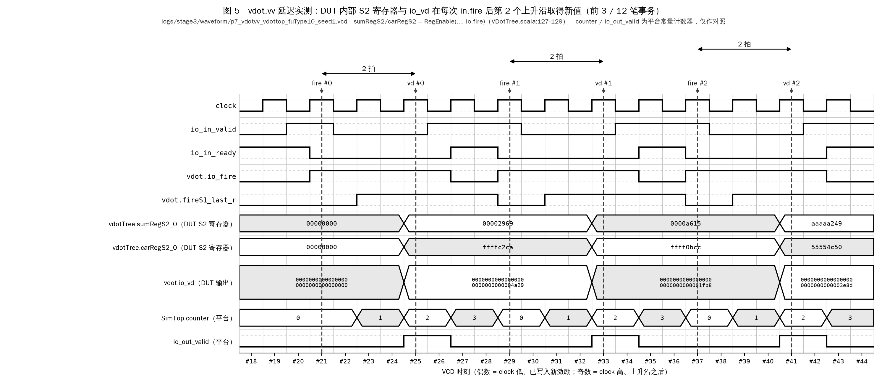
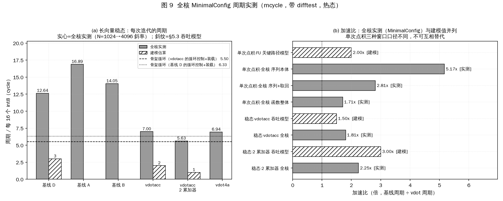

# 阶段三 3.2 / 3.3 —— RVV 1.0 基线实现、延迟实测与加速比分析

> 对应赛题：**3.2 基线功能实现**、**3.3 延迟加速分析**
> 对应总体方案：`docs/_plan/MASTER_PLAN.md` 的 **P7**、**D2.2 基线选型**、**D3 的 L4 层**
> 一键复现：`bash scripts/40_run_bench.sh`
> 本文每一个数字的原始数据都在 `bench/results/*.csv`，原始日志在 `logs/stage3/`。
> **源码行号基准**：XiangShan 源码行号默认指上游 pristine 树（`work/XiangShan-kmhv2`，`kunminghu-v2` @ `a4eeaab`）。
> `FuConfig.scala`、`UopInfoGen.scala`、`Parameters.scala`、`ExeUnit.scala`、`FuncUnit.scala`、`RiscvInst.scala`、`DecodeUnitComp.scala`
> 在实现树（`work/XiangShan-cosim`，上游 + `rtl/patch/0001`）中与 pristine 逐字节相同，行号两棵树通用；
> `VecDecoder.scala` 被补丁插入了 vdot 三行，两棵树行号不同，§4.4 同时给出两者。
> `VDotTop.scala` / `VDotTree.scala` / `VIMacU.scala` 中的 vdot 相关行只存在于实现树。

---

## 0. 阅读约定（先看这一节，否则后面的表会被误读）

本文所有数字只有三种来源，每张表的每个数值单元格都标注了其中之一：

| 标注 | 含义 | 本文中的典型例子 |
|---|---|---|
| **实测** | 本次在真实工具上跑出来的数，日志与波形在仓库里，可按本文给出的行号核对 | FU 延迟周期数（Verilator）、动态指令条数（NEMU `minstret`）、等价性通过数 |
| **实测（全核 MinimalConfig）** | 在香山 MinimalConfig 全核 emu 上带 difftest 跑出来的周期数（`mcycle`），只对 MinimalConfig 成立，**不是默认配置（KunminghuV2Config）** | §5.5 的单次点积、依赖链与长向量循环周期 |
| **静态计数** | 从源码或反汇编逐条数出来的指令条数，没有执行（由脚本解析，不是手抄常量） | 单次点积序列本体中的 `vsetvli` / 向量算术指令条数（`instr_count_single.csv`） |
| **声明值** | 香山源码里写死的常量，标注 `文件:行号`，**没有在本机实测** | `vsetvli` 的 `CertainLatency(0)` |
| **建模估算** | 用实测量 + 公开源码结构**推算**出来的数，不是跑出来的 | 依赖链关键路径周期数、循环吞吐模型、敏感性分析 |

**三条红线**（本文严格遵守）：

1. 不把建模估算写成实测；
2. 没跑的东西一律写「未执行」并说明原因（见 §10 局限性）；
3. 所有技术结论附 `文件:行号` 或 `日志:行号`。

**本文最重要的一句话**（请先读 §4.1）：
§4 测到的是**功能单元（FU）级延迟**，**不是**乱序核里的端到端延迟；
发射宽度、端口冲突、`vwredsum.vs` 的 uop 展开在 FU 级平台上**观测不到**，§5.1–§5.4 凡涉及这些的数字一律标注为「建模估算」。
**§5.5 另在 MinimalConfig 全核 emu 上实测了周期数**（单次点积、依赖链、长向量循环），与建模值并列给出；
**主结论**（全文见 §12 开头）：MinimalConfig 全核实测 latency 加速比为单次 16 元素点积 **1.70×**（函数整体，含装载与取回）、长向量稳态吞吐 **1.81×**（单累加器）/ **2.25×**（2 路累加器展开），对建模值 2.00× / 1.50× / 3.00×，差别原因见 §5.5.5；序列本体 5.17× 与加取回 2.81× 对窗口定义敏感，只作参考口径（§5.5.2）。

---

## 1. 证据层级

| 层级 | 装置 | 本文用它测什么 | 它测不到什么 |
|---|---|---|---|
| **L2 NEMU** | `work/NEMU` + `tests/riscv/baseline`（裸机 RV64 程序） | 基线序列与 vdot 的**逐位等价性**；**动态指令条数**（CSR `minstret`） | 周期数（NEMU 是功能级模拟器，不建模流水线） |
| **L1-a YunSuan** | `yunsuan/build/emu`（Verilator，`VDotTop`） | vdot 三条指令的**真实波形**与 in.fire→out.valid 周期数 | 其输出 valid 由平台计数器产生（见 §4.2 的说明），且只有 `VDotTop`，没有基线用到的另外两个 FU |
| **L1-b FU 直驱** | `VIMacUHarness` / `VIAluFixHarness` / `VIPUHarness`（Verilator） | **真正被集成进香山的** `VIMacU` / `VIAluFix` / `VIPU` 的延迟，按**数据成形拍**判定（§4.3） | 调度器、发射队列、写回仲裁、uop 展开；其 `out.valid` 由 harness 按声明延迟搭的寄存器链产生，同样不能单独作证据 |
| **L5 全核** | MinimalConfig 全核 emu + difftest（`docs/stage3/23_全核difftest验证报告.md`）；周期实测程序 `tests/riscv/fullcore/perf_cycles.c` + `perf_kernels.S` + 交付件 `bench/baseline/baseline_rvv.S` | P7 时**未执行**（当时的机器 16 GB，`docs/stage1/03_仿真平台搭建报告.md` §7.1）。之后在 Linux x86_64 服务器上补做：全核 difftest 做**功能**验证（文档 23），并在同一 emu 上用 `mcycle` **实测**单次点积、依赖链、长向量循环的周期数（§5.5，日志 `logs/stage3/fullcore/perf_cycles.log`） | 默认配置（KunminghuV2Config）的周期数；单条指令内部各级流水的逐拍分解（只有窗口总周期，未抓波形） |

---

## 2. 基线序列的推导与候选比较（赛题 3.2）

### 2.1 基线必须满足的条件

1. **只用 RVV 1.0 标准指令**（否则就不是「用现有指令做同一件事」的对照）；
2. 与 `vdot` 指令族**功能完全相同**，包括 `vl` / `vm` / `vta` / `vma` / `vstart` 的全部边角语义；
3. 是一个**有经验的 RVV 程序员真的会写出来的版本**，而不是刻意写差的版本。

第 3 条是本节的核心。基线选得越弱，加速比越好看，但结论越没有价值。

### 2.2 三个候选与选定结果（复核 D2.2）

P3 阶段已给出三个候选并裁定选 **候选 D**（`docs/stage2/13_参考模型与测试向量说明.md` §5.1）。
本阶段用 NEMU 把三个候选**全部真跑了一遍**，重新核对这个裁定：

| 候选 | 循环内核心指令 | 每 16 个 int8 的指令数（**实测**） | 循环内串行归约 | 向量寄存器占用 | 本次复核结论 |
|---|---|---:|---|---|---|
| A | `vwmul.vv` + `vwredsum.vs` | **10.00** | **有** | 5 | 指令数与 D 相同，但归约在循环里 |
| B | `vsext.vf4`×2 + `vmacc.vv` | **11.00** | 无 | 14 | 指令最多、寄存器压力最大 |
| **D（选定）** | `vwmul.vv` + `vwadd.wv` | **10.00** | 无 | 8 | **维持原裁定** |

> 实测值来源：`logs/stage3/p7_baseline_equiv.log:154-173` 的 `CSVROW` 行，
> 对 N = 64/256/1024/4096 四个点做线性回归得到的斜率；
> 原始数据见 `bench/results/instr_count_loop.csv`。

**本次复核的新发现**：A 与 D 的**指令条数完全相同（都是 10.00 条/迭代）**，
这是实测确认的，不是推断。两者的差别不在指令数而在**循环携带依赖的性质**：
A 的循环携带依赖是 `vwredsum.vs`（归约，VIPU，实测 2 拍，且在 LMUL=2 下拆 4 个 uop），
D 的循环携带依赖是 `vwadd.wv`（宽加法，VIAluFix，实测 1 拍）。
因此在**指令条数口径**上 A 和 D 等价，在**延迟口径**上 D 明显更强。

**是否存在比 D 更强的基线？** 本阶段又评估了两个方向，结论是没有：

* **用 `vwmacc.vv`（8→16 乘累加）替掉 `vwmul`+`vwadd.wv`**：可以把循环内向量指令从 6 条压到 5 条。
  但 `vwmacc.vv` 的累加器是 **16 位**，16 个 int8 乘积的和最大 262144，
  只要 N 超过 16 个元素就会溢出（`docs/stage2/10_vdot指令设计文档.md` §1.6 的溢出证明）。
  要正确就必须周期性地把 16 位累加器搬到 32 位，反而更慢。**不成立。**
* **用 `vqmaccsu`/`Zvqdotq` 类指令**：这些**不在 RVV 1.0 里**，用它们当基线就等于
  拿另一个自定义扩展当对照，违反第 1 条。**不成立。**

所以：**维持 D2.2 的裁定，基线 = 候选 D**。长向量加速比以 D 为分母；
A 仅作为「如果选了弱基线会怎样」的对照出现在图 2(a) 里。
值得一提的是：A 与 D 的指令数斜率完全相同（都是 10.00 条/迭代），只有序幕/尾声差 2 条
（A 的归约在循环内，循环外就不用再归约了），所以 N=4096 时
A/vdotacc = **1.248×**、D/vdotacc = **1.249×**，**在小数点后第 3 位才有差别**。
也就是说，**本方案在指令条数口径上的加速比根本不依赖于基线选得弱**——
这一点本身就是实测结论，而不是辩解。

### 2.3 单次 16 元素点积的基线序列

当 N = 16（恰好一个 VLEN=128 的 int8 向量）时，循环只有一轮，归约无法移出循环，
A 和 D 退化为同一个序列。这就是赛题 3.2 要求的基线：

```asm
    vsetivli    zero, 4,  e32, m1, ta, ma   # 1  e32、vl = 4 = VLMAX：下一条覆盖整个 v8
    vmv.v.i     v8, 0                       # 2  v8 = {0, 0, 0, 0}
    vsetvli     zero, a2, e8,  m1, ta, ma   # 3  切回 e8
    vwmul.vv    v4, v2, v1                  # 4  16 个 int16 乘积 -> v4:v5
    vsetvli     zero, a2, e16, m2, tu, ma   # 5  切到 e16/m2 以便归约；tu 保住 v8[1..3] 的 0
    vwredsum.vs v8, v4, v8                  # 6  16->32 位带符号归约，写 v8[0]
```

（`bench/baseline/baseline_rvv.S:291-296`。）

> **语义修订 S-3' 对基线的影响**：`vdot.vv` / `vdotacc.vv` 在 `vstart < vl` 时写 `vd[31:0]`、`vd[VLEN-1:32]` 恒为 0，
> 与 `vta` / `vma` 无关；`vl = 0` 时不写 `vd`（与赛题官方伪代码一致，见 `docs/stage2/10` §1「赛题官方语义与逐行对照」）。
> 基线因此必须把 `v8` **整体**清零，再用 `tu` 归约，只改写元素 0。修订前的序列是 `vsetvli e32` + `vmv.s.x v8, x0`
> （只清元素 0）+ 沿用 `vtype.vta` 的归约，tail 随 `vta` 处理（原裁定 S-3：`vta = 1` 时写全 1）。新旧序列都是 6 条，
> 第 2 条由 `vmv.s.x` 换成 `vmv.v.i`（两者同为 `VIAluFix` 上 1 拍、译码为 2 个 uop，见 §4.4–§4.6），第 1 条由 `vsetvli` 换成 `vsetivli`，
> 第 5 条由 `ta` 换成 `tu`。
>
> 交付件里的这个函数约定 `1 ≤ a2 ≤ 16`，所以第 1 条直接写 `vsetivli 4`。NEMU 等价性测试要覆盖 `vl = 0`，
> 用的是同一序列的通用写法（`tests/riscv/baseline/baseline_test.c:209-225`）：
>
> | 指令 | 基线序列（`baseline_test.c` 的 `run_baseline()`） | 条数 |
> |---|---|---:|
> | `vdot.vv` | `vsetvli(AVL = vl<<2) e32` → `vmv.v.i v8,0` → `vsetvli e8` → `vwmul.vv` → `vsetvli e16,m2,tu` → `vwredsum.vs` | 6 |
> | `vdotacc.vv` | `vsetvli(AVL = vl<<2) e32` → `vslideup.vi v9,v8,3` → `vslidedown.vi v8,v9,3`（保留 `v8[0]`、清零 `v8[1..3]`）→ 与 `vdot` 相同的后 4 条 | 7 |
> | `vdot4a.vv` | `vsetvli e32` + 4 组「移位抽子字节 + `vmacc.vv`」（S-3' 不涉及 `vdot4a`） | 19 |
>
> `AVL = vl<<2`：`vl = 0` 时 e32 下 `vl = 0`，其后的清零不写 `v8`；`vl ≥ 1` 时 AVL ∈ {4, 8, …, 64}，
> 按 RVV §6.3 必得 `vl = VLMAX = 4`，清零覆盖整个寄存器。三条指令的条数见 `logs/stage3/p7_baseline_equiv.log:117`
> （`baseline vector-instruction count per case: vdot=6  vdotacc=7  vdot4a=19`）。
> `vdotacc` 由修订前的 4 条增至 7 条：RVV 1.0 没有「保留元素 0、其余清零」的单条指令，多出的 3 条是新语义在基线侧的真实代价
> （`baseline_test.c:224-225`）。本文的单次点积加速比只用 `vdot.vv`（序列本体 6 条 vs 2 条），不受这一变化影响。

对照的 vdot 侧：

```asm
    vsetvli     zero, a2, e8,  m1, ta, ma   # 1
    vdot.vv     v8, v2, v1                  # 2  （.word 0xe6208457）
```

两段代码在同一个 ELF 镜像里（`tests/riscv/baseline/build/baseline_test.dis`），
来自交付件 `bench/baseline/baseline_rvv.S` 的 `baseline_vdot_single` / `vdot_single`，
**不是为写报告另抄的副本**。

静态指令条数（反汇编逐条数，**实测**，`logs/stage3/p7_baseline_equiv.log:59-61`，斜率法复核见 `:178-182`）：

| kernel | 静态指令数（含 `ret`） | 其中向量算术指令 | 其中 `vsetvli` |
|---|---:|---:|---:|
| `baseline_vdot_single`（含装载/取回） | **12** | 3（`vmv.v.i`/`vwmul.vv`/`vwredsum.vs`） | 5（含 1 条 `vsetivli`） |
| `vdot_single`（含装载/取回） | **7** | 1（`vdot.vv`） | 2 |

> 12 条 = 5 条 `vsetvli` + 3 条向量算术 + 2 条 `vle8.v` + 1 条 `vmv.x.s` + 1 条 `ret`；
> 7 条 = 2 条 `vsetvli` + 1 条 `vdot.vv` + 2 条 `vle8.v` + 1 条 `vmv.x.s` + 1 条 `ret`。
> 赛题 3.2 要求对照的「基线序列本体」是其中去掉装载/取回后的 **6 条 vs 2 条**（§5.1）。
>
> 关于 `:178-182` 的 `static_instr` 列：验收审计 M-8 之前该列是程序里写死的常量；整改后的 `baseline_test.c`
> 在运行时从函数入口逐条解码到第一条 `ret` 计数（日志 `:183` 的说明）。当前主日志由整改后的程序在 GCC 15.2 下产生
> （`:13-14`），运行时计数为 12 / 7（`:180-181`），与 `:59-61` 的反汇编 awk 计数、同行 `body_instr` 列的 `minstret` 斜率差（同为 12 / 7）三者一致。

**依赖链**：

```
基线：  #3 vsetvli(e8) ──> #4 vwmul.vv ──┐
        #1 vsetivli(e32)─> #2 vmv.v.i ──┼──> #6 vwredsum.vs
        #5 vsetvli(e16)────────────────┘
        关键路径 = #3 → #4 → #6（3 级），旁路 #1→#2→#6 更短

vdot：  #1 vsetvli(e8) ──> #2 vdot.vv
        关键路径 = 2 级
```

### 2.4 长向量循环基线（N ≫ 16）

循环体按「每处理 16 个 int8 对」计（源码见 `bench/baseline/baseline_rvv.S`）：

| 实现 | 循环体 | 向量指令 | 标量指令 | `vsetvli` | 循环携带依赖 |
|---|---|---:|---:|---:|---|
| 基线 A | `vsetvli e8`/`vle8`×2/`vwmul.vv`/`vsetvli e16`/`vwredsum.vs` | 6 | 4 | 2 | `vwredsum.vs`（归约） |
| 基线 B | `vsetvli e8`/`vle8`×2/`vsetvli e32,m4`/`vsext.vf4`×2/`vmacc.vv` | 7 | 4 | 2 | `vmacc.vv` |
| **基线 D** | `vsetvli e8`/`vle8`×2/`vwmul.vv`/`vsetvli e16`/`vwadd.wv` | **6** | 4 | 2 | `vwadd.wv`（宽加法） |
| `vdotacc` | `vsetvli e8`/`vle8`×2/`vdotacc.vv` | **4** | 4 | **1** | `vdotacc.vv` |
| `vdot4a` | `vsetvli e32`/`vle32`×2/`vdot4a.vv` | **4** | 5 | **1** | `vdot4a.vv`（4 条独立 lane） |

---

## 3. 等价性验证结果（赛题 3.2）

### 3.1 验证装置

`tests/riscv/baseline/baseline_test.c` 是一个裸机 RV64 程序，在 **NEMU 上真实执行**：

* 语料：`tests/vectors/` 的 30739 条共享语料 + `tests/riscv/vdot/extra_vectors/` 的 55 条
  = **30794 条**（`logs/stage3/p7_baseline_equiv.log:25-39`；裁定 S-7' 传播后重新生成，见 §3.3；语义修订 S-3' 后按新语义再次生成，
  `vdot` / `vdotacc` 的 positive / negative / boundary 各补 6 条 `vl = 8` 定向用例，30758 → 30794），由 `tests/riscv/vdot/pack_corpus.py` 打包进镜像（与 P5 用的是同一个打包器、同一批文件）；
* 每条用例在**同一台 NEMU 上**先跑一遍基线序列、再跑一遍 vdot 指令，
  然后做**三方比对**：基线 vs 语料黄金值、vdot vs 语料黄金值、基线 vs vdot；
* 测试程序**不含任何点积语义实现**，比对只是 `memcmp`；期望值全部来自
  `tests/golden/vdot_ref.c` 生成的语料。

### 3.2 单次点积等价性：逐 suite 结果（**实测**）

`logs/stage3/p7_baseline_equiv.log:97-116`（S-3' 修订后重跑）：

| suite | 用例数 | 实跑 | 通过 | 失败 | 跳过 |
|---|---:|---:|---:|---:|---:|
| positive | 46 | 46 | **46** | 0 | 0 |
| negative | 50 | 50 | **50** | 0 | 0 |
| boundary | 109 | 100 | **100** | 0 | 9 |
| vdotacc_positive | 46 | 46 | **46** | 0 | 0 |
| vdotacc_negative | 50 | 50 | **50** | 0 | 0 |
| vdotacc_boundary | 109 | 100 | **100** | 0 | 9 |
| vdot4a_positive | 40 | 40 | **40** | 0 | 0 |
| vdot4a_negative | 44 | 44 | **44** | 0 | 0 |
| vdot4a_boundary | 115 | 106 | **106** | 0 | 9 |
| vstart_relaxed(strict) | 130 | 22 | **22** | 0 | 108 |
| random | 10000 | 8459 | **8459** | 0 | 1541 |
| vdotacc_random | 10000 | 8428 | **8428** | 0 | 1572 |
| vdot4a_random | 10000 | 8461 | **8461** | 0 | 1539 |
| vstart_range(extra) | 55 | 8 | **8** | 0 | 47 |
| **合计** | **30794** | **25960** | **25960** | **0** | **4834** |

```
[A] TOTAL cases=30794 run=25960 pass=25960 fail=0 skip(illegal-by-spec)=4834 skip(baseline-inexpressible,vstart!=0)=0
    baseline-vs-golden mismatch = 0 , vdot-vs-golden mismatch = 0 , baseline-vs-vdot mismatch = 0
    unexpected baseline trap = 0 , unexpected vdot trap = 0 , vl readback mismatch = 0
    baseline vector-instruction count per case: vdot=6  vdotacc=7  vdot4a=19   (vdot side = 1 each)
```

**结论**：在 **25960 条实跑用例**上，RVV 1.0 基线序列与 `vdot` 指令族的结果**逐位完全相同**，
且两者都与参考模型的黄金值逐位相同，**0 失配**。比对的是整个 128 位 `vd`（`tests/riscv/baseline/baseline_test.c:155-160` 回读 16 字节），因此 S-3' 要求的 `vd[127:32] = 0`
在基线、`vdot` 指令、黄金值三方之间也逐位核对过。
其中随机用例 **8459 + 8428 + 8461 = 25348 条**，远超验收要求的 ≥10000 条；
定向 suite（positive / negative / boundary 共 9 个）**全部覆盖且全部通过**。

### 3.3 被跳过的 4834 条：现在只剩一类

**全部 4834 条都是「架构上必须抛 Illegal Instruction」的用例**（`skip(illegal-by-spec)=4834`）：
语料 `status != OK`（三条指令的 `vstart != 0`、`vsew` 不匹配、`vstart` 越界）。
基线侧使用的标准 RVV 指令在这些配置下同样非法，没有可对照的执行结果；
trap 行为已在 P5 单独验证（`docs/stage3/20_NEMU指令扩展说明.md`，4834/4834 以 mcause=2 trap）。

**「基线不可表达」一类已经归零（`skip(baseline-inexpressible,vstart!=0)=0`）。**
首轮运行时这一类有 **1553 条**（vdot4a_random 1539 + vdot4a_boundary 6 + vstart_range 8），
全部是 `vdot4a` 且 `vstart != 0` 而语料标为 `OK` 的用例 —— 基线侧每一条向量指令都 trap 了，
`vdot4a` 却不 trap。对照实验（`logs/stage3/p7_baseline_equiv.log:79-92`，数据另存
`bench/results/vstart_control.csv`）当时与现在的结果对比如下：

| 指令 | `vstart = 0` | `vstart = 1`（首轮） | `vstart = 1`（**S-7' 传播后**） |
|---|---|---|---|
| `vadd.vv` | 不 trap | TRAP, mcause=2 | TRAP, mcause=2 |
| `vwmul.vv` | 不 trap | TRAP, mcause=2 | TRAP, mcause=2 |
| `vwredsum.vs` | 不 trap | TRAP, mcause=2 | TRAP, mcause=2 |
| `vmv.s.x` | 不 trap | TRAP, mcause=2 | TRAP, mcause=2 |
| `vsll.vi` | 不 trap | TRAP, mcause=2 | TRAP, mcause=2 |
| `vsra.vi` | 不 trap | TRAP, mcause=2 | TRAP, mcause=2 |
| `vmacc.vv` | 不 trap | TRAP, mcause=2 | TRAP, mcause=2 |
| `vdot4a.vv`（本方案新增） | 不 trap | **不 trap**（唯一例外） | **TRAP, mcause=2** |

根因：NEMU 的**通用向量算术通路** `arithmetic_instr()` 无条件调用
`check_vstart_exception()`（`work/NEMU/src/isa/riscv64/instr/rvv/vcompute_impl.c:544`，
该函数在 `vcommon.c:20-24` 里 `vstart > 0` 即 `longjmp_exception(EX_II)`），
因此 **NEMU 里每一条标准向量算术指令在 `vstart != 0` 时都判非法**；
香山译码侧同样如此（`VecExceptionGen.scala` 的 `vstartIllegal = isVArith && vstart =/= 0`，
即 `MASTER_PLAN.md` D2.3 的分歧 G5b）。首轮时 `vdot4a` 走自己的 `vdot.c` 实现，按原裁定 S-7
**没有**调用 `check_vstart_exception()`，成了这台模拟器里唯一一条允许非零 `vstart` 的向量算术指令。

> ### 发现与处置记录：裁定 S-7′ 的传播
>
> 本文首轮运行时报告了「S-7′ 尚未传播」（`vdot4a_random.txt` 等语料中 1545 条
> `vdot4a` + `vstart != 0` 仍标为 `OK`；`vdot.c` 注释仍写「裁定 S-7」），按纪律只报告不修复。
> 该问题随后由语义收敛环节按 D2.3 传播清单完成修复：参考模型 → 语料重新生成（1545 条
> `OK → ILLEGAL_VSTART`）→ NEMU `vdot.c:166` 补 `check_vstart_exception(s)` → 重跑 P4/P5/P6/P7。
> 本节表格与上方汇总即为重跑结果；对照表最后一行由「不 trap」变为「TRAP, mcause=2」。
>
> **对本文其余结论的影响：无。** §3.2 的等价性结论只涉及 `vstart = 0` 的用例；
> §4 / §5 / §6 的全部延迟、指令数、加速比数字在重跑后**逐字节不变**
> （`critical_path.csv` / `instr_count_*.csv` / `speedup.csv` / `sensitivity.csv` / `uop_count.csv`
> 与重跑前 `diff` 为空）。唯一变化的派生量是 `latency_fu.csv` 中 `vdot4a.vv` 的 VIMacU 直驱事务数
> 196 → 190：该 harness 从共享语料取激励，`vdot4a_boundary.txt` 里 6 条 `vstart != 0` 用例
> 现在是非法指令、不再投放；其余 190 笔的结果仍在第 2 拍成形（§4.3）。
>
> **附带的方法论结论**：这处不一致是**写基线等价性测试时被动暴露出来的**——
> 因为基线只能用标准 RVV 指令，而标准 RVV 指令在这台机器上根本不允许非零 `vstart`。
> 「要求自己写一个只用标准指令的等价实现」本身就是一种交叉检查。它与 P6 协同仿真
> （`docs/stage3/21` §7.3）是**两条互相独立的路径**发现同一个问题。

### 3.4 长向量循环等价性（**实测**）

直接调用交付件 `bench/baseline/baseline_rvv.S` 里的六个长向量 kernel（原五个 + 2 路累加器 `vdot_dot_i8_acc2`），
与测试程序里的**纯标量 C 参考实现**（`naive_dot()`，32 位回绕）逐个比对，
数据由与 `tests/golden/test_golden.c:176-181` **完全相同的 LCG** 生成，保证宿主端与 NEMU 端同源。

`logs/stage3/p7_baseline_equiv.log:119-147`：

* N ∈ {0, 4, 16, 32, 64, 128, 256, 512, 1024, 2048, 4096}：六路实现（基线 A/B/D、`vdotacc`、`vdot4a`、`vdotacc` 2 累加器即 `vdacc2` 列）与标量参考**全部一致**；
* N ∈ {1, 2, 3, 5, 15, 17, 31, 33, 63, 127, 255, 1023, 4095}（非 16 整数倍，含非 4 整数倍）：
  五路实现（`vdot4a` 按定义只处理 4 的整数倍组，不参与）与标量参考**全部一致**；
* 合计 **24 个长度，0 处失配**（`:146`）。

> 这一组用例覆盖了 `tu`（tail-undisturbed）这个工程细节：最后一次迭代 `vl < 16` 时，
> 若累加器指令误用 `ta`，`lane[vl..15]` 的已累加值会被写成全 1。
> N = 1/2/3/5/15/17/… 这些非整数倍长度就是专门用来打这个洞的，全部通过。

### 3.5 这套比对真的会红吗

P3 阶段已对同一套参考模型做过故障注入，3 个人为缺陷全部被检出（S-3' 修订后重跑，
`logs/stage2/p3_golden_selftest.log:53-57`；第 2 个注入点是「`vdot`/`vdotacc` 元素 1..3 写全 1，退回旧 S-3」，
第 3 个注入点就是「基线仿真的 `vwredsum.vs` 丢掉标量初值」）。
本文 §3.3 的对照实验本身也是一次有效性证明：
测试程序确实能分辨 trap / 不 trap，并把它算作失败——首轮运行时正是它报出了 1553 条
「基线不可表达」，我们才追到 S-7′ 未传播这个问题；传播后这一类归零（§3.3）。

---

## 4. 延迟实测（赛题 3.3）

### 4.1 方法、以及这套方法**测不到**什么（本文最重要的一节）

**测得到**：功能单元的结果数据在 `in.fire` 之后第几拍成形（逐拍采输出数据并与参考模型比较）。
这对应昆明湖 V2 调度器用来做投机唤醒的那个「延迟」（`FuConfig` 的 `CertainLatency`）。
各平台的 `out.valid` 也一并记录，但**两类平台的 `out.valid` 都是测试平台按声明延迟构造出来的**
（L1 是计数器，§4.2；FU 直驱是 harness 寄存器链，§4.3），只用作与声明值的对照，不作为延迟证据。

**测不到**（以下四项在 FU 级平台上**没有对应的信号**，本文凡涉及一律标「建模估算」）：

1. **发射宽度与端口冲突**。`vimac` 只挂在 VFEX0 一个执行端口上，`vipu` 只挂在 VFEX1 上
   （`Parameters.scala:449-450`）。多条同类指令必须排队，FU 级平台一次只喂一条，看不到排队。
2. **uop 展开**。`vwredsum.vs` 在 LMUL=2 下被译码器拆成 **4 个 uop**
   （`UopInfoGen.scala:229`：`VEC_VWW -> Cat(lmul, 0)` = 2×lmul）。
   FU 级 harness 只喂 `vuopIdx = 0` 的那一个 uop，**另外 3 个 uop 的代价完全看不见**。
   同理 `vsetvli` 是 2 个 uop（`UopInfoGen.scala:199`），`vwadd.wv` 在 LMUL=2 下是 4 个 uop。
3. **端到端 issue-to-commit 延迟**。前端取指、译码、重命名、分发、读寄存器、
   向量专用的 `Og2ForVector` 一级、写回仲裁、ROB 提交全都不在 FU 里
   （完整链路见 `docs/stage1/02_向量加法指令执行过程分析.md` §8.4）。
4. **访存**。两个 `vle8.v` 的 L1D 命中/缺失行为。

**因此：本文给出的「单次点积 4 拍 vs 2 拍」是一个「把实测 FU 延迟按依赖链相加」的模型值，
不是任何一台机器上真实测到的端到端延迟。** 端到端周期数需要在全核上测。

> **后续更新（全核实测）**：MinimalConfig 全核 emu 已经可用（`docs/stage3/23_全核difftest验证报告.md`），
> 本文 §5.5 在它上面**实测**了单次点积与长向量循环的周期数（带 difftest，结果逐条与 NEMU 一致）。
> 实测表明上面四项「测不到」的因素在全核里影响很大：每一跳向量依赖实际要 FU 延迟 + 5 拍，
> 单次点积序列本体实测 31 拍 vs 6 拍，远不是 4 拍 vs 2 拍。「4 拍 vs 2 拍」保留为 FU 级模型值，与实测并列。

判读约定与 P1 阶段分析 `vadd.vv` 时完全相同
（`docs/stage1/02_向量加法指令执行过程分析.md` §8.2），用的也是同一个工具 `scripts/tools/vcd_extract.py`。

### 4.2 vdot 三条指令：L1 波形实测

命令（`logs/stage3/p7_latency_measure.log:12-27`）：

```
YS_VDOT_VECTORS=/tmp/p7_w_vdot.txt ./build/emu --dump-wave -b 0 -e 400 -O 12 -s 1
python3 scripts/tools/vcd_extract.py --vcd <vcd> --transactions
```

事务表（`p7_latency_measure.log:29-44`，`vdot.vv`；另两条见 `:88-103`、`:147-162`）：

| 指令 | 波形文件 | 事务数 | `in.fire → out.valid` |
|---|---|---:|---|
| `vdot.vv` | `logs/stage3/waveform/p7_vdotvv_vdottop_fuType10_seed1.vcd` | **12** | **2 拍 × 12/12** |
| `vdotacc.vv` | `logs/stage3/waveform/p7_vdotaccvv_vdottop_fuType10_seed1.vcd` | **12** | **2 拍 × 12/12** |
| `vdot4a.vv` | `logs/stage3/waveform/p7_vdot4avv_vdottop_fuType10_seed1.vcd` | **12** | **2 拍 × 12/12** |

**但 `out.valid` 在这个平台上不能单独作为证据。** L1 平台的 `io.out.valid` 是由测试平台
自己的计数器 `counter >= latency` 产生的（`yunsuan/src/test/scala/top/VectorSimTop.scala:106-127`），
`latency` 取自平台常量 `VDOT_latency = 2`（`:26`）。它只能证明「平台按声明值收结果」。
所以本文**另外看了一遍 DUT 自己的信号**（`p7_latency_measure.log:46-69`）：

```
 time      vdot.io_fire   vdot.io_vd                        vdotTree.sumRegS2_0  io_out_valid
  #20          0          00000000000000000000000000000000      00000000             0
  #21          1          00000000000000000000000000000000      00000000             0    <- in.fire
  #23          1          00000000000000000000000000000000      00000000             0    <- fire+1：vd 还是旧值
  #25          1          00000000000000000000000000004a29      00002969             1    <- fire+2：vd 成形
```

即：**`io_vd` 在 `fire` 后的第 1 个上升沿（#23）仍是旧值，在第 2 个上升沿（#25）才变成本次结果。**
（`p7_latency_measure.log:57-60`。按语义修订 S-3'，`vd[127:32]` 为 0、只有元素 0 = `0x00004a29`；修订前同一笔事务的
`io_vd` 高 96 位是 `vta = 1` 写出的全 1。）
这与 RTL 结构完全自洽：

* `VDotTop.scala:44` `fireS1 = GatedValidRegNext(fire)` —— 第一级流水寄存器使能；
* `VDotTree.scala:127-129` `sumRegS2/carRegS2 = RegEnable(..., io.fire)` —— 第二级流水寄存器；
* `io.vd` 由 S2 级寄存器组合产生（`VDotTop.scala:121-144`）。

**两级流水寄存器 ⇒ 2 拍**，波形、RTL 结构、`VimacCfg.latency = CertainLatency(2)` 三者一致。

图 5–7 把三份 VCD 的前 3 笔事务画出来：每次 `in.fire` 之后，DUT 内部的 `sumRegS2_0` / `carRegS2_0` 与 `io_vd`
都在第 2 个上升沿才变成本次的值。平台的 `counter` / `io_out_valid` 也画在图里，标为「平台」，只作对照。
图由 `bash scripts/tools/make_stage23_figures.sh` 渲染，只读 VCD，不重跑仿真。




### 4.3 直驱 `VIMacU`：真正被集成进香山的那一个

L1 平台测的是 `VDotTop`（YunSuan 侧的独立模块），而真正被集成进香山的是 `VIMacU`。
为了不留这个缺口，本文用 `VIMacUHarness`（交付仓库 `tests/unit/VIMacUHarness.scala`，运行时同步进
`work/XiangShan-cosim/src/test/scala/xiangshan/backend/fu/`）直接驱动 `VIMacU`，
测试平台为 `tests/unit/vimacu_latency_tb.cpp`。

**先说清楚哪个数字不能当证据。** 昆明湖 V2 的功能单元自己不保存流水副本，harness 必须照
`ExeUnit.scala:228-241` 在外面搭 `validPipe/ctrlPipe/dataPipe`，而链长取自
`VimacCfg.latency`（`VIMacUHarness.scala` 中 `nLat = VimacCfg.latency.latencyVal.get`）。
`VIMacU` 的 `out.valid = validPipe(nLat) & validVecThisFu(nLat)`（`FuncUnit.scala:214-216`），
即 `io_valid` 经 harness 自己的两级寄存器——生成网表里是
`assign io_out_valid = io_in_bits_validPipe_2 & validVecThisFu_2`，
`vPipe_1_REG <= io_valid; vPipe_2_REG <= vPipe_1_REG`。
所以「`out.valid` 在第 2 拍」**按构造必然成立**，与 L1 平台 `counter >= latency` 是同一类问题，
本文只把它当作与声明值的对照。

**独立证据是数据成形拍。** tb 在 `fire` 前（第 0 拍）与 `fire` 后第 1..4 拍的下降沿各采一次 `io_vd`，
直接与参考模型比较，**不读 `out.valid`**：

* 第 2 拍（固定拍）`io_vd` 与参考逐位一致 ⇒ 该笔数据通路深度 ≤ 2；
* 第 1 拍 `io_vd` 仍不等于参考 ⇒ 该笔数据通路深度 ≥ 2。

乘法阵列与加法树的流水寄存器是 `VIMacU` 自己的（`VIMac64b` 内部的 `fireS1`、`VDotTree` 的 S2 寄存器，
使能来自 `io.in.valid` 及其自身打拍），不来自 harness 的 `validPipe`，因此这一观测确实反映 DUT 的数据通路深度。

成形拍是**下界型证据**：如果 `fire` 前输出端残留的上一笔结果恰好等于本笔结果
（例如连续两条 `vl = 0` 或全掩码用例，结果都等于 `oldVd`），第 1 拍就会「看起来已成形」，
其实什么也说明不了。tb 的处理办法是：只在「`fire` 前输出 ≠ 参考」的事务上判定；不满足的，
先插一笔操作数取反/异或的「扰动前驱」事务再重测（最多 4 次），仍不可判定的单独计数，一律不计入「第 1 拍未成形」。
激励：vdot 族来自共享语料（参考 = `tests/golden/vdot_ref.c`）；
`vmul` / `vwmul` / `vmacc` 为每条 64 笔随机激励（参考 = tb 内逐元素 C 模型，`vl = 16`、`vm = 1`、`vta = 1`）。

`logs/stage3/p7_latency_measure.log:189-282`（**实测**，2026-10-26 语义修订 S-3' 后重跑；运行环境见下方说明）：

| 指令 | 事务数 | `out.valid` 延迟（**平台构造值**） | 第 1 拍未成形（**独立观测**） | 第 2 拍数据与参考逐位一致 | 不可判定 | 日志 |
|---|---:|---|---:|---:|---:|---|
| `vdot.vv` | 196 | 2 拍 × 196 | **196/196**（其中 55 笔经扰动前驱重测后可判定） | **196/196** | 0 | `:232-236` |
| `vdotacc.vv` | 196 | 2 拍 × 196 | **196/196**（55 笔经重测） | **196/196** | 0 | `:237-241` |
| `vdot4a.vv` | 190 | 2 拍 × 190 | **190/190**（35 笔经重测） | **190/190** | 0 | `:242-246` |
| `vmul.vv`（上游既有） | 64 | 2 拍 × 64 | **64/64** | **64/64** | 0 | `:249-253` |
| `vwmul.vv`（上游既有，**基线用到**） | 64 | 2 拍 × 64 | **64/64** | **64/64** | 0 | `:254-259` |
| `vmacc.vv`（上游既有） | 64 | 2 拍 × 64 | **64/64** | **64/64** | 0 | `:260-264` |

汇总行（供 `collect_results.py` 解析）在 `:266-280`。

> vdot / vdotacc 的事务数由 S-3' 修订前的 178 笔增至 196 笔：激励取自共享语料，修订时
> positive / negative / boundary 各补了 6 条 `vl = 8` 定向用例（3 × 6 = 18）。

> **读法**：774 笔事务（196 + 196 + 190 + 64 × 3）全部可判定，**全部在第 1 拍未成形、第 2 拍逐位正确**，即数据通路深度 = 2，
> 与 `VimacCfg.latency = CertainLatency(2)` 一致。第一遍按原顺序投放时，vdot 族有 145 笔（55 + 55 + 35）
> 在 `fire` 前输出端就已等于本笔结果（前驱残留值相同），属不可判定；换扰动前驱重测后全部变为
> 「第 1 拍未成形」。修订前的同一测量为 97 笔（31 + 31 + 35），与验收审计在未加扰动时观察到的
> 「642 笔中 97 笔第 1 拍已等于终值」一致（`docs/_plan/ACCEPTANCE_P3.md` §3 第 3 条），说明那 97 笔是残留值巧合，而不是数据通路只有 1 拍。

> `vwmul.vv` 的参考模型：harness 固定 `vuopIdx = 0`，tb 用两个候选模型
> （「元素 0..7 的 16 位积」和「元素 8..15 的 16 位积」）先探测一次，
> 64 笔**全部命中前者**，0 笔两者皆不命中（`:259`）；成形拍判定用命中的那一个作参考。

> **运行环境说明**：`p7_latency_measure.log` 全文（§4.2 的 L1 波形、本节的 `VIMacU`、§4.4 的 `VIAluFix` / `VIPU`）
> 是 2026-10-26 语义修订 S-3' 后由 `scripts/40_run_bench.sh` 一次性重跑的结果（`:3`），环境为 Linux x86_64 + **Verilator 5.024**
> （`:193`；`logs/stage3/p7_bench_run.log:7`），工作树为 `work/XiangShan-cosim`（`:196`）。本次精化得到的 `VIMacUHarness.v` 为 4364 行（`:203`）。
> 此前各段曾分别在 macOS arm64 + Verilator 5.052（2026-10-24）与 Linux x86_64 + Verilator 5.024（2026-10-25）上运行，
> 旧日志见 git 历史。声明值来源由脚本定位 `val VimacCfg` 定义块内的 `latency` 行打印（`:204-205`：`FuConfig.scala:563`，
> 定义始于 `:551`）；更早的日志曾误印成标量乘法器 `MulCfg` 的 `FuConfig.scala:334`（审计 M-7），已修正。

**这同时回答了「新增指令有没有把既有指令变慢」**：
`vmul`/`vwmul`/`vmacc` 与三条 `vdot` 指令的数据**同在第 2 拍成形**（第 1 拍未成形、第 2 拍正确），
`VimacCfg.latency` 未被改动。

### 4.4 基线其余两个功能单元：直驱 `VIAluFix` / `VIPU`

基线序列的三条核心指令落在**三个不同的功能单元**上，所以必须分别测（`vmv.v.i` 是 S-3' 修订后单次点积基线的清零指令，
`vmv.s.x` 仍用于长向量 kernel 的累加器初始化，例如 `bench/baseline/baseline_rvv.S:183`，两者都测）：

| 指令 | FuType | 功能单元 | 译码依据（上游 pristine 树） | 同一行在实现树中的行号 |
|---|---|---|---|---|
| `vmv.v.i` | `vialuF` | `VIAluFix` | `VecDecoder.scala:336` | `:345` |
| `vmv.s.x` | `vialuF` | `VIAluFix` | `VecDecoder.scala:457` | `:466` |
| `vwadd.wv` | `vialuF` | `VIAluFix` | `VecDecoder.scala:421` | `:430` |
| `vwmul.vv` | `vimac` | `VIMacU` | `VecDecoder.scala:427` | `:436` |
| `vwredsum.vs` | `vipu` | `VIPU` | `VecDecoder.scala:243` | `:244` |
| `vredsum.vs` | `vipu` | `VIPU` | `VecDecoder.scala:410` | `:419` |

> 行号差来自 `rtl/patch/0001-xiangshan-vdot.patch` 在 `VecDecoder.scala` 中插入的 vdot 译码行
> （实现树 `:256-258`，pristine 树中不存在）：其后的行号整体后移。两棵树的这六行内容逐字相同。

YunSuan 的 L1 平台只例化了 YunSuan 自己的 `VIAluFWrapper`，**既没有 `VIMacU` 也没有 `VIPU`**
（`VectorSimTop.scala:161-396` 的模块清单）。
本文为此新增了一个通用 harness `VecFuLatHarness.scala`（**只做连线，不含任何算术逻辑，不修改任何 RTL**），
把 `VIAluFix` 和 `VIPU` 也收窄成同样的窄 IO。

`logs/stage3/p7_latency_measure.log:284-338`（**实测**，2026-10-26 重跑；`VIAluFix` 四行在 `:315-322`，`VIPU` 两行在 `:333-336`）：

| 指令 | harness | 事务数 | `out.valid` 延迟（**平台构造值**） | **数据成形拍**（独立观测） | 数值比对 |
|---|---|---:|---|---|---|
| `vadd.vv` | `VIAluFixHarness` | 64 | **1 拍 × 64/64** | **1 拍 × 64/64** | 一致 64/64 |
| `vwadd.wv` | `VIAluFixHarness` | 64 | **1 拍 × 64/64** | **1 拍 × 64/64** | 一致 64/64 |
| `vmv.s.x` | `VIAluFixHarness` | 64 | **1 拍 × 64/64** | **1 拍 × 64/64** | 一致 64/64 |
| `vmv.v.i`（S-3' 后新增） | `VIAluFixHarness` | 64 | **1 拍 × 64/64** | **1 拍 × 64/64** | 一致 64/64 |
| `vredsum.vs` | `VIPUHarness` | 64 | **2 拍 × 64/64** | **2 拍 × 64/64** | 未建模 |
| `vwredsum.vs` | `VIPUHarness` | 64 | **2 拍 × 64/64** | **2 拍 × 64/64** | 未建模 |

「数据成形拍」= `io.vd` 第一次等于 `out.valid` 那拍的值的拍数（`tests/unit/vecfu_latency_tb.cpp`）。
之所以要单独测它：`VecFuLatHarness` 与 `VIMacUHarness` 一样，按 `cfg.latency` 搭 `RegNext` 链，
`out.valid` 按构造等于声明值，只看 valid 位会变成同义反复。成形拍同样是**下界型**观测：
`VIPU` 的「2 拍」表示第 1 拍输出与第 2 拍不同（数据通路深度 ≥ 2），64 笔随机激励下 64/64 如此；
`VIAluFix` 的「1 拍」是可观测的最小值。本段 tb 未做 §4.3 那样的「`fire` 前残留值」排除与扰动重测，
但 64 笔随机操作数下前驱残留值恰好等于本笔结果的概率可以忽略。两列数值相同，说明**数据通路深度与声明值一致**。

> **`vwredsum.vs` / `vredsum.vs` 的数值未建模**：
> 这两条指令在 LMUL>1 时被拆成多个 uop，中间部分和存在译码器分配的临时寄存器里
> （`DecodeUnitComp.scala:1502-1524`），单个 uop 的语义要复现 VIPU 内部的分段策略，
> 本文没有做。因此对这两条指令，本文**只认定其延迟实测值**，不对数值正确性下结论。
> 这是本文延迟表里唯一一处「有延迟、无数值交叉校验」的格子。

### 4.5 汇总表：实测 vs 声明值

原始数据：`bench/results/latency_fu.csv`；图：`docs/stage3/figures/fig3_latency.png`。

| 指令 | FuType | FuConfig | **声明值** | 声明值出处 | **实测值** | 标注 | 发射端口 |
|---|---|---|---:|---|---:|---|---|
| `vsetvli` | `vsetiwi`/`vsetiwf` | `VSetRiWiCfg`/`VSetRiWvfCfg` | 0 | `FuConfig.scala:415` / `:402` | — | **声明值**（未实测） | BJU2（1 个，`Parameters.scala:409`） |
| `vmv.s.x` | `vialuF` | `VialuCfg` | 1 | `FuConfig.scala:544` | **1** | **实测** | VFEX0, VFEX2（2 个） |
| `vmv.v.i` | `vialuF` | `VialuCfg` | 1 | `FuConfig.scala:544` | **1** | **实测** | VFEX0, VFEX2（2 个） |
| `vwmul.vv` | `vimac` | `VimacCfg` | 2 | `FuConfig.scala:563` | **2** | **实测** | VFEX0（1 个） |
| `vwadd.wv` | `vialuF` | `VialuCfg` | 1 | `FuConfig.scala:544` | **1** | **实测** | VFEX0, VFEX2（2 个） |
| `vwredsum.vs` | `vipu` | `VipuCfg` | 2 | `FuConfig.scala:615` | **2** | **实测** | VFEX1（1 个） |
| `vredsum.vs` | `vipu` | `VipuCfg` | 2 | `FuConfig.scala:615` | **2** | **实测** | VFEX1（1 个） |
| `vadd.vv` | `vialuF` | `VialuCfg` | 1 | `FuConfig.scala:544` | **1** | **实测** | VFEX0, VFEX2（2 个） |
| `vmul.vv` | `vimac` | `VimacCfg` | 2 | `FuConfig.scala:563` | **2** | **实测** | VFEX0（1 个） |
| `vmacc.vv` | `vimac` | `VimacCfg` | 2 | `FuConfig.scala:563` | **2** | **实测** | VFEX0（1 个） |
| **`vdot.vv`** | `vimac` | `VimacCfg` | 2 | `FuConfig.scala:563` | **2** | **实测** | VFEX0（1 个） |
| **`vdotacc.vv`** | `vimac` | `VimacCfg` | 2 | `FuConfig.scala:563` | **2** | **实测** | VFEX0（1 个） |
| **`vdot4a.vv`** | `vimac` | `VimacCfg` | 2 | `FuConfig.scala:563` | **2** | **实测** | VFEX0（1 个） |

**声明值与实测值在 12/13 条指令上完全一致**（`vsetvli` 未实测，见下）。
「实测值」一列按数据成形拍判定（§4.3 / §4.4），不是按平台构造的 `out.valid`；
`vwredsum.vs` / `vredsum.vs` 没有数值比对（§4.4），其成形拍只说明输出在第 2 拍才稳定。

> **为什么 `vsetvli` 没有实测**：`vsetvli` 的两个 uop 落在 `VSetRiWiCfg` / `VSetRiWvfCfg` 上，
> 两者都挂在**整数侧**的 BJU2 执行单元（`Parameters.scala:409`），
> 不属于向量功能单元，既不在 YunSuan 的 L1 平台里，也不在本文新建的三个 harness 里。
> 本文采用其**声明值 0**（`CertainLatency(0)`），并在 §6 敏感性分析里评估了
> 「如果它实际要花 1 拍」「如果三条 `vsetvli` 完全串行」两种情形。

### 4.6 FU 级延迟之外：uop 展开与发射端口（**源码推导，非实测**）

这一节是对 §4.1 第 1、2 条的量化，数据来自 `UopInfoGen.scala:197-235` 的 `numOfUop` 查找表，
**全部是源码推导，没有在 RTL 上实测**（原始表见 `bench/results/uop_count.csv`）。

| 指令 | 本序列中的 LMUL | `UopSplitType` | **uop 条数** | 出处 |
|---|---|---|---:|---|
| `vsetvli` | — | `VSET` | **2** | `UopInfoGen.scala:199` |
| `vmv.s.x` | m1 | `VEC_0XV` | **2** | `UopInfoGen.scala:200` |
| `vmv.v.i`（S-3' 后单次点积基线的第 2 条） | m1 | `VEC_VXV`（`OPIVI` 默认值，`VecDecoder.scala:69`；译码行 `:336`） | **2** | `UopInfoGen.scala:211`（`lmul + 1` = 2） |
| `vwmul.vv` | m1 | `VEC_VVW` | **2** | `UopInfoGen.scala:214`（`numOfUopWV`, vlmul=000 → 2） |
| `vwadd.wv` | m2 | `VEC_WVW` | **4** | `UopInfoGen.scala:215`（`numOfUopWV`, vlmul=001 → 4） |
| `vwredsum.vs` | m2 | `VEC_VWW` | **4** | `UopInfoGen.scala:229`（`Cat(lmul,0)` = 2·lmul = 4） |
| `vredsum.vs` | m4 | `VEC_VRED` | **4** | `UopInfoGen.scala:224`（`lmul` = 4） |
| **`vdot.vv` / `vdotacc.vv` / `vdot4a.vv`** | m1 | `VEC_VVV` | **1** | `UopInfoGen.scala:201`（`lmul` = 1） |

单次 16 元素点积的 uop 总数：

* 基线 = 2(`vsetivli`) + 2(`vmv.v.i`) + 2(`vsetvli`) + 2(`vwmul.vv`) + 2(`vsetvli`) + 4(`vwredsum.vs`) = **14**
  （`vsetivli` 与 `vsetvli` 同为 `VSET`，`VecDecoder.scala:744-745`；S-3' 修订前第 2 条是 `vmv.s.x`，同为 2 个 uop，合计不变）
* vdot = 2(`vsetvli`) + 1(`vdot.vv`) = **3**

> `vsetvli` 也是复杂指令：`isComplex = isVecArith || …`，而 `isVecArith` 只看 opcode 是不是
> `OP_V`（`RiscvInst.scala:93`），`vsetvli` 的 opcode 正是 `0x57`，所以它走复杂译码通路，
> 产出 2 个 uop（`DecodeUnitComp.scala:280-310`）。这一点很容易被忽略。

---

## 5. 加速比分析（赛题 3.3）

原始数据：`bench/results/speedup.csv`、`bench/results/critical_path.csv`、`bench/results/instr_count_loop.csv`。

### 5.1 单次 16 元素点积

| 口径 | 基线 | vdot | 加速比 | 标注 | 依赖的假设 |
|---|---:|---:|---:|---|---|
| **架构指令条数** | 6 | 2 | **3.00×** | **实测（全核 `minstret` 窗口差）**；与源码宏静态计数一致 | 操作数已在向量寄存器里；两侧都含必需的 `vsetvli` |
| **向量算术指令条数** | 3 | 1 | **3.00×** | **静态计数**（源码宏 `BASE_BODY` / `VDOT_BODY`） | 不计 `vsetvli` |
| **译码级 uop 条数** | 14 | 3 | **4.67×** | **源码推导** | §4.6 的 uop 表 |
| **FU 延迟关键路径** | 4 cycle | 2 cycle | **2.00×** | **建模估算** | 见下 |
| 全核周期·序列本体（参考口径） | 31 cycle | 6 cycle | 5.17× | **实测（全核 MinimalConfig）** | 窗口口径见 §5.5.1；操作数已在寄存器；对窗口定义敏感（§5.5.2） |
| 全核周期·序列 + 取回标量（参考口径） | 38 cycle | 13.5 cycle | 2.81× | **实测（全核 MinimalConfig）** | 两侧各加 `vsetvli e32` + `vmv.x.s`；对窗口定义敏感（§5.5.2） |
| **全核周期·函数整体（主结论）** | 52 cycle | 30.5 cycle | **1.70×** | **实测（全核 MinimalConfig）** | `baseline_vdot_single` / `vdot_single` 整体调用（含 2 条 `vle8.v`） |

> **CSV 说明（`bench/results/instr_count_single.csv`，复审 M-1 整改后）**：该表改为长表，每个数值单独一行、单独标注来源：
> `static_instr_function`（12 / 7，函数整体，含装载、取回与 `ret`）为**静态计数**，由脚本从 `p7_baseline_equiv.log` 的反汇编计数段解析；
> `instr_per_call_nemu`（20 / 15，含调用开销；GCC 15.2 下的值，原始运行为 18 / 13，见 §5.2 关于工具链的说明）为 NEMU `minstret` 斜率**实测**；
> `sequence_instr`（6 / 2）为**全核 `minstret` 窗口差实测**（`logs/stage3/fullcore/perf_cycles.log:19-28`，窗口内提交条数减去空窗口的 3 条）；
> `sequence_vector_arith_instr`（3 / 1）与 `sequence_vsetvli`（3 / 1）为**静态计数**，由脚本从 `tests/riscv/fullcore/perf_kernels.S` 的
> `BASE_BODY` / `VDOT_BODY` 宏解析（脚本同时核对 `BASE_BODY` 与 `bench/baseline/baseline_rvv.S` 中「序列 A 本体：6 条」逐条相同）；
> `sequence_decoded_uops`（14 / 3）为**源码推导**，由 `uop_count.csv` 逐条相加。
> 整改前该表的 `vector_body_instr`（6 / 1）与 `arch_instr_in_sequence`（11 / 3）是 `collect_results.py` 中写死的常量，且两行计法不一致
> （基线 11 = 函数 12 条去掉 `ret`，vdot 3 = 2 条装载 + 1 条 `vdot.vv`），**已删除**；`speedup.csv` 的 6→2、3→1 同样不再是常量
> （6→2 来自全核窗口实测，无全核日志时退回源码宏静态计数并如实标注；3→1 来自源码宏静态计数）。

FU 延迟关键路径的拼法（每一项的延迟都是 §4.5 的实测值）：

```
基线：vsetvli(e8) 0 拍  →  vwmul.vv 2 拍  →  vwredsum.vs 2 拍   = 4 拍
      （旁路分支 vsetivli(e32) 0 + vmv.v.i 1 = 1 拍 < 2 拍，不是关键路径）
vdot：vsetvli(e8) 0 拍  →  vdot.vv 2 拍                        = 2 拍
```

**这个 4 拍 / 2 拍是模型值，必须连同它的四条假设一起引用**：
① 结果到使用零气泡前递；② 没有发射端口冲突；③ `vsetvli` 真的 0 拍且不阻塞；
④ 多 uop 指令的所有 uop 能并行发射（**这一条对基线最有利**——
`vwredsum.vs` 的 4 个 uop 若必须串行，基线会慢得多，见 §6）。
**2.00× 只在假设④这一维上是下界**：放宽④只会让基线变慢（§6 的 5.00×）。
它在其它维上**不是**下界——§6 中有三种情形低于 2.00×：`vsetvli` 实际花 1 拍（1.67×）、
vdot 延迟退化为 3 拍（1.33×）或 4 拍（1.00×）。整体敏感性区间为 1.00×–5.00×。

**全核实测对这个模型的检验（§5.5）**：假设①（零气泡前递）在 MinimalConfig 全核里不成立——每一跳向量依赖实测为
FU 延迟 + 5 拍（§5.5.3）。序列本体实测 31 拍 vs 6 拍（5.17×），比模型的 2.00× 大；把装载、取回和调用都算进去的函数整体
实测 52 拍 vs 30.5 拍（1.70×），比模型小。三个实测口径都只对 MinimalConfig 成立。

### 5.2 长向量循环：动态指令条数（**全部实测**）

NEMU 上用 CSR `minstret` 在 kernel 前后各读一次，差值即真实执行的指令条数。
NEMU 的配置是 `CONFIG_INSTR_CNT_BY_INSTR=1`（`work/NEMU/include/generated/autoconf.h:17`），
`get_minstret()` = `minstret->val + get_abs_instr_count_csr()`（`priv.c:986-993`），
在 BY_INSTR 模式下 `get_abs_instr_count_csr()` 直接返回 `g_nr_guest_instr`（`cpu-exec.c:132-137`），
即**逐条精确计数**。两次 `csrr` 自身的开销（实测 1 条）已扣除。

> **绝对值依赖编译器，斜率不依赖。** `minstret` 差值里含调用点开销（实参装填、`call`/`ret`），
> 它随编译器版本变化。下表是 2026-10-26 语义修订 S-3' 后的重跑结果（`logs/stage3/p7_baseline_equiv.log:154-177`），
> 编译器为 GCC 15.2（`riscv64-unknown-elf-gcc`，`:13-14`）。与 P7 原始运行（`scripts/40_run_bench.sh` 容器内交叉编译器，旧日志见 git 历史）
> 相比，**每个点都 +2**（例如基线 D / `vdotacc` 在 N=64 时由 55 / 45 变为 57 / 47，N=4096 时由 2575 / 2061 变为 2577 / 2063；
> 验收审计 `ACCEPTANCE_P3.md` §6 R9 当时在 GCC 15 下独立得到同样结果）。这一变化来自工具链，**与 S-3' 无关**：
> 长向量 kernel 不含 `vdot.vv`，`baseline_rvv.S` 中这几个 kernel 也未因 S-3' 改动。
> N=64 的比值因此由 1.222× 变为 1.213×，而**回归斜率 10/11/10/8/9 完全不变**，渐近加速比 1.250× 不变。
> 本文的指令数结论以斜率为准，表中绝对值只对产生它的那套工具链成立。
>
> **CSV 说明（`bench/results/instr_count_loop.csv`）**：该表由当前 `p7_baseline_equiv.log` 解析生成，已含 2 路累加器内核
> `vdotacc_acc2` 的四行（`instr_count_loop.csv:22-25`，日志 `:174-177`），与其余五个 kernel 同一次运行、同一工具链，可以直接比较。

| kernel | N=64 | N=256 | N=1024 | N=4096 | 每 16 个 int8 的指令数（回归斜率） |
|---|---:|---:|---:|---:|---:|
| 基线 A | 55 | 175 | 655 | 2575 | **10.00** |
| 基线 B | 61 | 193 | 721 | 2833 | **11.00** |
| **基线 D（选定）** | **57** | **177** | **657** | **2577** | **10.00** |
| **`vdotacc.vv`** | **47** | **143** | **527** | **2063** | **8.00** |
| `vdotacc.vv` 2 累加器（`vdot_dot_i8_acc2`） | 50 | 146 | 530 | 2066 | **8.00** |
| **`vdot4a.vv`** | 54 | 162 | 594 | 2322 | **9.00** |

回归斜率与 §2.4 的手工指令表**完全吻合**（基线 D：6 向量 + 4 标量 = 10；`vdotacc`：4 + 4 = 8；
`vdot4a`：4 + 5 = 9），这是对两套统计口径的交叉验证。

**指令条数口径的加速比**（基线 D ÷ `vdotacc`，**实测**）：

| N | 64 | 256 | 1024 | 4096 | N→∞（渐近） |
|---|---:|---:|---:|---:|---:|
| 加速比 | **1.213×** | **1.238×** | **1.247×** | **1.249×** | **1.250×** |

> N=64…4096 四列是实测点之比（`bench/results/speedup.csv:6-9`）；N→∞ 一列是**实测回归斜率之比**（10.00 / 8.00，`bench/results/speedup.csv:10`），
> 即用实测斜率外推的稳态值，不是某个实测点。图 2(a) 的虚线图例按同一口径标注为「实测斜率之比，N→∞ 外推」。

若换成弱基线 A 做分母，加速比只从 1.249× 变成 1.248×（N=4096）——
**本方案的加速比几乎不依赖于基线选得弱**，这正是 D2.2 选 D 的价值所在。

### 5.3 吞吐模型（**建模估算**，FU 级平台测不到）

把 §4.5 的实测延迟、§4.6 的 uop 条数、`Parameters.scala` 的端口绑定拼成一个
稳态循环吞吐模型。每次迭代处理 16 个 int8：

**向量执行端口的占用**（VFEX0 可跑 `vialuF`/`vimac`，VFEX2 只跑 `vialuF`）：

| 实现 | 向量算术 uop | 端口约束 | 端口下界（拍/迭代） |
|---|---|---|---:|
| 基线 D | `vwmul.vv` 2 个（**只能**在 VFEX0）+ `vwadd.wv` 4 个（VFEX0 或 VFEX2） | 6 个 uop / 2 个端口，其中 2 个钉死在 VFEX0 | **3** |
| `vdotacc` | `vdotacc.vv` 1 个（只能在 VFEX0） | 1 个 uop | **1** |

**循环携带依赖**：

| 实现 | 携带依赖 | FU 延迟（实测） | 依赖下界（拍/迭代） |
|---|---|---:|---:|
| 基线 D | `vwadd.wv` → 下轮 `vwadd.wv`（同 uopIdx 同寄存器） | 1 | **1** |
| `vdotacc` | `vdotacc.vv` → 下轮 `vdotacc.vv`（同一个 `vd`） | 2 | **2** |

> 「依赖下界」只计 FU 延迟，本表数字是建模值。MinimalConfig 全核实测的每跳依赖为 `vdotacc.vv` 7 拍、`vwadd.wv` 6 拍（FU 延迟 + 5 拍，§5.5.3），实测的循环周期见 §5.5.4。

**合成**（取两者的较大值）：

| 实现 | 端口下界 | 依赖下界 | 稳态拍/迭代 | 相对基线 D |
|---|---:|---:|---:|---:|
| 基线 D | 3 | 1 | **3** | 1.00× |
| `vdotacc`（单累加器） | 1 | 2 | **2** | **1.50×** |
| `vdotacc`（2 个累加器轮转，`vdot_dot_i8_acc2`） | 1 | 1 | **1** | **3.00×** |

> **全核实测（§5.5.4）**：稳态每迭代实测为基线 D **12.64** 拍、`vdotacc` **7.00** 拍、2 累加器 **5.63** 拍，
> 加速比 **1.81×** / **2.25×**（模型 1.50× / 3.00×）。三行的稳态拍数都比模型大得多，限制因素也与模型不同，见 §5.5.5。

> 2 路累加器这一行的**代码已交付**：`bench/baseline/baseline_rvv.S` 的 `vdot_dot_i8_acc2`（v8 / v9 轮转，循环后 `addw` 合并）。
> 在 NEMU 上**实测**了它的两件事（`logs/stage3/p7_baseline_equiv.log`）：
> ① 24 个长度（含非 16 / 非 32 整数倍）与标量参考 0 失配（`:121-146` 的 `vdacc2` 列）；
> ② 动态指令数 N=64/256/1024/4096 为 50/146/530/2066（`:174-177`；`bench/results/instr_count_loop.csv:22-25`），
> 回归斜率 **8.00 条 / 16 个 int8**，与单累加器版相同（序幕/尾声多 3 条：多一次清零、一次取回、一次 `addw`）。
> 也就是说，展开不增加稳态指令数；3.00× 中的周期数是 FU 级建模值，FU 级平台测不到循环携带依赖被隐藏的效果。全核实测的 2 累加器稳态为 5.63 拍/迭代、2.25×（§5.5.4）。

> **`vsetvli` 的代价**：`vsetvli` 的 2 个 uop 都落在整数侧的 BJU2（`Parameters.scala:409`），
> **不占用向量执行端口**，所以它不进上表的端口下界。但 BJU2 同时还要处理分支
> （`BrhCfg`/`JmpCfg` 也在 BJU2 上），循环体里的 `bnez` 要和它抢。
> 基线 D 每迭代 2 条 `vsetvli` = 4 个 BJU2 uop，`vdot` 侧只有 1 条 = 2 个 BJU2 uop，
> **少一半**。这部分收益上表没有计入（保守）。

### 5.4 一个**不利于本方案**的发现，必须写明

上表里 `vdotacc` 的「依赖下界 = 2」**比基线 D 的 1 还差**。
原因很直接：基线 D 的循环携带依赖是一条 1 拍的宽加法，
而 `vdotacc` 的循环携带依赖是**整条乘法阵列 + 加法树**，实测 2 拍。

**后果**：如果软件**不做累加器展开**，并且循环恰好是延迟受限（而不是端口/访存受限）的，
`vdotacc` 的稳态吞吐可能**只有基线 D 的一半**。
上表给出 1.50× 是因为基线 D 的端口下界（3）压过了它自己的依赖下界（1）；
一旦昆明湖 V2 的向量端口数增加，或者基线换成 uop 更少的写法，这个优势会缩水。

**缓解措施（已交付代码）**：`bench/baseline/baseline_rvv.S` 的 `vdot_dot_i8`
段注释要求「用多累加器展开才能填满流水」，2 路展开版本 `vdot_dot_i8_acc2` 已随交付并在 NEMU 上验证等价、
实测指令数（§5.3）；
`vdot4a.vv` 因为天然有 4 条互相独立的 lane 累加器，在这一点上比 `vdotacc.vv` 更友好。

**全核实测（§5.5）证实了这条风险的性质，但没有出现「不升反降」**：MinimalConfig 全核上 `vdotacc` 单累加器循环
稳态每迭代 **7.00** 拍，正好等于 `vdotacc` 依赖链每跳的实测周期（7.00 拍），比骨架循环（5.50 拍）慢——它确实是被循环携带依赖卡住的；
基线 D 每迭代 **12.64** 拍，比它更慢，所以加速比仍为 **1.81×**。2 路累加器把依赖下界降到 3.5 拍，实测 5.63 拍，
已贴近骨架循环的 5.50 拍，即展开后的瓶颈换成了循环控制与装载（§5.5.5）。

> **全核波形观测与实测的对应**：全核 MinimalConfig 波形（`docs/stage3/23_全核difftest验证报告.md` §7.2 第 4 条、§9 第 3 条，`logs/stage3/fullcore/wave_trace.txt:173-188`）中，两条相互依赖的 VIMacU 指令（vdot→vdotacc→vdot4a）发射间隔为 **7 拍**（1494→1501→1508 = 发射→进 FU 3 拍 + FU 2 拍 + 写回→依赖者发射 2 拍）；同一波形里走 `VIAluFix` 的 `vadd.vv` 从发射到依赖者发射为 **6 拍**（1488→1494）。
> 当时这只是一条依赖链、一次执行的观测，6 拍取自 `vadd.vv` 而不是 `vwadd.wv`。§5.5.3 的依赖链实测把它补齐了：
> `vdotacc.vv` 链每跳 **7.000** 拍，`vwadd.wv`（LMUL=2，4 个 uop）链每跳 **6.000** 拍，`vadd.vv` 6.000 拍，`vwredsum.vs` 7.000 拍
> （`logs/stage3/fullcore/perf_cycles.log:49-88`，16 条与 48 条两档之差 / 32）。「2 拍 vs 1 拍」在全核中确实是「7 拍 vs 6 拍」。

### 5.5 全核周期实测（MinimalConfig）

> **适用范围**：本节所有周期数都是在香山 **MinimalConfig** 全核 emu（`work/XiangShan-fullcore`，上游 `a4eeaab` + `rtl/patch/0001/0002`，
> 构建见 `docs/stage3/23_全核difftest验证报告.md` §3）上测得的。MinimalConfig 缩小了 ROB（48 项）、发射队列（10 项）、
> 物理寄存器堆等（XiangShan `src/main/scala/top/Configs.scala:72-118`），向量执行端口绑定与默认配置相同（`Parameters.scala:449-456`）。
> **这些数不能当作默认配置 KunminghuV2Config 的周期数**；默认配置的全核构建本机未做（§10）。

#### 5.5.1 测量方法

* **程序**：`tests/riscv/fullcore/perf_cycles.c`（驱动与标量参考 `naive_dot()`）+ `perf_kernels.S`（测量窗口）+ 交付件
  `bench/baseline/baseline_rvv.S`（**原样链接**，长向量 kernel 与单次点积函数直接调用，不另抄副本）。
  一键复现：`bash scripts/50_run_fullcore_difftest.sh perf`（带 difftest；日志 `logs/stage3/fullcore/perf_cycles.log`，
  驱动输出 `perf_driver.log`）。CSV 由 `bench/collect_results.py --fullcore-perf-log` 从日志解析生成 `bench/results/cycles_fullcore.csv`，不手抄。
* **计数器**：M 态 `csrr mcycle` / `csrr minstret`。`mcycle` 每拍加 1（`NewCSR/MachineLevel.scala:343-351`，`mcountinhibit` 复位为 0）。
  读这两个 CSR 在香山里属于 `isPerfCnt`（`NewCSR.scala:942-945`），difftest 对它们 `isSkipDiff`（`Bundle.scala:369`），
  把 DUT 的读数同步给 NEMU，不会误报，其余指令照常逐条比对。
* **为什么每次读计数器前都加 `fence`**：这一版昆明湖V2 在 Rename 阶段对「只读 CSRR」（`rs1 = x0`）去掉了
  `waitForward` / `blockBackward`，只有白名单里的 CSR 保持按序（`Rename.scala:290-307`，白名单 `NewCSR/CSROoORead.scala:10-38`，
  `mcycle` / `minstret` 不在其中）。所以裸的 `csrr mcycle` 会与前后指令乱序执行。对照试验
  `logs/stage3/fullcore/perf_csrr_probe.log:4-9`（程序 `tests/riscv/fullcore/perf_csrr_probe.{c,S}`）：

  | 被测代码 | 裸 `csrr mcycle`（8 次读数） | `fence` + `csrr mcycle`（8 次读数） |
  |---|---|---|
  | 空 | 2, 2, 2, **−2**, 3, 2, 2, 2 | 35 × 8 |
  | 50 条相互依赖的 `addi` | 23, 19, 24, 34, 30, 29, 33, 35（**比 50 还小**） | 83 × 8 |
  | 50 条相互依赖的 `mul` | 96–108，波动 | 183 × 8 |

  裸读数出现负值、且比依赖链长度还短，说明它不能当计时器用。`FENCE` 译码为 `noSpec + blockBack + flushPipe`
  （`DecodeUnit.scala:231`）：等所有更老的指令提交、存储缓冲排空后才执行，并冲刷流水线。于是
  窗口为 `fence → csrr mcycle(始) → [被测代码] → fence → csrr mcycle(终)`：起点在窗口之前的一切（含上一行打印的串口写）完成之后，
  终点在被测代码最后一条指令提交之后；被测代码紧跟在 `csrr mcycle(始)` 后取指，开始时后端是空的。
* **扣除开销**：空窗口（两端 `fence` + `csrr` 之间什么都没有）实测 **35 拍 / 3 条**（`perf_cycles.log:9-13`，5 次相同）；
  函数调用窗口另用空函数 `perf_nop` 标定：热态 **38 拍 / 6 条**（`:15-18`；首次执行 71 拍，`:14`）。
  下文「净周期」= 原始读数 − 对应标定值；「净指令」同理。因为空窗口的固定开销与被测代码在流水线里部分重叠，
  **净周期是「被测代码让最后一次提交推迟了多少拍」，不是任何一条指令的绝对延迟**；它可以比单跳依赖还短（例如 vdot 序列本体的 6 拍）。
* **冷热状态**：每个测量点连续重复 5 次。rep 0 是该段代码第一次执行（ICache、分支预测器冷），rep 1–4 为热态；
  下文一律取**热态 4 次的中位数**，`cycles_fullcore.csv` 同时给出 rep 0 原始值与热态最小 / 最大值。
  数据 A/B 各 4 KiB，初始化时已写入 DCache（32 KiB，`Configs.scala:117`），所以热态也是 DCache 命中状态。
  长循环的冷热差很小（基线 D N=4096：rep 0 3312 拍，热态 3310–3311 拍，`:129-133`）；短函数差别大（`baseline_vdot_single` rep 0 154 拍 vs 热态 90 拍，`:39-43`）。
* **正确性**：300 次测量全部与标量参考一致、无异常（`perf_cycles.log:310-311` `PERF TOTAL measurements=300 result-mismatch=0 unexpected-trap=0`，
  `RESULT: PASS`），difftest 全程开启并 HIT GOOD TRAP（`:320`）。全核 `minstret` 测得的稳态每迭代指令数（基线 A/B/D 10/11/10，
  `vdotacc` 8、2 累加器 8、`vdot4a` 9，`cycles_fullcore.csv` 的 `loop_slope` 行）与 NEMU 的回归斜率（§5.2）逐个相同，
  说明两边执行的是同一条动态指令流。
* **可重复性与语义修订后的重跑**：emu 是确定性的。2026-10-25 首轮之后曾用同一脚本重跑一次，300 行 `PERF` 与首轮逐字节相同
  （该次重跑的日志已清理，见 git 历史）。语义修订 S-3' 之后，全核 emu 与 NEMU 参考库按新补丁重建，`perf_cycles.bin` 按新的
  `BASE_BODY` / `baseline_vdot_single` 重新编译（`perf_driver.log:12-13`，2026-10-26），再完整重跑一遍（`perf_cycles.log:2`，
  difftest 开启、`:320` HIT GOOD TRAP）：**300 行 `PERF` 与修订前逐字节相同**，日志只有起止时间、emu 编译时刻与宿主耗时几行不同
  （提交 `61eb937` 中该文件的 diff）。因此 §5.5 的全部周期数与主结论 1.70× / 1.81× / 2.25× 在 S-3' 后**不变**，原因见 §5.5.2 末尾。

#### 5.5.2 单次 16 元素点积（实测）

| 窗口 | 窗口内容 | 基线净周期 | vdot 净周期 | 加速比 | 净指令（基线 / vdot） | 日志 |
|---|---|---:|---:|---:|---|---|
| 序列本体（参考口径） | §2.3 的 6 条 vs 2 条，操作数已在 `v1`/`v2` | 31 | 6 | 5.17× | 6 / 2 | `perf_cycles.log:19-28` |
| 序列 + 取回标量（参考口径） | 本体后两侧都加 `vsetvli e32` + `vmv.x.s` | 38 | 13.5 | 2.81× | 8 / 4 | `:29-38` |
| 函数整体（**主结论**） | `baseline_vdot_single` / `vdot_single` 整体调用（2 条 `vle8.v` + 本体 + 取回 + `ret`） | **52** | **30.5** | **1.70×** | 10 / 5 | `:39-48` |

读法：

* 三个窗口口径不同，**不可互相替代**。序列本体对应 §5.1 的 FU 关键路径模型（2.00×），实测 5.17×；
  但 vdot 一侧只有 6 拍净周期，小于一跳依赖（7 拍），说明它有一部分藏在空窗口的固定开销里，5.17× 对窗口定义敏感。
  函数整体口径两侧多了相同的 2 条装载与取回，比值被稀释到 1.70×，**低于建模的 2.00×**。
  对外引用单次点积的全核加速比时以「1.70×（函数整体，含装载与取回），MinimalConfig 实测」为主结论；5.17× / 2.81× 只作参考口径，引用时必须写明窗口。
* 净指令条数 6 / 2、8 / 4、10 / 5 与源码逐条计数一致（函数整体的 10 / 5 = 静态 12 / 7 条减去空函数 `perf_nop` 的 `li` + `ret` 2 条）。
* **S-3' 修订后周期不变的原因**：基线序列本体只换了三处——第 1 条 `vsetvli e32` → `vsetivli 4, e32`，第 2 条 `vmv.s.x v8, x0` → `vmv.v.i v8, 0`，
  第 5 条 `vsetvli e16,m2,ta` → `tu`（`tests/riscv/fullcore/perf_kernels.S:102-109`；§2.3）。
  ① `vmv.v.i` 与 `vmv.s.x` 同在 `VIAluFix` 上执行、FU 延迟同为 1 拍（§4.4 实测）、译码同为 2 个 uop（§4.6），且都不在关键路径上（§5.1 旁路分支）；
  ② `tu` 不引入新的依赖：`vwredsum.vs v8, v4, v8` 的 `vs1` 本来就是 `v8`，旧值 `v8` 早已是它的源操作数；
  ③ `vsetivli` 与 `vsetvli` 同为 `VSET`、2 个 uop（`VecDecoder.scala:744-745`），且不再读 `a2`。
  三处替换都不增加指令条数（净指令 6 / 8 / 10 不变）、uop 条数与依赖跳数，实测周期逐拍相同与此一致。

#### 5.5.3 依赖链与端口吞吐（实测）

每个内核在窗口内连续执行 16 条与 48 条同一指令，每条的周期 = 两档净周期之差 / 32（`cycles_fullcore.csv` 的 `chain_slope` 行）：

| 内核 | 内容 | FU 延迟（§4.5 实测） | **全核每条周期** | 日志 |
|---|---|---:|---:|---|
| `chain_vdotacc` | `vdotacc.vv v8,v2,v1` 串行累加（同一 `vd`） | 2 | **7.000** | `perf_cycles.log:49-58` |
| `chain_vwaddwv` | `vwadd.wv v8,v8,v4`（e16/m2，4 个 uop），基线 D 的循环携带依赖 | 1 | **6.000** | `:59-68` |
| `chain_vwredsum` | `vwredsum.vs v8,v4,v8`（e16/m2），基线 A 的循环携带依赖 | 2 | **7.000** | `:69-78` |
| `chain_vadd` | `vadd.vv v8,v8,v1`（e8/m1，单 uop） | 1 | **6.000** | `:79-88` |
| `chain_vsetadd` | （`vsetvli e8` ; 依赖上一对的 `vadd.vv`）成对 | — | **6.000** / 对 | `:99-108` |
| `indep_vdot` | 8 个互不相关的 `vdot.vv` 轮转 | 2 | **1.000** | `:89-98` |

结论：

1. **每一跳向量依赖 = FU 延迟 + 5 拍**，四种指令无一例外（1+5、2+5）。§5.1–§5.3 的模型只计 FU 延迟（假设①完美前递），
   每跳少算 5 拍。这 5 拍与 §5.4 波形里的「发射→进 FU 3 拍 + 写回→依赖者发射 2 拍」吻合。
2. `vwadd.wv` 的 4 个 uop 与 `vwredsum.vs` 的多个 uop 在依赖链上**没有串行展开**（每跳与单 uop 的 `vadd.vv` 只差 FU 延迟）；
   §6 中「`vwredsum` 的 4 个 uop 串行（5.00×）」那一行在 MinimalConfig 上不成立。
3. 在依赖链中间插 `vsetvli`（`rs1 = a2`，写 `vl`）**不增加**每跳周期（6.000 对 6.000）：`vsetvli` 不在这条链的关键路径上。
4. 互不相关的 `vdot.vv` 每拍发射一条：`VIMacU` 只有 VFEX0 一个端口（§4.5），且完全流水。

#### 5.5.4 长向量循环（实测）

`bench/baseline/baseline_rvv.S` 的 kernel 原样调用，扣除空函数调用开销，热态中位数（拍）：

| kernel | N=16 | N=64 | N=256 | N=1024 | N=4096 | **稳态 拍/迭代** | 指令/迭代 | 日志 |
|---|---:|---:|---:|---:|---:|---:|---:|---|
| **基线 D（选定）** | 62 | 100.5 | 243 | 848 | 3274.5 | **12.64** | 10 | `perf_cycles.log:109-133` |
| 基线 A | 56 | 101 | 290.5 | 1098.5 | 4341.5 | 16.89 | 10 | `:134-158` |
| 基线 B | 65 | 115.5 | 274 | 946 | 3644 | 14.05 | 11 | `:159-183` |
| **`vdotacc`（单累加器）** | 34 | 55 | 139 | 476 | 1819.5 | **7.00** | 8 | `:184-208` |
| **`vdotacc` 2 累加器**（`vdot_dot_i8_acc2`） | 39 | 56 | 126 | 395 | 1476 | **5.63** | 8 | `:209-233` |
| `vdot4a` | 41 | 78.5 | 146 | 498 | 1830.5 | 6.94 | 9 | `:234-258` |
| 骨架循环（`vdotacc` 的循环控制 + 装载，无计算） | 15.5 | 33 | 99 | 363.5 | 1419.5 | 5.50 | 7 | `:259-308` |
| 骨架循环（基线 D 的循环控制 + 装载 + 2 条 `vsetvli`） | 15.5 | 37.5 | 111.5 | 417 | 1633 | 6.33 | 8 | `:259-308` |

稳态 = （N=4096 净周期 − N=1024 净周期）/ 192 次迭代。骨架循环（`perf_kernels.S` 的 `skel_vdotacc` / `skel_seqD`）不是点积，
只用来区分「循环控制与装载」和「计算依赖链」各占多少。

| 加速比（基线 D ÷ vdot 侧，全核实测） | N=1024 | N=4096 | 稳态 | 建模（§5.3） |
|---|---:|---:|---:|---:|
| `vdotacc` 单累加器 | 1.78× | 1.80× | **1.81×** | 1.50× |
| `vdotacc` 2 累加器 | 2.15× | 2.22× | **2.25×** | 3.00× |
| `vdot4a` | 1.70× | 1.79× | 1.82× | — |

#### 5.5.5 建模与实测的对比：哪里对、哪里偏、原因

| 结论 | 建模 | 实测（MinimalConfig） | 判定 |
|---|---|---|---|
| `vdotacc` 单累加器循环被循环携带依赖卡住（§5.4） | 依赖下界 2 拍 > 端口下界 1 拍 | 7.00 拍/迭代 = 依赖链每跳 7.00 拍 > 骨架 5.50 拍 | **性质对，数值偏小 5 拍**（漏算每跳 +5） |
| 基线 D 被端口卡住 | 端口下界 3 拍 | 12.64 拍/迭代，既大于端口下界 3、携带依赖 6.00（实测每跳），也大于骨架 6.33 | **偏，限制因素不是端口**；真实瓶颈未定位，见下 |
| 单累加器加速比 | 1.50× | 1.81× | 实测**高于**模型：基线比模型慢得更多（3→12.64）而 vdotacc 是 2→7 |
| 2 累加器隐藏携带依赖 | 依赖下界 1 拍 → 3.00× | 5.63 拍/迭代 ≈ 骨架 5.50 拍 → 2.25× | **偏**：依赖确实被隐藏（3.5 < 5.5），但瓶颈换成了模型没算的循环控制 + 装载（§9.2 假设 5） |
| `vdot4a` 的 4 条 lane 独立、携带依赖更短（§2.4、§5.4） | 更友好 | 6.94 拍/迭代，与单累加器 `vdotacc` 相同 | **不成立**：依赖按整个向量寄存器追踪，lane 独立不缩短跳数 |
| `vdotacc` 2 拍 vs `vwadd.wv` 1 拍的不利差距 | 2 : 1 | 7 : 6（§5.5.3） | 波形观测得到证实，差距被稀释 |
| 单次点积 | 4 拍 vs 2 拍，2.00× | 31 vs 6（5.17×）/ 38 vs 13.5（2.81×）/ 52 vs 30.5（1.70×） | **绝对值偏差一个数量级**；比值随窗口口径在模型两侧 |

关于**基线 D 的 12.64 拍**：它比本节测到的每一个单项下界都大，模型给不出解释。一个**未经验证的推测**是：每次迭代内
`vle8.v → vwmul.vv → vwadd.wv` 的链路本身就有约 7 + 6 拍再加装载延迟，而 MinimalConfig 的 ROB（48 项）与发射队列（10 项）
只能让少数几次迭代重叠，于是迭代内的链路延迟暴露出来。确认它需要抓循环的波形或打开 emu 的性能计数器，本次**未做**（§10）。
同样**未做**的还有单次点积 31 拍的逐拍分解：已知的只有其中两跳依赖（`vwmul.vv`、`vwredsum.vs`，各 7 拍），其余部分（3 条 `vsetvli`
在空流水线下的开销等）没有逐拍证据。

**不利结果也照写**：

* 函数整体口径的单次点积加速比 **1.70× 低于建模的 2.00×**；
* 2 累加器展开的实测收益只有 **1.24×**（7.00 → 5.63 拍），远小于模型预期的 2×，加速比 **2.25× 低于建模的 3.00×**；
* `vdot4a` 在长向量循环里**没有**比 `vdotacc` 更快（6.94 对 7.00 拍/迭代）；
* 以上均只对 MinimalConfig 成立。默认配置的 ROB、发射队列更大，基线 D 的重叠程度可能更高，单累加器的 1.81× 可能**下降**；
  这一方向的变化本次无法测量。



图 9 由 `bench/plot_results.py` 从 `cycles_fullcore.csv` 与 `speedup.csv` 生成：(a) 稳态每迭代周期，实心为全核实测、斜纹为 §5.3 模型，
虚线 / 点线为两种骨架循环；(b) 加速比实测与建模并列。

#### 5.5.6 加速比总表（建模 vs 实测）

| 口径 | 单次 16 元素点积 | 长向量 N=1024 | 长向量 N=4096 | 长向量稳态 | 标注 |
|---|---|---:|---:|---:|---|
| 指令条数（NEMU `minstret`） | 3.00×（6→2，全核窗口实测同值） | 1.247× | 1.249× | 1.250× | 实测 |
| 译码 uop 条数 | 4.67×（14→3） | — | — | — | 源码推导 |
| FU 关键路径 / 吞吐模型（单累加器） | 2.00×（4→2 拍） | — | — | 1.50×（3→2 拍） | 建模估算 |
| 吞吐模型（2 累加器） | — | — | — | 3.00×（3→1 拍） | 建模估算 |
| **实测（全核 MinimalConfig）· 单累加器 `vdotacc`** | **1.70×**（函数整体，主结论）；参考：5.17×（序列本体）/ 2.81×（含取回），口径敏感 | 1.78× | 1.80× | **1.81×** | 实测（全核 MinimalConfig） |
| **实测（全核 MinimalConfig）· 2 累加器** | — | 2.15× | 2.22× | **2.25×** | 实测（全核 MinimalConfig） |
| **实测（全核 MinimalConfig）· `vdot4a`** | — | 1.70× | 1.79× | 1.82× | 实测（全核 MinimalConfig） |

---

## 6. 敏感性分析

原始数据 `bench/results/sensitivity.csv`，图 `docs/stage3/figures/fig4_sensitivity.png`。
下表全部针对**单次 16 元素点积的 FU 延迟关键路径**，单位为时钟周期。

| 情形 | 改变了什么假设 | 基线 | vdot | 加速比 |
|---|---|---:|---:|---:|
| **基准（本次实测值）** | `vsetvli`=0、`vwmul`=2、`vwredsum`=2、`vdot`=2；完美前递、无发射冲突 | 4 | 2 | **2.00×** |
| vdot 延迟退化为 3 | 若加法树在更高频率/更大 VLEN 下无法在 2 级内收敛 | 4 | 3 | **1.33×** |
| vdot 延迟退化为 4 | 更保守的综合结果 | 4 | 4 | **1.00×**（优势全部消失） |
| `vsetvli` 实际花 1 拍 | 把 vtype/vl 的唤醒开销计入两侧（各 +1） | 5 | 3 | **1.67×** |
| 基线三条 `vsetvli` 全部串行 | 最坏情况：vtype 写后读无旁路 | 7 | 3 | **2.33×** |
| `vwredsum.vs` 的 4 个 uop 串行 | VEC_VWW 在 LMUL=2 下拆 4 个 uop，若后继 uop 依赖前一个的部分和 | 10 | 2 | **5.00×** |
| 基线的 `vsetvli` 与向量指令双发射 | BJU2 与 VFEX0/1 完全并行，`vsetvli` 被隐藏 | 4 | 2 | **2.00×** |

**读法**：
* 最悲观的情形是「vdot 延迟退化到 4」——那时加速比归一，优势完全消失。
  本次实测 vdot = 2 拍（§4.2/§4.3），所以这一行目前**不成立**，但如果以后把 VLEN 从 128
  提到 256/512，加法树要多 1–2 级折叠，这一行就可能成立（`10_vdot指令设计文档.md` §8.2）。
* 最乐观的情形是「`vwredsum` 的 uop 串行」——那是 **5.00×**。本文**不采用**这一行，
  因为没有证据表明 VIPU 的多 uop 归约必须串行。
* 换言之：基准 2.00× 位于 1.00×–5.00× 区间的中段——使 vdot 变慢或把 `vsetvli` 计为 1 拍的三种情形低于它
  （1.00×–1.67×），使基线变慢的两种情形高于它（2.33×、5.00×）。它**不是**整个区间的下界，只在 §5.1 假设④一维上是下界。
* **与全核实测（§5.5）对照**：本表所有情形都假设零气泡前递，而 MinimalConfig 实测每跳依赖要 FU 延迟 + 5 拍，
  所以本表的绝对拍数（4、2、…）都不是全核拍数。`vwredsum` 的 uop 串行一行在全核依赖链实测中不成立（§5.5.3 第 2 条）。
  全核单次点积实测比值（主结论 1.70×；参考口径 2.81× / 5.17× 对窗口定义敏感）落在本表 1.00×–5.00× 区间附近，但那是另一套口径的结果，不能用来「验证」本表某一行。

---

## 7. 代价：这个加速比花了多少钱

一个没有标出代价的加速比不是工程结论。

### 7.1 面积（**源码结构计数，非综合结果**）

`docs/stage2/10_vdot指令设计文档.md` §5.3 用「全加器等价（FAE）」为单位
从 Chisel 生成器里数实例个数，得到：

```
新增 / (新增 + 复用)  ≈  1338 / (1338 + 8192 + 256)  ≈  13.7%
```

触发器方面，新增 S1→S2 的 `(S1_g, C1_g)` 共 **256 bit**，
相对 2 片 `VIMac64b` 现有的约 1840 bit 增加约 **14%**（仅相对 MAC 数据通路）。

**这是结构计数的上界，不是面积报告**：综合器会对「32 位 CSA/CPA 的高 12 位恒为符号位复制」
做大量常量传播（同文 §4.3 的位宽推导），真实面积应当更小。
**本阶段未做综合，面积的真实数值仍为未知。**

### 7.2 对既有指令的影响：**实测为零**

这是本设计最关键的代价控制决策：**`VimacCfg.latency` 保持 2 不变**。
设计阶段曾评估过「把 latency 提到 3」的方案 C 并否决
（`10_vdot指令设计文档.md` §3.6.4：那会让 `vmul`/`vmulh`/`vmacc`/`vwmacc`/`vsmul` 等
**十几条既有 RVV 指令集体慢一拍**）。

本阶段用**数据成形拍**确认了这个决策真的落地了（§4.3；`out.valid` 由 harness 按 `VimacCfg.latency` 构造，不作证据）：

| 指令 | 数据成形拍（实测） | 第 1 拍未成形 | 第 2 拍与参考逐位一致 |
|---|---:|---:|---:|
| `vmul.vv`（既有） | 2 拍 | 64/64 | 64/64 |
| `vwmul.vv`（既有） | 2 拍 | 64/64 | 64/64 |
| `vmacc.vv`（既有） | 2 拍 | 64/64 | 64/64 |
| `vdot.vv` / `vdotacc.vv` / `vdot4a.vv`（新增） | 2 拍 | 196/196, 196/196, 190/190 | 196/196, 196/196, 190/190 |

调度器、唤醒网络、写回仲裁一律不动。
**代价结论：约 13.7% 的新增算术逻辑（结构计数上界）+ 256 bit 触发器，换来 §5 的加速比，
且既有 `vmul`/`vwmul`/`vmacc` 的数据仍在第 2 拍成形（实测，按数据成形拍）。**

### 7.3 一处必须承认的「非延迟」代价

`vdot`/`vdotacc` 的输出绕过 `Mgu`、走新增的 `RedTailGen`（`10_vdot指令设计文档.md` §3.3），
S2 级多了「Fold L2 + Acc + 4×CPA32 + RedTailGen」一串组合逻辑。
这串逻辑**是否会成为新的关键路径、从而拉低整核频率**，
需要综合与静态时序分析才能回答，**本阶段未做**。若它真的成为关键路径，
代价就不再是面积而是频率，整个加速比都要重算。这是 §10 的第 1 条局限。

---

## 8. 图表

| 图 | 文件 | 内容 | 数据来源 |
|---|---|---|---|
| 图 1 | `docs/stage3/figures/fig1_instr_count.png` | (a) 长向量点积的 NEMU 实测动态指令总数（五个实现 × 四个 N）；(b) 稳态循环体指令数（由 (a) 回归得到） | `bench/results/instr_count_loop.csv`（**全部实测**） |
| 图 2 | `docs/stage3/figures/fig2_speedup.png` | (a) 指令条数口径的加速比 vs N（实线=实测，虚线=实测斜率外推）；(b) 单次点积的四种口径，每根柱子注明实测/建模 | `instr_count_loop.csv` + `speedup.csv` |
| 图 3 | `docs/stage3/figures/fig3_latency.png` | 13 条指令的 FU 延迟：声明值（斜纹）vs 实测值（实心） | `bench/results/latency_fu.csv` |
| 图 4 | `docs/stage3/figures/fig4_sensitivity.png` | 敏感性分析：加速比在 7 种假设下的取值 | `bench/results/sensitivity.csv` |
| 图 5–7 | `docs/stage3/figures/fig{5,6,7}_latency_wave_*.png` | vdot 三条指令的延迟实测波形（§4.2），DUT 内部 S2 寄存器与 `io_vd` 逐拍 | `logs/stage3/waveform/p7_*.vcd`（**实测**；由 `scripts/tools/make_stage23_figures.sh` 渲染） |
| 图 9 | `docs/stage3/figures/fig9_fullcore_cycles.png` | 全核 MinimalConfig 周期实测：(a) 长向量稳态每迭代周期（实测 vs 模型，含骨架循环）；(b) 加速比实测与建模并列 | `bench/results/cycles_fullcore.csv` + `speedup.csv`（**实测（全核 MinimalConfig）** 与建模分开呈现） |

> 图 2 已随 M-1 整改重新渲染：(b) 只画原来的四种口径，柱上的标注改为 CSV 中的新 `kind`（6→2 为全核窗口实测，3→1 为静态计数）；
> 全核周期口径不画进图 2，单独见图 9。
> 语义修订 S-3' 后（提交 `364b141`）图 1、2、3、5、6 已按新 CSV / VCD 重新渲染：图 1、2 反映 GCC 15.2 下的新指令数，
> 图 3 增加 `vmv.v.i` 一行，图 5、6 的 `io_vd` 高位为 0。图 4、7、9 的数据未变，未重新渲染。

**绘图规范**（刻意遵守，脚本 `bench/plot_results.py` 里有对应注释）：
单一 y 轴；加速比图 y 轴从 0 起；**不使用双 y 轴**；全部用灰阶配色 + 填充花纹，
黑白打印后仍可区分；坐标轴标题带单位；实测与建模的柱子用不同花纹并在图例里写明。

---

## 9. 假设与误差来源

### 9.1 实测数据的误差来源

| 来源 | 影响 | 处置 |
|---|---|---|
| `minstret` 读数包含两条 `csrr` 自身 | 每次测量 +1 条 | **已实测标定并扣除**（`p7_baseline_equiv.log:151`：开销 = 1 条） |
| 单次调用的实参装填指令数在两个调用点可能差 1 条 | 单次点积的测量值 ±1 | **已用斜率法消除**：同一 kernel 跑 R=1 与 R=65 次，取差分斜率；结果（12 / 7）与静态反汇编**精确一致** |
| 波形事务只有 12 笔 | 统计量小 | 另用 `VIMacUHarness` 跑了 196/196/190 笔（合计 **582 笔**），按数据成形拍判定全部「第 1 拍未成形、第 2 拍逐位正确」（§4.3）；注意这 582 笔的 `out.valid` 是 harness 构造值，不计入证据 |
| 两类平台的 `out.valid` 都由测试平台按声明延迟产生（L1：计数器；FU 直驱：harness 寄存器链） | 只看 valid 是同义反复 | L1 **另外核对 DUT 内部信号**（§4.2）；FU 直驱改看**数据成形拍**（§4.3 / §4.4） |
| 数据成形拍是下界型观测 | 输出端残留的前一笔结果恰好等于本笔结果时，会把「未成形」误看成「已成形」 | `VIMacU`：只在 `fire` 前输出 ≠ 参考的事务上判定，不满足的换扰动前驱重测；774 笔全部可判定（§4.3）。`VIAluFix`/`VIPU`：随机操作数，未做该排除（§4.4） |
| 仿真器版本单一 | 不同仿真器版本的调度差异理论上可能影响逐拍观测 | S-3' 后的重跑（2026-10-26）全部在 Verilator 5.024（Linux x86_64）上完成（`p7_bench_run.log:7`）；此前 L1 波形与 `VIAluFix` / `VIPU` 段曾在 Verilator 5.052（macOS arm64）上给出相同的延迟拍数（旧日志见 git 历史），数据成形拍只在 5.024 上测过 |
| `minstret` 绝对值含调用点开销 | 绝对值随编译器版本变化（当前 GCC 15.2 比 P7 原始运行的工具链每点 +2） | 结论以回归斜率为准，斜率在两套工具链下相同（§5.2） |
| NEMU 是功能级模拟器 | 指令条数准确，周期数**不可得** | 本文从不把 NEMU 的任何数字当周期数；周期数只来自全核 emu（§5.5） |
| 全核：裸 `csrr mcycle` 乱序执行 | 读数可为负、比依赖链还短（`perf_csrr_probe.log:4-6`） | 每次读计数器前加 `fence`（§5.5.1），读数 5 次重复完全一致 |
| 全核：`fence` + `csrr` 的固定开销与被测代码部分重叠 | 净周期不是绝对延迟；很短的序列（vdot 本体 6 拍）被低估 | 用空窗口 / 空函数标定扣除；单次点积给三种窗口口径（§5.5.2），以函数整体 1.70× 为主结论，5.17× 只作参考 |
| 全核：冷启动 | rep 0 含 ICache / 分支预测器冷启动，短函数可多 60 拍以上 | 取热态 4 次中位数；rep 0 原值保留在 `cycles_fullcore.csv` |
| 全核：N=64 等短循环各次重复不完全相同（例如 124 / 154 拍交替） | 短循环的单点数值有 ±15% 抖动 | 取中位数；稳态斜率只用 N=1024 与 N=4096 两点（两点上热态抖动 ≤ 0.5%） |
| 全核：只测了 MinimalConfig | 默认配置的 ROB / 发射队列更大，周期与加速比可能不同 | 每处标注「MinimalConfig」；默认配置未测（§10） |

### 9.2 建模估算所依赖的假设（逐条列出）

1. **完美前递**：结果到使用零气泡。昆明湖 V2 的 `CertainLatency` 机制本身就是为投机唤醒设计的
   （`FuConfig.scala:66` 定义了该字段；`FuncUnit.scala:214-216` 据它生成流水副本）。
   **全核实测否定了这一条**：MinimalConfig 上每跳向量依赖 = FU 延迟 + 5 拍（§5.5.3）。
2. **无发射端口冲突**（仅 §5.1 的关键路径模型）：§5.3 的吞吐模型反过来**专门**建模了端口冲突。
3. **`vsetvli` 延迟 0 且不阻塞**：声明值如此，§6 评估了它为 1 拍和三条串行两种情形。
4. **多 uop 指令的 uop 可并行发射**（§5.1）：这对基线有利，故 §5.1 的 2.00× 仅在这一条假设上是下界；
   其它假设（`vsetvli` 延迟、vdot 自身延迟）变坏时加速比可低至 1.00×（§6）。
   全核依赖链实测中 `vwadd.wv` / `vwredsum.vs` 的多个 uop 没有串行展开（§5.5.3），与这条假设相符。
5. **访存不是瓶颈**：两个 `vle8.v` 在两侧完全相同，比值上相消；但如果循环是访存受限的，
   两侧都会被压到同一个上限，**加速比趋近 1.00×**。本文模型未建模 L1D 行为。
   **全核实测**：2 累加器版本的稳态（5.63 拍/迭代）已贴近只有循环控制与装载的骨架循环（5.50 拍），
   这正是这条假设失效的情形——它是 2 累加器实测 2.25× 低于模型 3.00× 的原因（§5.5.5）。
6. **`vlmul` 固定为 1**（裁定 S-6）：LMUL>1 的 vdot 判非法，加速比结论只对 LMUL=1 成立。
7. **uop 条数来自源码查找表**：`UopInfoGen.scala` 的 `numOfUop` 是可读的常量表，
   但本文**没有在 RTL 上实测过 uop 条数**。若表与实际行为不符，§5.1 的 4.67× 与 §5.3 的端口下界都要重算。
8. **`vle8.v` 的 uop 条数两侧相同**：两侧循环体都是 2 条 `vle8.v`，故未展开计数。

### 9.3 口径之间不可互相替代

本文给出的 **3.00×（指令条数）/ 4.67×（uop）/ 2.00×（FU 延迟）/ 1.25×（长向量指令数）/ 1.50×（吞吐模型）**
是**五个不同量纲的数字**，不能混用，也不能挑一个最大的当作「加速比」。
§5.5 的全核实测又给出单次点积 **1.70×**（函数整体，主结论）/ 2.81× / 5.17×（参考口径，对窗口敏感）与长向量稳态 **1.81×**（单累加器）/ **2.25×**（2 累加器），
它们是 MinimalConfig 上的周期比，同样各有口径；与建模值并列引用，不替代、也不合并。
图 2(b) 刻意把它们并排画出来并在标题里注明「四根柱子量纲不同，不可互相替代」。

---

## 10. 局限性

1. **未做综合与静态时序分析**。面积、功耗、频率的真实数值**全部未知**。
   §7.1 的 13.7% 是从 Chisel 结构里数出来的上界，§7.3 的频率风险完全没有评估。
   这是本阶段最大的缺口。
2. **全核周期只测了 MinimalConfig**。P7 当时的机器 16 GB 内存，无法构建全核（`docs/stage1/03_仿真平台搭建报告.md` §7.1）；
   之后在 Linux x86_64 服务器上构建了 MinimalConfig 全核 emu，完成了功能 difftest（`docs/stage3/23_全核difftest验证报告.md`）
   与本文 §5.5 的周期实测。**默认配置（KunminghuV2Config）的全核周期未测**，§5.5 的全部数字不能外推到默认配置。
   另外 §5.5 只有窗口总周期：基线 D 每迭代 12.64 拍的瓶颈、单次点积 31 拍的逐拍分解都没有用波形或 emu 性能计数器确认（§5.5.5）。
3. **`vsetvli` 的延迟是声明值，不是实测值**。它落在整数侧的 BJU2，不在本文建的三个
   向量 FU harness 里。§6 用敏感性分析覆盖了这个不确定性。
4. **`vwredsum.vs` / `vredsum.vs` 只测了延迟，没有做数值比对**。多 uop 归约的
   单 uop 语义本文未建模（§4.4）。
5. **uop 条数是源码推导，不是实测**。可以通过给 `DecodeUnit` 加一个 `numOfUop` 探针端口
   来实测，本阶段因时间未做，登记为后续工作。
6. **循环携带依赖变长的风险（§5.4）已在 MinimalConfig 上实测**：`vdotacc` 单累加器循环确实被携带依赖卡住
   （7.00 拍/迭代 = 每跳 7.00 拍），但基线 D 更慢（12.64 拍），加速比 1.81×，没有不升反降（§5.5.4）。
   这一结论依赖于 MinimalConfig 下基线 D 偏慢的原因（未定位）；在发射窗口更大的默认配置上，基线 D 可能更快、单累加器的优势可能缩小，未测。
7. **只覆盖 VLEN=128、LMUL=1、SEW=8/32**。其它配置的加速比未测。
8. ~~**发现但未修复的语义不一致（§3.3 的 S-7′ 未传播）**~~ —— **已由语义收敛环节修复并重跑**
   （§3.3 的处置记录）。重跑后性能数字逐字节不变。

---

## 11. 复现方法

```bash
source scripts/env_host.sh
bash scripts/40_run_bench.sh          # 幂等；FORCE=1 可强制重建 NEMU / trace emu / mill 精化
```

脚本依次做六件事，每一步的输出都落盘：

| 步骤 | 做什么 | 产物 |
|---|---|---|
| 1/6 | Docker 里构建 NEMU（`riscv64-xs-kmhv2_defconfig`），交叉编译并运行 `tests/riscv/baseline` | `logs/stage3/p7_baseline_equiv.log` |
| 2/6 | 用带 `--trace` 的 L1 emu 抓 vdot 三条指令的 VCD，用 `vcd_extract.py` 抽事务与内部信号 | `logs/stage3/p7_latency_measure.log`、`logs/stage3/waveform/*.vcd` |
| 3/6 | 直驱 `VIMacU`（vdot 族 + 上游 `vmul`/`vwmul`/`vmacc`） | 同上 |
| 4/6 | 直驱 `VIAluFix` / `VIPU` | 同上 |
| 5/6 | 从两份日志解析出全部 CSV | `bench/results/*.csv` |
| 6/6 | 绘图 | `docs/stage3/figures/fig1–fig4`（`bench/plot_results.py`）；波形图 fig5–fig7 另由 `scripts/tools/make_stage23_figures.sh` 生成 |

完整终端日志：`logs/stage3/p7_bench_run.log`。

**可选开关**：`SKIP_NEMU=1`（无 Docker）、`SKIP_RTL=1`（无 verilator/mill）、
`VECFU_LAT_OPS=N`（FU 延迟实测的事务数，默认 64）。

### 本阶段新增的文件

| 文件 | 作用 |
|---|---|
| `tests/riscv/baseline/{Makefile,baseline_test.c,corpus.S}` | NEMU 上的基线 ↔ vdot 等价性测试程序（裸机 RV64） |
| `tests/unit/vimacu_latency_tb.cpp` | 直驱 `VIMacU` 的延迟测试平台（逐拍采 `io_vd` 判定数据成形拍；`out.valid` 只作对照） |
| `tests/unit/vecfu_latency_tb.cpp` | 直驱 `VIAluFix` / `VIPU` 的延迟测试平台 |
| `tests/unit/VecFuLatHarness.scala` | 通用 `VecPipedFuncUnit` 窄 IO 包装（只连线，不含算术，**不改 RTL**）。`work/` 被 `.gitignore` 排除，所以交付仓库里的这一份是唯一事实来源，脚本会在精化前把它同步进工作树 |
| `tests/unit/VIMacUHarness.scala` | `VIMacU` 的窄 IO 包装。P4 的 `scripts/tools/run_vimacu_tb.sh` 原本只在 `work/` 里有这份源码（未进交付仓库），本阶段把它补进 `tests/unit/`，两个脚本共用。P8 已核对：它与 `rtl/chisel/xiangshan/VIMacUHarness.scala`（由 `rtl/patch/0001-xiangshan-vdot.patch` 重建的只读副本）**逐字节相同**（`cmp` 无输出，均 164 行）；前者供脚本同步进工作树，后者供阅读，二者是同一份源码的两个用途，不构成两个版本 |
| `scripts/40_run_bench.sh` | 一键复现 |
| `scripts/tools/run_vimacu_latency.sh`、`run_vecfu_latency.sh` | 两个 FU 延迟实测的单独入口（`run_vimacu_latency.sh` 支持 `XS_DIR=<私有副本>`） |
| `tests/riscv/fullcore/perf_cycles.c`、`perf_kernels.S` | 全核周期实测程序（§5.5）：测量窗口、依赖链、骨架循环；长向量 kernel 直接链接 `bench/baseline/baseline_rvv.S` |
| `tests/riscv/fullcore/perf_csrr_probe.{c,S}` | 计时方法对照试验（裸 `csrr mcycle` vs `fence` + `csrr mcycle`，§5.5.1） |
| `scripts/50_run_fullcore_difftest.sh perf` | 全核周期实测一键复现（带 difftest）；日志 `logs/stage3/fullcore/perf_cycles.log`、`perf_csrr_probe.log`、`perf_driver.log` |
| `bench/results/cycles_fullcore.csv`、`docs/stage3/figures/fig9_fullcore_cycles.png` | 全核实测 CSV（`collect_results.py --fullcore-perf-log` 解析生成）与图 9。`scripts/40_run_bench.sh` 在该日志存在时自动带上这一参数 |
| `bench/collect_results.py`、`bench/plot_results.py` | 日志 → CSV → 图表 |

> 本阶段**没有修改任何 RTL 语义**。新增的 Scala 文件只做端口收窄与连线；
> `tests/golden/`、`tests/vectors/`、`rtl/`、`nemu/patch/` 一律未改动（`git status` 可核）。
> `bench/baseline/baseline_rvv.S` 在审计整改时**只追加**了 2 路累加器内核 `vdot_dot_i8_acc2`（审计 M-9），
> 原有七个函数逐字未变；`tests/riscv/baseline/baseline_test.c` 同步把它加入 `[B]` 等价性比对与 `[C]` 指令计数
> （排在原五个 kernel 之后），并把单次点积的 `static_instr` 由写死常量改为运行时逐条解码计数（审计 M-8）。
> 当前 `logs/stage3/p7_baseline_equiv.log` 由整改后的程序产生（2026-10-26，GCC 15.2），已含 `vdotacc_acc2` 的等价性与指令数行
> （`:121-146`、`:174-177`）和运行时静态计数（`:180-183`）。整改后到 S-3' 之前曾另存一份 GCC 15 补充日志
> `p7_baseline_gcc15_supplement.log`，其内容已被主日志覆盖，文件已删除（见 git 历史）。
>
> **语义修订 S-3'（提交 `364b141`）对本阶段交付件的改动**：`bench/baseline/baseline_rvv.S` 只改了 `baseline_vdot_single`
> 的序列本体（§2.3），长向量 kernel 未动；`tests/riscv/baseline/baseline_test.c` 的 `run_baseline()` 改为新序列（vdotacc 4 → 7 条）；
> `tests/riscv/fullcore/perf_kernels.S` 的 `BASE_BODY` 同步改写；`tests/unit/vecfu_latency_tb.cpp` 增加 `vmv.v.i`。
> 语料、参考模型、RTL、NEMU 补丁同时按新语义修改，本段开头的「一律未改动」与「原有七个函数逐字未变」只描述 P7 与审计整改当时的状态。
> 本阶段只用 `work/XiangShan-cosim` 与 `work/NEMU` 两棵树，
> 未写入 `work/XiangShan-vdot`（P4/P6 正在使用）与 `work/XiangShan-kmhv2`（干净基线）。

> **波形的交付范围（已决策）**：`.gitignore` 仍默认排除全部 `*.vcd` / `*.fst` / `*.fsdb`，
> 但按 `docs/stage2/11_RTL实现说明.md` §11 的判据——**有文档逐值引用**且**单份 ≤ 3 MB**（原定 2 MB，S-3' 重跑后放宽，理由见该节）——
> 对 `logs/stage1/waveform/`、`logs/stage2/waveform/`、`logs/stage3/waveform/` 三个目录逐目录放行。
> 因此本阶段 §4.2 引用的三份波形 `logs/stage3/waveform/p7_{vdotvv,vdotaccvv,vdot4avv}_vdottop_fuType10_seed1.vcd`
> （S-3' 重跑后分别 2616554 / 2739091 / 2842412 字节，合计 8198057 字节；重跑前为 1855675 / 1846077 / 1942423 字节）**已随交付仓库提供**，
> 评委无需重建仿真器即可用 `scripts/tools/vcd_extract.py --transactions` 复核 3×12 笔事务；
> 它们同样可由 `bash scripts/40_run_bench.sh` 原样重新生成。
> 构建树下的临时波形（`work/`、`**/build/`）仍一律不入库。

---

## 12. 结论速览

> **主结论（赛题 3.3）**：MinimalConfig 全核实测 latency 加速比——单次 16 元素点积 **1.70×**（函数整体，含 2 条装载与结果取回，52 → 30.5 拍）；
> 长向量稳态吞吐 **1.81×**（`vdotacc` 单累加器，12.64 → 7.00 拍/16 个 int8），2 路累加器展开 **2.25×**（5.63 拍/16 个 int8）。
> **适用范围**：香山 MinimalConfig 全核 emu、热态（每点重复 5 次取后 4 次中位数，数据已在 DCache）、带 difftest；默认配置（KunminghuV2Config）未测。
> 语义修订 S-3' 后按新基线序列重建并重跑，300 个测量点逐字节不变（§5.5.1、§5.5.2 末尾）。
> **为什么选这三个口径**：它们最贴近实际调用（整函数调用、真实循环 kernel），且是全核实测周期，不依赖建模假设。
> 序列本体 5.17× 与加取回 2.81× 对窗口定义敏感（vdot 侧序列本体净值只有 6 拍，小于一跳依赖，§5.5.1–§5.5.2），只作参考口径；
> 2.00× / 1.50× / 3.00× 是 FU 级**建模**值；指令数 3.00× / 1.249×、uop 4.67× 是不同量纲，均不替代主结论。

1. **等价性（赛题 3.2）**：RVV 1.0 基线序列在 NEMU 上与 `vdot` 指令族**逐位相同**，
   **25960 条实跑用例 0 失配**（S-3' 后语料 30794 条；其中随机用例 25348 条，定向 suite 9 个全覆盖）；
   长向量循环在 **24 个长度上与标量 C 参考 0 失配**（含 2 路累加器内核）。
   S-3' 后基线序列条数：`vdot` 6 条、`vdotacc` 7 条（原 4 条）、`vdot4a` 19 条。
2. **延迟（赛题 3.3）**：三条 vdot 指令的 FU 延迟**实测 2 拍**，证据是数据成形拍而不是 `out.valid`
   （L1 波形 12×3 笔：DUT 内部 S2 寄存器与 `io_vd` 在第 2 拍成形；`VIMacU` 直驱 582 笔：全部第 1 拍未成形、
   第 2 拍与参考逐位一致。两个平台的 `out.valid` 都由测试平台按声明延迟构造，只作对照），
   与 `VimacCfg.latency = CertainLatency(2)`（`FuConfig.scala:563`）一致；
   基线三条核心指令的延迟也**全部实测**：`vmv.v.i` 1 拍（S-3' 前为 `vmv.s.x`，同为 1 拍）、`vwmul.vv` 2 拍、`vwredsum.vs` 2 拍，
   与声明值一致。唯一未实测的是 `vsetvli`（落在整数侧 BJU2），采用声明值 0。
3. **加速比（赛题 3.3）**：
   * 单次 16 元素点积：指令条数 6→2（**3.00×，实测**），uop 14→3（**4.67×，源码推导**），
     FU 延迟关键路径 4→2 拍（**2.00×，建模估算**）；
   * 长向量循环：N=4096 时动态指令 2577→2063（**1.249×，实测**，GCC 15.2），稳态 10→8 条/迭代；
   * 吞吐模型（FU 级）：**1.50×（建模）**，若软件做 2 路累加器展开可到 3.00×（建模；对应内核 `vdot_dot_i8_acc2` 已交付，
     NEMU 实测等价且稳态指令数仍为 8 条/16 个 int8；周期数见下一条的全核实测）；
   * FU 延迟关键路径 2.00× 只在「多 uop 并行发射」这一假设上是下界，整体敏感性区间 1.00×–5.00×（§6）；
   * **全核实测（MinimalConfig，§5.5，主结论）**：单次点积 **1.70×**（函数整体，含装载与取回）；参考口径 2.81×（序列 + 取回标量）/
     5.17×（只含序列本体），对窗口定义敏感；长向量稳态 **1.81×**（单累加器，12.64 vs 7.00 拍/迭代）、**2.25×**（2 累加器，5.63 拍/迭代）。
     与建模相比：单累加器高于模型 1.50×，2 累加器低于模型 3.00×，函数整体单次点积低于模型 2.00×。只对 MinimalConfig 成立。
4. **代价**：新增算术逻辑约 **13.7%**（结构计数上界，非综合结果），新增触发器 256 bit；
   **既有 `vmul`/`vwmul`/`vmacc` 的数据仍在第 2 拍成形（实测，按数据成形拍），一拍没慢**。
5. **最大威胁**：`vdotacc` 的循环携带依赖（FU 级 2 拍）比基线 D 的（1 拍）**更长**。
   MinimalConfig 全核实测（§5.5）：依赖链每跳 7 拍 vs 6 拍，`vdotacc` 单累加器循环确实被它卡住（7.00 拍/迭代），
   但基线 D 自身更慢（12.64 拍/迭代），所以**没有出现不升反降**，加速比 1.81×。2 累加器只把它降到 5.63 拍（贴近骨架循环 5.50 拍），
   收益 1.24×；`vdot4a` 的独立 lane 在全核里不缩短依赖（6.94 拍）。默认配置未测，基线 D 在更大窗口下可能更快，此时优势会缩小。
