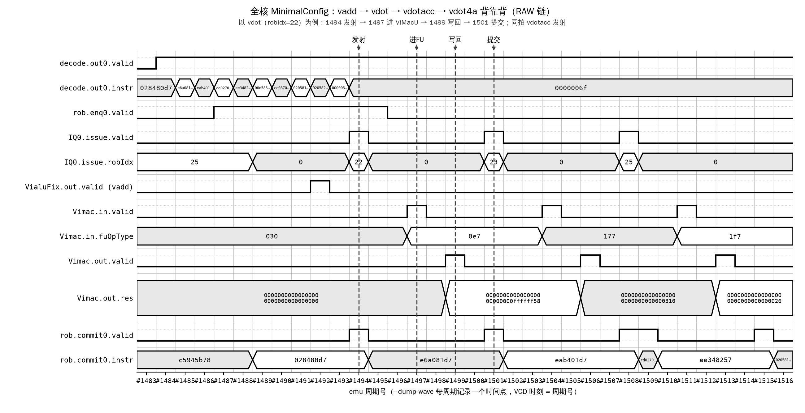
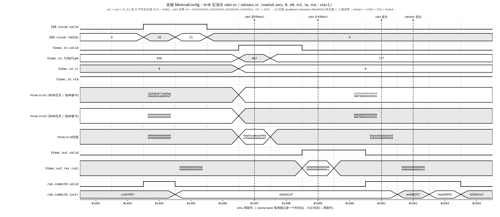

# 23 全核 difftest 验证报告（HANDOFF T1）

| 项 | 值 |
|---|---|
| 对应赛题 | **阶段三 3.1.2 NEMU 与 RTL 协同仿真**（全核层级，Level 2） |
| 对应计划 | `docs/_plan/HANDOFF_TODO.md` T1 |
| DUT | 香山昆明湖V2 全核 `MinimalConfig`，Verilator emu（带 difftest）。工作树 `work/XiangShan-fullcore` = `work/XiangShan-kmhv2`（`a4eeaab`）副本 + `rtl/patch/0001-xiangshan-vdot.patch` + `rtl/patch/0002-yunsuan-vdot.patch` |
| REF | `work/NEMU-fullcore`（`work/NEMU` 的私有副本，`9090839` + `nemu/patch/0001-add-vdot-instruction-family.patch`），`riscv64-xs-kmhv2-ref_defconfig` 构建的 `riscv64-nemu-interpreter-so` |
| 一键复现 | `scripts/50_run_fullcore_difftest.sh`（`build` / `run` / `wave` / `wave-vl8` / `fault`） |
| 测试程序 | `tests/riscv/fullcore/` |
| 日志 | `logs/stage3/fullcore/` |
| 执行环境 | Ubuntu 22.04 x86_64，128 核，约 1 TB 内存；Verilator 5.024；OpenJDK 17.0.20；clang++ 14；交叉 GCC 15.2（`/opt/riscv`） |

---

## 0. 结论速览

| 验收项（HANDOFF T1） | 结果 | 证据 |
|---|---|---|
| 全核 emu 构建（带 difftest） | **完成**。MinimalConfig，S-3' 语义修订后由脚本重建：`make emu` 墙钟 24:31.63（精化约 8:36 + verilate 约 14:02 + C++ 约 1:54），峰值 RSS 56445000 KiB（约 53.8 GiB） | `build_emu.log:2429,2434,2448`；分阶段时刻 `build_emu.log:21,2385,2409,2449` |
| 全部语料 0 mismatch | **完成**。30794 条（全部定向 + 3×10000 随机 + 55 条补充定向），其中 4834 条应 trap，6 批全部 HIT GOOD TRAP，difftest 失配 0 | `summary.log:1-9` |
| 背靠背依赖（Level 1 证明不了的部分） | **完成**。10 个依赖内核 × 4 个随机种子 × 200 次迭代 × (背靠背 + fence 隔离) = 16000 次内核调用，自洽比较 0 失败，difftest 失配 0，4 次均 HIT GOOD TRAP | `summary.log:10-37`；`dep0.log:9-22` |
| 异常投递与 mcause | **完成**。4834 条非法用例在全核上全部 trap 且 mcause=2；流水线中（前后有依赖指令）插入的非法 vdot/vdot4a/vstart≠0 每次恰好 trap 3 次（K8，`k8-trap-count-bad=0`）；REF 侧独立执行判定，CSR 每条提交比对 | `summary.log:8,12`；§2.2 |
| 故障注入 | **完成**。两种注入各 3/3 检出：① VIMacU 的 vdot 结果 bit0 翻转，3 个程序在**第一条** vdot 提交处被 difftest 中止（`v3_low` right/wrong 只差 bit0）；② 把 vdot / vdotacc 写回尾部退回旧裁定 S-3 的全 1（`s3old`），同样在第一条 vdot 处中止（`v3_low` / `v3_high` 高位失配）。源码还原后均与全核树逐字节一致 | `fault_summary.log:1-5`；`fault_summary_s3old.log:1-5` |
| 全核波形（译码 → ROB 提交） | **完成**。文本轨迹 + 时序图；VCD 382 MB 不入库 | `wave_trace.txt:155-192`；`wave_fullcore_vdot.png`（嵌入 §7 图 8） |
| vl=8 主演示（与官方伪代码逐位等价） | **完成**。`vsetivli zero, 8, e8, m1, ta, ma`（vta=1）下 vdot / vdotacc 只取元素 0..7，高 8 字节的无关值不参与；vd 旧值的元素 1..3（非零垃圾值）被清零；`vdot` 得 `0x00000000_00000000_00000000_000000cc`（Σi² = 204），`vdotacc` 得 `0x…000004b4`（1000 + 204）；程序内自检通过，HIT GOOD TRAP，difftest 失配 0 | `wave_vl8_run.log:32-34,45-56,59`；`wave_vl8_trace.txt:76-81`；§7.3 图 10 |
| Level 1 等价性论证是否成立 | **成立，且其 4 个缺口中的 G1–G4 已在全核上实测闭合**（§8） | §8 |
| 发现 RTL / NEMU 补丁缺陷 | **未发现**。全核 difftest 本身没有促成 `rtl/patch/`、`nemu/patch/` 的任何改动（两份补丁在 S-3' 语义修订中有改动，那是语义对齐，见提交 b16b58d，不是本报告发现的缺陷） | — |

一句话：**打了 vdot 补丁的昆明湖V2 全核与打了 vdot 补丁的 NEMU 在 24,524,262 条逐条提交比对（27,104,437 个周期）上 0 失配；vdot 指令族在乱序流水线中的发射、物理寄存器旁路、提交与异常投递均与 NEMU 一致。**

> **语义修订 S-3' 后已全部重跑**：`vdot.vv` / `vdotacc.vv` 在 `vstart < vl` 时 `vd[31:0]` 写结果、`vd[VLEN-1:32]` 恒为 0（与 vta/vma 无关），`vl = 0` 时 vd 不写；`vdot4a` 不变。修订理由与赛题官方伪代码的对照见 `docs/stage2/10` §1「赛题官方语义与逐行对照」。全核树、NEMU `.so`、emu 均按新补丁重建，本文所有数字均为重跑所得。

---

## 1. 为什么要做，以及与 Level 1 的关系

`docs/stage3/21_协同仿真验证报告.md` 的 Level 1 方案把全核 difftest 的 REF 侧（真实 NEMU `.so`）原样搬过来，DUT 换成「vdot 功能单元 `VDotTop` + 香山译码单元」。它能回答「一条 vdot 应该算出什么、该不该报非法」，但它自己在 §10.3、§11.2 中承认回答不了：

* **G1** 写回成形逻辑在 `VIMacU`（全核里真正挂进流水线的 FU）和 `VDotTop`（Level 1 的 DUT）里是两份代码，Level 1 只验了后者；
* **G2** 没有背靠背流量；
* **G3** `vcsr` / `mstatus.VS` 不比对；
* **G4** 异常只验到译码打标，没有经过 ROB 投递。

本报告用真正的全核 difftest（Level 2）逐条回答这四个问题，结论见 §8。

---

## 2. 方法

### 2.1 链路

```
tests/riscv/fullcore/*.bin ──┬──> XiangShan-fullcore/build/emu（DUT：全核 RTL，Verilator 16 线程）
                             │        每拍把提交信息、架构寄存器、CSR、访存事件经 DPI 交给 difftest
                             └──> NEMU-fullcore/ref/riscv64-nemu-interpreter-so（REF，dlopen）
                                      DUT 每提交一条，REF 执行一条，随后整体比对
```

命令行：`emu -i <镜像> --diff <ref .so>`（`scripts/50_run_fullcore_difftest.sh` 中 `run_emu()`）。

### 2.2 difftest 比了什么（源码依据）

| 比对项 | 依据 |
|---|---|
| 整数 / 浮点 / **向量**架构寄存器堆、**向量 CSR**（`vstart vxsat vxrm vcsr vl vtype vlenb`）、H 扩展 CSR、普通 CSR（含 `mstatus mcause mepc mtval`） | `work/XiangShan-fullcore/difftest/src/test/csrc/difftest/refproxy.cpp:185-230`（`RefProxy::compare`，逐块 `memcmp`）；本次构建生成的 `build/generated-src/difftest-state.h:181-189`（`DifftestVecCSRState`）、`:249-252`（`DifftestArchVecRegState`，64×u64 = 32 个 128 位寄存器） |
| CSR 失配的豁免规则 | `refproxy.cpp:320-337`：只在 `CPU_ROCKET_CHIP` 下对 `mtval/stval/mtvec/stvec` 豁免，香山不适用 |
| **异常**：DUT 报出非法指令异常时，REF 不是被强制陷入，而是 `ref_exec(1)` **自己执行**那条指令 | `difftest/src/test/csrc/difftest/checkers/traps.cpp:81-106`：只有页错误 / 硬件错误类（`EX_IPF…EX_HWE`）走 `force_raise_exception`，其余（含 cause=2）走 `proxy->ref_exec(1)` |

第三行是异常比对有效的关键：若 RTL 判非法而 NEMU 判合法（或反之），两边的 `pc` / `mcause` / `mepc` / `vd` 会立即分叉并被 `compare` 捕获。

### 2.3 工作树与 NEMU

* 全核树 `work/XiangShan-fullcore` 由 kmhv2 基线 `rsync`（排除 `out/ build/`）后 `git checkout -- .`，再 `git apply` 两份补丁（`scripts/50_run_fullcore_difftest.sh` 的 `make_tree()`）。没有应用 `tests/unit/yunsuan_vdot_testbench.patch`（只影响 yunsuan 的 L1 测试平台，与全核无关）。收尾时核对：`git apply --check --reverse` 两份补丁均通过，kmhv2 基线 `git status` 为空。
* NEMU 用私有副本 `work/NEMU-fullcore`（`rsync` 自 `work/NEMU`），避免改动共享 `.config`（陷阱清单第 3 条）。`.so` 拷到 `work/NEMU-fullcore/ref/`，与同一副本里后续构建的解释器形态互不覆盖。补丁状态由 `git apply --check --reverse nemu/patch/0001-*.patch` 确认（`run_driver.log` 中「vdot 补丁已处于已应用状态」）。

---

## 3. 配置选择与构建

### 3.1 为什么选 `MinimalConfig`，它对结论有什么影响

kunminghu-v2 提供 `MinimalConfig`（`work/XiangShan-fullcore/src/main/scala/top/Configs.scala:68`）。它也是上游 CI 构建 emu 的配置（`.github/workflows/emu.yml:89-92`）。与默认配置的差别：

| 项 | MinimalConfig | 默认（`Parameters.scala`） | 对 vdot 结论的影响 |
|---|---|---|---|
| 译码 / 重命名宽度 | 6 / 6（`Configs.scala:72-73`） | 6 / 6（`Parameters.scala:149-150`） | 无 |
| ROB | 48（`Configs.scala:91`） | 160（`Parameters.scala:178`） | 只影响在飞指令数上限 |
| 整数侧发射队列 | 10（`Configs.scala:98`） | 24（`Parameters.scala:181`） | 无（vdot 走向量发射队列） |
| **向量调度器** | `vfSchdParams` 写死 `numEntries = 16/16/10`，**不随 `IssueQueueSize` 变化**（`Parameters.scala:445-466`） | 同左 | **无：两种配置的向量发射队列、FU 分组完全相同** |
| 向量物理寄存器 | 160（`Configs.scala:106`） | 128（`Parameters.scala:194`） | 只影响重命名压力 |
| `VIMacU` 所在执行单元 | `VFEX0 = {Vfma, Vialu, Vimac, Vppu}`（`Parameters.scala:449`），全核唯一一个 Vimac | 同左 | 无 |
| VLEN | 128（`Parameters.scala:60`，MinimalConfig 不改） | 128 | 无 |
| Cache / TLB / L2 / L3 | 缩小 | — | vdot 不访存；依赖测试 K6 的访存路径只是尺寸不同 |

因此：**功能结论（0 失配、异常投递、旁路正确）对默认配置同样成立的理由是：vdot 经过的译码、向量调度、VIMacU、写回、ROB 提交逻辑在两种配置下是同一份参数化 RTL，参数也相同**；ROB / 物理寄存器数目不同只改变压力而不改变数据通路。默认配置与 `KunminghuV2Config`（CHI 总线）**未实际构建运行**，§6 的周期数只对 MinimalConfig 实测有效。

### 3.2 构建命令与资源

```bash
cd work/XiangShan-fullcore
make emu CONFIG=MinimalConfig EMU_THREADS=16 EMU_TRACE=1 JVM_XMX=200G \
         WITH_CHISELDB=0 WITH_CONSTANTIN=0 CXX=clang++ LINK=clang++ -j128
```

当前存档是 S-3' 语义修订后由 `bash scripts/50_run_fullcore_difftest.sh build` 重新生成全核树、重建私有 NEMU `.so`（`build_driver.log:20-27`）并完整重建 emu 的结果（`build_driver.log:29-32`，构建日志 `build_emu.log`）：

| 阶段 | 墙钟 | 证据 |
|---|---:|---|
| mill 精化 + firtool | 约 8:36（15:41:57 → 15:50:33） | `build_emu.log:21,2385` |
| Verilator 生成 C++ | 约 14:02（15:50:33 → 16:04:35） | `build_emu.log:2385,2409` |
| C++ 编译 + 链接（clang++，`-j128`） | 约 1:54（16:04:35 → 16:06:29） | `build_emu.log:2409,2449` |
| **`make emu` 合计** | **24:31.63**，`exit=0` | `build_emu.log:2429,2447-2448` |
| **峰值 RSS** | **56445000 KiB（约 53.8 GiB，约 57.8 GB）** | `build_emu.log:2434` |

说明：

* 分阶段耗时由日志中各阶段起点打印的时间戳相减得到，不是 GNU time 的分阶段统计；峰值 RSS 是 GNU time 对整个 `make emu` 进程树记录的最大单进程 RSS（字段 `Maximum resident set size (kbytes)`，单位为 KiB = 1024 字节）。这次日志没有分阶段的 RSS；首次构建的分阶段统计显示峰值出现在 Verilator 单线程前端（59157676 KiB），该记录见 git 历史（提交 19a29ea 中的 `logs/stage3/fullcore/build_time_breakdown.log:34,39`）。
* 这次构建期间，两棵故障注入树（§6）的 emu 构建同时进行（`build_emu_fault.log:1`、`build_emu_fault_s3old.log:1` 的起始时刻分别为 15:43:32、15:43:54），三份构建共享 128 核，耗时偏保守；两棵注入树各自为 27:34.11 / 27:18.77，峰值 RSS 56596284 / 56621028 KiB（`build_emu_fault.log:2429,2434`、`build_emu_fault_s3old.log:2426,2431`）。
* 脚本自身的墙钟为 24m45s（`build_driver.log:40`），但该次脚本以 `exit=2` 结束（`build_driver.log:33,43`）：emu 已构建完成（`build_emu.log:2448` `exit=0`，`build_driver.log:32` 已列出 emu）之后，构建进行中脚本文件被就地改写（加入 `FAULT_KIND` 选项），bash 读到改写后的文件尾部报 `unexpected EOF`。日志中已附说明并在不改动任何东西的前提下重跑一次 `build` 模式，确认补丁状态、`.so` 与 emu 均已就绪、`exit=0`（`build_driver.log:45-65`）。构建产物不受影响：本 emu 正是 §5 各次运行使用的 emu（`corpus_b00.log:42` `emu compiled at Oct 26 2026, 16:04:36`）。

原机器 16 GB 内存做不了的根本原因由此量化：构建峰值 RSS 约 53.8 GiB（首次构建中 Verilator 前端约 56.4 GiB），远超 16 GB。

### 3.3 首次构建中真实遇到的两次失败（如实记录）

以下发生在首次构建（S-3' 之前）。当时的 g++/clang 排查日志在 S-3' 重建时已从工作区删除（它们不再对应当前树），记录保留在 git 历史中（提交 19a29ea），下文行号均指该提交中的文件，可用 `git show 19a29ea:<路径>` 查看。

1. **g++ 不认识 clang 专有选项**。difftest 子模块（`3729300`）把 `OPT_FAST ?= -O3 -fno-slp-vectorize` 写死（`work/XiangShan-fullcore/difftest/verilator.mk:76`，当前树仍然如此），该选项只有 clang 认识；Verilator 默认用 g++，于是 C++ 阶段立即失败：19a29ea 的 `logs/stage3/fullcore/build_emu.log:2421-2423`（`g++: error: unrecognized command-line option '-fno-slp-vectorize'`）、`:2484` `exit=2`。
2. **g++ 编译超大单函数极慢**。改用 GCC 等价选项 `-fno-tree-slp-vectorize` 重编（19a29ea 的 `build_emu_2.log:3`）后，Verilator 生成的 `VSimTop___024root__DepSet_hd5918264__2.cpp`（15.9 MB，几乎全是一个函数 `nba_sequent__TOP__22`）在 g++ 11.4 `-O3` 下编译 85 分钟仍未结束。同一文件用 `clang++ -O3 -fno-slp-vectorize` 单独编译只需 1 分 48 秒，于是人工终止（同文件 `:38-61`），改用 clang++ 重编全部目标文件，1 分 42 秒完成（19a29ea 的 `build_emu_3.log:38,57`）。

S-3' 重建直接使用 clang++（`build_emu.log:19` 的 `CXX=clang++ LINK=clang++`），一次通过。

两者都是环境问题（编译器选择），与 vdot 无关。一键脚本已固化为默认使用 clang++，缺少 clang++ 时退回 g++ 并告警（`scripts/50_run_fullcore_difftest.sh` 的 `build_emu_in()`）。

---

## 4. 测试程序

全部在 `tests/riscv/fullcore/`，用交叉 GCC 15.2 编译，链接地址 `0x80000000`，串口用香山 SoC 的 UARTLite `0x40600000`（`work/XiangShan-fullcore/src/main/scala/system/SoC.scala:163`），以 `nemu_trap`（`0x0000006b`，`a0` = 失败条数）结束。

### 4.1 语料批次（复用 P5 一致性测试程序，不做修改）

* 程序：`tests/riscv/vdot/start.S`、`vdot_test.c`、`corpus.S` **原样复用**，只是 `nemu_config.h` 改由 `tests/riscv/fullcore/Makefile` 按香山 SoC 地址生成。程序自带 M 态 trap handler，对每条用例检查「该 trap 的是否 trap、mcause 是否为 2、vd 是否不变」（`tests/riscv/vdot/vdot_test.c:272-284`），并逐字节比对 vd 与语料期望值。
* 语料：`tests/vectors/*.txt`（13 个 suite）+ `tests/riscv/vdot/extra_vectors/vstart_range.txt`，由 `pack_corpus.py` 打包成 30794 条（`fault_driver.log:26`，打包输出与 `run` 模式相同），`slice_corpus.py` 切成 6 批（每批 5133 条，末批 5129 条，`run_driver.log:12-17`）在 6 个 emu 进程上并行运行。
* 规模：全部定向用例（正数 / 负数 / 边界 × 3 条指令、`vstart_relaxed` 130 条按 STRICT 语义重标为必须 trap、补充定向 55 条）+ 每条指令 10000 条随机，共 30794 条（S-3' 修订时 vdot 与 vdotacc 的正数 / 负数 / 边界共 6 个 suite 各补 6 条 vl=8 定向用例，30758 → 30794，见 `corpus_b00.log:22-27`）；其中 4834 条必须 trap（SEW 不符、`vstart≠0`）。
* 这是**双重判定**：程序自身对照参考模型期望值；difftest 同时把每条提交与 NEMU 比对。

### 4.2 背靠背依赖测试（Level 1 证明不了的部分）

`vdot_dep.c` + `vdot_dep_kernels.S`。每个内核以宏写一次，实例化成两个函数：

* `kN_fast`：指令背靠背，依赖全部落在乱序流水线内部；
* `kN_slow`：同一序列，相邻指令间插 `fence`（`vdot_dep_kernels.S:38-42`）。昆明湖V2 的 `FENCE` 译码为 `noSpec + blockBack + flushPipe`（`work/XiangShan-fullcore/src/main/scala/xiangshan/backend/decode/DecodeUnit.scala:231`）：等所有更老指令提交后才执行、并冲刷流水线，使每条消费者只能读到已提交的架构状态。

驱动对同一份随机输入（32 个向量寄存器 + 64 B 访存缓冲；随机 AVL，SEW=8 取 0..17、SEW=32 取 0..5，四分之一迭代非满 vl；随机 vta/vma；偶尔放入全 0x80 / 全 0x7f 寄存器）各跑一次，逐字节比较 32 个向量寄存器与 4 个标量结果（`vdot_dep.c:119-125`）。fast/slow 不一致即流水线内的旁路、唤醒或重命名有错，与 NEMU 无关；两者一致但与 NEMU 不同则 difftest 当场中止。

| 内核 | 覆盖的依赖 | 源码 |
|---|---|---|
| K1 | `vadd`/`vsub` → vdot 的 vs1、vs2（RAW），vdot → `vmv.x.s` → 整数 `add`（跨域） | `vdot_dep_kernels.S:96` |
| K2 | vdot → vdotacc ×3 对同一 vd（v3）累加；之后 `VDOTACC 4,3,3`（vs2=vs1=上一条结果 v3，vd=v4）与 `VDOTACC 4,4,3`（vd=vs2=v4，vs1=v3） | `:112`（末两条见 `:122,124`） |
| K3 | vdot（e8）→ `vsetvl` → e32 的 `vadd` / vdot4a（vs2、vd 都是前序结果）/ `vredsum`（vs1 种子） | `:129` |
| K4 | `vmul` → vdot4a 累加 → vdot4a（vs1=vd）→ `vmslt` 生成 v0 → 带掩码 vdot4a → `vadd` | `:145` |
| K5 | `vmslt` → 带掩码 vdot（v0 RAW）→ 用 vdot 结果 `vmsne` 生成掩码 → 带掩码 vdotacc | `:162` |
| K6 | `vle8` → vdot → `vse32` → `vle32` → vdotacc（经访存的依赖），再 `ld` 回读 | `:176` |
| K7 | WAR / WAW：vdot 后立即覆写其源寄存器，结果寄存器被连续写 | `:197` |
| K8 | 流水线中的异常投递：合法 vdot 之后紧跟 SEW=32 的 vdot、SEW=8 的 vdot4a、`vstart=1` 的 vdotacc（各一次非法），trap 返回后继续消费前序结果；要求每次恰好 trap 3 次、mcause 之和 = 6（`vdot_dep.c:121-125`） | `:216` |
| K9 | 8 条互相独立的 vdot 同时在发射队列中，再收拢为两条 vdotacc 链，SEW=32 下 vdot4a 读归约结果 | `:244` |
| K10 | 16 次迭代的 vdotacc 累加循环；循环出口分支预测失败冲刷投机发射的 vdotacc | `:273` |

每个种子 10 内核 × 200 迭代 × 2 版本 = 4000 次内核调用；按内核源码静态计数，每次迭代（fast+slow）执行 152 条 vdot 族指令（其中 6 条为必须 trap 的非法指令），4 个种子合计约 12.2 万条 vdot 族动态指令。

### 4.3 波形程序

`vdot_wave.S`：`vadd.vv v1` → `vdot.vv v3, v10, v1` → `vdotacc.vv v3, v11, v8` → `vsetivli e32` → `vdot4a.vv v4, v3, v9`，一条 RAW 链，期望值写在文件头注释里（`vdot_wave.S:10-15`，按 S-3' 给出，并注明原裁定 S-3 下的旧值）。该程序取 `vl = 16`（满寄存器），是「流水线时序」演示。

`vdot_wave_vl8.S`：`vl = 8` 的主演示，与赛题官方伪代码 `for i in range(8)` 逐位等价，程序内自检，见 §7.3。

---

## 5. 结果

### 5.1 语料（`logs/stage3/fullcore/summary.log:1-9`）

```
batch     cases     pass   fail  must-trap   trapped-ok  emu
b00        5133     5133      0        809          809  HIT_GOOD_TRAP
b01        5133     5133      0        787          787  HIT_GOOD_TRAP
b02        5133     5133      0        761          761  HIT_GOOD_TRAP
b03        5133     5133      0        862          862  HIT_GOOD_TRAP
b04        5133     5133      0        774          774  HIT_GOOD_TRAP
b05        5129     5129      0        841          841  HIT_GOOD_TRAP
CORPUS TOTAL cases=30794 pass=30794 fail=0 must-trap=4834 trapped-mcause2=4834 batches=6 hit-good-trap=6/6
difftest 失配报告行数（'different at' / 'ABORT'）：0
```

单批明细见 `corpus_b00.log:19-41`（分 suite 表，与 P5 在 NEMU 上的结果口径相同），`corpus_b00.log:50-51` 为 `HIT GOOD TRAP` 与 `instrCnt = 1033683, cycleCnt = 1492000`。每批约 103 万条提交、149–151 万周期（各批 `corpus_b0[0-5].log:51`），6 批合计 6,191,702 条提交、9,000,638 个周期。本次 6 批与依赖测试的第一个种子同时运行（`run_driver.log:36`），每批 emu 墙钟 1283–1314 s（各批 `corpus_b0[0-5].log:55`，约 1.15 k 周期/秒）；`run` 模式总墙钟 60m33s（`run_driver.log:76`）。

### 5.2 依赖测试（`summary.log:10-37`）

4 个种子全部 `DEP TOTAL runs=2000x2 fail=0 k8-trap-count-bad=0`、`RESULT: PASS`、`HIT GOOD TRAP`；每次约 458 万条提交、452–454 万周期（IPC≈1.01，`dep[0-3].log:32`），4 个种子合计 18,332,560 条提交、18,103,799 个周期。分内核明细见 `dep0.log:9-22`。

### 5.3 异常投递与 mcause

* 语料中 4834 条必须 trap 的用例在全核上**全部 trap 且 mcause=2**，vd 保持不变（`summary.log:8`；单批 `corpus_b00.log:38-39`）。由于 REF 侧对非法指令是独立执行判定（§2.2，`traps.cpp:81-106`），且 `mcause/mepc/mtval/mstatus` 每条提交都比对，这同时证明 RTL 与 NEMU 对每一条非法用例的判定、`mepc`、`mtval` 一致——否则 difftest 会在该条中止。
* K8 在流水线中前后都有依赖指令的情况下注入 3 种非法 vdot 族指令，16000 次内核调用中每次恰好 trap 3 次（`k8-trap-count-bad=0`）。
* `vstart` 归零、`vl/vtype` 与 `mstatus.VS` 置脏：`vcsr` 与 `mstatus` 每条提交比对（§2.2），全程无失配。

### 5.4 汇总

| 项 | 数值 |
|---|---|
| 逐条比对的提交指令 | 24,524,262（6 批语料 6,191,702 + 4 个依赖种子 18,332,560，各次 `instrCnt` 之和：`corpus_b0[0-5].log:51`、`dep[0-3].log:32`） |
| 仿真周期 | 27,104,437（9,000,638 + 18,103,799，同上各行的 `cycleCnt` 之和） |
| difftest 失配 | 0 |
| HIT GOOD TRAP | 10 / 10 次运行 |

---

## 6. 故障注入（`logs/stage3/fullcore/fault_*`）

`bash scripts/50_run_fullcore_difftest.sh fault` 支持两种注入（`FAULT_KIND`，`scripts/50_run_fullcore_difftest.sh:384-401`），各自在独立的全核副本中改源码、重建 emu，再跑同样 3 个程序，结束时把源码改回并 `cmp` 核对与全核树逐字节一致。两种注入均在 S-3' 重建后执行（`fault_driver.log:46`、`fault_driver_s3old.log:31`）。

### 6.1 结果总线 bit0 翻转（`FAULT_KIND=bit0`，默认）

在独立副本 `work/XiangShan-fullcore-fault` 中修改 `src/main/scala/xiangshan/backend/fu/wrapper/VIMacU.scala:181`（`fault_diff.txt:1-4`）：

```scala
-  private val dotVd = vdotTree.io.dotVd
+  private val dotVd = vdotTree.io.dotVd ^ 1.U  // FAULT-INJECTION T1-F1: flip bit0 of the vdot result
```

这是三条 vdot 指令共用的结果总线（归约写回 `redVd` 与 vdot4a 走 `Mgu` 的两条路径都取自它），即「改坏数据通路一位」。该树重新精化后生成的 `work/XiangShan-fullcore-fault/build/rtl/VIMacU.sv` 中可见两处翻转：vdot4a 送 `Mgu` 的 `{_vdotTree_io_dotVd[127:1], ~(_vdotTree_io_dotVd[0])}`（`:547`）与归约写回的 `{96'h0, _vdotTree_io_dotVd[31:1], ~(_vdotTree_io_dotVd[0])}`（`:621`）。该文件是构建产物，不入库。

| 程序 | 结果 | 首个失配 | 被中止的提交 |
|---|---|---|---|
| `vdot_wave.bin` | **检出** | `v3_low right = 0x00000000ffffff58, wrong = 0x00000000ffffff59`（`fault_wave.log:178-179`） | 第一条 vdot `e6a081d7` @ `0x80000042`（`fault_wave.log:54`） |
| `dep0/vdot_dep.bin` | **检出** | `right = 0x0000000000000468, wrong = …469`（`fault_summary.log:2`） | K1 的 vdot `e62081d7`（`fault_dep.log:67`） |
| `b00/vdot_test.bin` | **检出** | `right = 0x00000000000005d8, wrong = …5d9`（`fault_summary.log:3`） | 语料第一条 vdot `e62081d7` @ `0x8000092a` 所在提交组（`fault_corpus_b00.log:76-77`） |

`FAULT-INJECTION (bit0): 3 / 3 个程序检出`；随后源码改回，`cmp` 确认与全核树逐字节一致（`fault_summary.log:4-5`）。三处失配的 right/wrong 都**只差 bit0**，说明 difftest 比的确实是 VIMacU 写回的 vd，且粒度到位。三处 right 值的 `v3_low` 高 32 位都是 0，这正是 S-3' 下 REF（NEMU）给出的 `vd[63:32]`。

### 6.2 写回尾部退回旧语义（`FAULT_KIND=s3old`）

为了证明全核 difftest 能区分新旧两种语义（而不只是能发现任意一位错误），第二种注入在独立副本 `work/XiangShan-fullcore-fault-s3old` 中把 vdot / vdotacc 的写回尾部从 S-3' 的「恒为 0」改回旧裁定 S-3 的「全 1」（`fault_diff_s3old.txt:1-4`，`VIMacU.scala:193`）：

```scala
-                      Cat(0.U((VLEN - 32).W), dotVd(31, 0)))              // 裁定 S-3'
+                      Cat(~0.U((VLEN - 32).W), dotVd(31, 0)))             // FAULT-INJECTION T1-F2: tail back to old S-3 (all ones)
```

生成的 `work/XiangShan-fullcore-fault-s3old/build/rtl/VIMacU.sv:621` 为 `{96'hFFFFFFFFFFFFFFFFFFFFFFFF, _vdotTree_io_dotVd[31:0]}`（对照全核树 `work/XiangShan-fullcore/build/rtl/VIMacU.sv:621` 的 `{96'h0, _vdotTree_io_dotVd[31:0]}`）。注入是无条件写全 1，对应的是旧 S-3 在 `vta=1` 时的行为（旧 S-3 在 `vta=0` 时保持尾部不变，这里没有再现那一支）；结果低 32 位不受影响。

| 程序 | 结果 | 首个失配 | 被中止的提交 |
|---|---|---|---|
| `vdot_wave.bin` | **检出** | `v3_low right = 0x00000000ffffff58, wrong = 0xffffffffffffff58`；`v3_high right = 0x0000000000000000, wrong = 0xffffffffffffffff`（`fault_wave_s3old.log:178-179`） | 第一条 vdot `e6a081d7` @ `0x80000042`（`fault_wave_s3old.log:54`） |
| `dep0/vdot_dep.bin` | **检出** | `v3_low wrong = 0xffffffff00000468`，`v3_high wrong = 0xffffffffffffffff`（`fault_dep_s3old.log:191-192`） | K1 的 vdot `e62081d7`（`fault_dep_s3old.log:67`） |
| `b00/vdot_test.bin` | **检出** | `v3_low wrong = 0xffffffff000005d8`，`v3_high wrong = 0xffffffffffffffff`（`fault_corpus_b00_s3old.log:201-202`） | 语料第一条 vdot `e62081d7` @ `0x8000092a` 所在提交组（`fault_corpus_b00_s3old.log:76-77`） |

`FAULT-INJECTION (s3old): 3 / 3 个程序检出`，源码还原后与全核树逐字节一致（`fault_summary_s3old.log:1-5`；驱动日志 `fault_driver_s3old.log:31-46`）。三处失配都是**结果值（低 32 位）完全正确、只有 `vd[127:32]` 不同**：right（NEMU，S-3'）为 0，wrong（注入后的 RTL）为全 1。这说明：

* 全核 difftest 对 vd 的比对覆盖整个 128 位寄存器（`v3_low` 与 `v3_high` 两块都比），不只看元素 0；
* RTL 若仍按旧语义写尾部，会在**第一条** vdot 提交时就被 REF 拦下；反过来，§5 的 0 失配说明当前 RTL 与 NEMU 在 `vd[127:32]` 上确实都按 S-3' 清零，二者没有「同时停留在旧语义」的可能（REF 侧语义另有 `logs/stage3/p5_vdot_tests.log` 的 30794 条语料独立核对）。

### 6.3 判读说明

注：difftest 报告里 `different at pc = …` 打印的 pc 不是出错 vdot 的地址，出错提交要看提交轨迹。轨迹中的 `<--` 标在出错**提交组**的最后一条指令上，而不一定是 vdot 本身：`vdot_wave.bin` 与 `dep0` 的出错提交组只有 1 条（`cmtcnt 1`，`fault_wave.log:29`、`fault_dep.log:33`），`<--` 正好落在 vdot 上（`fault_wave.log:54`、`fault_dep.log:67`）；`b00` 的出错提交组有 2 条（`fault_corpus_b00.log:43` 的 `cmtcnt 2`），`<--` 落在同组第二条 `j` 指令上（`:77`），vdot `e62081d7` 是同组第一条（`:76`）。`s3old` 各日志的对应行号与此相同（`fault_wave_s3old.log:29,54`、`fault_dep_s3old.log:33,67`、`fault_corpus_b00_s3old.log:43,76-77`）。上两表最后一列按此判读。注入版 emu 留在 `work/XiangShan-fullcore-fault/build/` 与 `work/XiangShan-fullcore-fault-s3old/build/`（源码已还原，二进制保留以便复查）；两棵树的 emu 构建日志为 `build_emu_fault.log`、`build_emu_fault_s3old.log`。

---

## 7. 全核波形：vdot 从译码到 ROB 提交

### 7.1 抓取方式

```
emu -i vdot_wave.bin --diff <ref .so> --dump-wave -b 0 -e 2000 --wave-path work/build/fullcore/wave/vdot_wave.vcd
```

emu 在 `--dump-wave`（不加 `--dump-wave-full`）下每个周期只写一个时间点，VCD 时刻即周期号。整核 1594 个周期的 VCD 为 382 MB（`wave_dump.log:19`），**不入库**；入库的是：

* `logs/stage3/fullcore/wave_trace.txt`：`tests/riscv/fullcore/wave_trace.py` 从 VCD 抽取 162 个信号（译码、重命名、ROB 入队、向量发射队列入/出、VialuFix 与 Vimac 的输入输出、ROB 提交）后得到的事件轨迹；
* `logs/stage3/fullcore/wave_fullcore_vdot.png`：用 `scripts/tools/vcd_plot.py` 从同一 VCD 渲染的 13 路信号时序图（周期 1483–1516），文档内嵌的图 8 是它的逐字节副本 `docs/stage3/figures/fig8_fullcore_vdot_wave.png`；  图 8　全核时序图（周期 1483–1516；`vl = 16` 的满寄存器版本，16 项求和，与官方伪代码逐位等价的 `vl = 8` 主演示见 §7.3 图 10）。四条竖线标出 vdot（robIdx=22）的发射 1494、进 VIMacU 1497、写回 1499、提交 1501；`Vimac.in.valid` → `Vimac.out.valid` 三次都是 2 拍。图由 `scripts/50_run_fullcore_difftest.sh` 的 `run_wave()` 函数在抓完 VCD 后渲染；S-3' 重建后已重新抓取并重画（`wave_driver.log:23-27`），图 8 与 `wave_fullcore_vdot.png` 逐字节相同。VCD 不入库，但只要 `work/build/fullcore/wave/vdot_wave.vcd` 还在，就可以只重画图、不重跑仿真：在 `PYTHON` 带 matplotlib 的环境中执行 `run_wave()` 里那条 `vcd_plot.py` 命令（`--vcd` 指向上述 VCD，`--from 1483 --to 1516`，13 个 `--signal` 原样照抄）。
* `logs/stage3/fullcore/wave_run.log`：同一程序带 `--dump-commit-trace` 的逐条提交记录，`wave_run.log:34,35,37` 是三条 vdot 族指令的提交，`:46` 为 `HIT GOOD TRAP`。

### 7.2 关键信号与时刻（`wave_trace.txt:155-192`）

层次前缀 `TOP.SimTop.cpu.l_soc.core_with_l2.core.backend.` 省略。表中时刻取自第二次译码。轨迹里 vadd、vdot 在 1424、1459 已经各有一次译码输出（`wave_trace.txt:15,127`），但都停在重命名输入（`:19-148`），从未入 ROB（轨迹中第一条 `ROB-ENQ` 在 1487，`:168`）；1470–1482 没有事件，1483 起整组重新进入译码（`:150-153`）。这与紧挨在 vadd 之前的 `fence`（提交记录 `wave_run.log:32`）的语义一致：昆明湖V2 把 `FENCE` 译码为 `noSpec + blockBack + flushPipe`（`DecodeUnit.scala:231`，见 §4.2），更年轻的指令要等它提交，提交后流水线被冲刷、从下一条重新取指。轨迹没有抽取冲刷信号本身，所以「被 fence 冲刷」是由上述现象和源码语义推断的。`IQ0` = `inner_vfScheduler.IssueQueueVfmaVialuFixVimacVppuVfaluVfcvtVipuVsetrvfwvf`（含 Vimac 的那个向量发射队列）。

| 周期 | 阶段（信号） | vadd.vv v1 | vdot.vv v3,v10,v1 | vdotacc.vv v3,v11,v8 | vdot4a.vv v4,v3,v9 |
|---:|---|---|---|---|---|
| 1484–1488 | 译码输出 `inner_ctrlBlock.decode.io_out_0_*` | 1484 | 1485，`fuType=0x200000 fuOpType=0xe7 illegalInstr=0` | 1486，`fuOpType=0x177` | 1488，`fuOpType=0x1f7` |
| | 重命名输入 `inner_ctrlBlock.rename.io_in_0_*` | 1485 | 1486 | 1487 | 1489 |
| | 进发射队列 `IQ*.io_enq_0_*` | 1486（IQ1） | 1487（IQ0） | 1488（IQ0） | 1490（IQ0） |
| | 入 ROB `inner_ctrlBlock.rob.io_enq_req_0_*` | 1487 | 1488 | 1489 | 1491 |
| | 出发射队列 `IQ*.io_deqDelay_0_*`（物理源 rf0/rf1/rf2） | 1488，pdest=59 | **1494**，robIdx=22，pdest=60，psrc=(**59**,52,56) | **1501**，robIdx=23，pdest=61，psrc=(48,54,**60**) | **1508**，robIdx=25，pdest=62，psrc=(50,**61**,58) |
| | FU 输入 `exus_2.VialuFix.io_in_*` / `exus.Vimac.io_in_*` | 1491 | **1497**，vsew=0，`src0(vs1)=1211…0403`（= vadd 结果） | **1504**，`src2(oldVd)=…ffffff58`（= vdot 结果） | **1511**，vsew=2，`src1(vs2)=…00000310`（= vdotacc 结果） |
| | FU 输出 `…io_out_*`（`res_data`） | 1492，`1211100f…0403` | **1499**，`00000000 00000000 00000000 ffffff58` | **1506**，`00000000 00000000 00000000 00000310` | **1513**，`00000000 00000000 00000000 00000026` |
| | ROB 提交 `inner_ctrlBlock.rob.io_commits_*` | 1494 | **1501** | **1508** | **1515** |

读法：

1. **RAW 旁路走的是物理寄存器号**：vadd 的 `pdest=59` 出现在 vdot 的 `psrc rf0`（vs1），vdot 的 `pdest=60` 出现在 vdotacc 的 `rf2`（旧 vd / 累加源），vdotacc 的 `pdest=61` 出现在 vdot4a 的 `rf1`（vs2）。三条消费者进入 VIMacU 时读到的源值正是生产者在 FU 输出端产生的值（`wave_trace.txt:179→182`，`183→186`，`187→190`）。
2. **结果值与手算一致**：vdot = −(3+…+18) = −168 = `0xffffff58`；vdotacc 加上 −128×64 + 127×72 = 952 得 `0x310`；vdot4a 第 0 lane (0x10+0x03)×2 = 38 = `0x26`。按 S-3'，vdot / vdotacc 的 `vd[127:32]` 为 0（虽然这里 `vta=1`，`wave_trace.txt:182,186`），因此 vdot4a 读到的 vs2 元素 1..3 为 0、其余 lane 结果为 0（`wave_trace.txt:183,187,191`；原裁定 S-3 下这三个 lane 为全 1 参与累加，得 `0xfffffff8`，见 `vdot_wave.S:15`）。语义修订只改变了数值，各级时刻与 S-3 时完全相同。
3. **VIMacU 的 latency=2 在全核中得到确认**：Vimac `io_in_valid` 到 `io_out_valid` 恰为 2 拍（1497→1499、1504→1506、1511→1513），这是在真实流水线中、由 `VIMacU` 内部 `ctrlPipe/dataPipe` 驱动的结果，不再是 L1 平台的常量计数器（陷阱第 6 条）。
4. **发射 → FU 输入固定 3 拍**（1494→1497 等，对应读物理寄存器堆的 OG0/OG1 两级）；**FU 输出 → 依赖者发射 2 拍**（1499→1501）。因此在 MinimalConfig 下，**相互依赖的两条 vdot 族指令的发射间隔是 7 拍**（1494→1501→1508）。这是本波形的实测，样本为一条依赖链，见 §9 第 3 条的讨论。

### 7.3 vl=8 主演示（与官方伪代码逐位等价）

§7.1–§7.2 的程序取 `vl = 16`，求的是 16 项和。赛题官方伪代码（`docs/_recon/figures/vdot_official_semantics.jpg`）写死 `for i in range(8)`，取 8 个 int8 求和写入 `vd[0]`、其余清零。本项目对元素 `0..vl-1` 求和，`vl = 8` 时与伪代码逐位等价（`docs/stage2/10` §1）。答辩与录屏以本节的 `vl = 8` 用例为主演示，§7.2 作为满寄存器版本的补充。

**程序**：`tests/riscv/fullcore/vdot_wave_vl8.S`（构建目标 `make wave-vl8`，运行 `bash scripts/50_run_fullcore_difftest.sh wave-vl8`）。

```
vsetivli zero, 8, e8, m1, ta, ma     # vl = 8，vta = 1
vdot.vv    v3, v9, v8                # vs1 = v8，vs2 = v9
vdotacc.vv v4, v9, v8
```

| 寄存器 | 字节 0..7（参与求和） | 字节 8..15（无关值，不参与） | 说明 |
|---|---|---|---|
| `v8`（vs1） | 1, 2, 3, 4, 5, 6, 7, 8 | `0x7f` × 8（+127） | |
| `v9`（vs2） | 1, 2, 3, 4, 5, 6, 7, 8 | `0x80` × 8（−128） | |
| `v3`（vdot 的 vd 旧值） | u32 `{0xdeadbeef, 0xcafebabe, 0x8badf00d, 0xfeedface}` | | 元素 0..3 全是非零垃圾值 |
| `v4`（vdotacc 的 vd 旧值） | u32 `{0x000003e8 (=1000), 0x5a5a5a5a, 0xa5a5a5a5, 0x0badc0de}` | | 元素 0 为累加初值 |

**手算（按官方伪代码）**（`vdot_wave_vl8.S:18-27`）：

* `result = Σ_{i=0..7} vs1[i]·vs2[i] = 1 + 4 + 9 + 16 + 25 + 36 + 49 + 64 = 204 = 0xcc`；
* `vdot.vv`：`vd[0] = 0xcc`，`vd[1..3] = 0` → `v3 = 0x00000000_00000000_00000000_000000cc`；
* `vdotacc.vv`（本项目扩展，伪代码未涉及；初值取 `vd.u32[0]`）：`1000 + 204 = 1204 = 0x4b4` → `v4 = 0x00000000_00000000_00000000_000004b4`；
* 对照：若把 16 个元素都加进来，结果是 `204 + 8×127×(−128) = −129844 = 0xfffe04cc`，与 `0xcc` 截然不同；
* `vta = 1` 不影响清零：按 S-3'，vdot / vdotacc 的 `vd[127:32]` 恒为 0。

**程序内自检**（`vdot_wave_vl8.S:70-90`）：`csrr vl` 必须为 8，两个结果寄存器存回内存后逐个 64 位与上面的期望值比较，全部一致才 `a0 = 0`（HIT GOOD TRAP），否则以出错项编号作为 `a0` 进入 BAD TRAP。

**运行结果**（S-3' 补丁构建的同一个全核 emu，带 difftest）：

* `logs/stage3/fullcore/wave_vl8_run.log:32-33`：`vdot.vv`（`e69401d7`）与 `vdotacc.vv`（`ea940257`）提交；`:34` `csrr s1, vl` 读回 8；`:45,49,52,56` 自检的 `ld` 读回 `0xcc`、`0`、`0x4b4`、`0`；`:59` `HIT GOOD TRAP`，`:60` `instrCnt = 49, cycleCnt = 1585`；`:64` `emu-exit=0`。日志中 `different at` / `ABORT` 0 行，即 difftest 0 失配（每条提交都与 NEMU 比对了整个向量寄存器堆与 `vl`/`vtype`）。
* 抓波形的第二次运行同样 HIT GOOD TRAP（`wave_vl8_dump.log:13`），VCD 约 382 MB，不入库（`work/build/fullcore/wave_vl8/vdot_wave_vl8.vcd`，`wave_vl8_driver.log:5`）。

**文本轨迹**（`logs/stage3/fullcore/wave_vl8_trace.txt`）：

| 行 | 周期 | 事件 | 内容 |
|---:|---:|---|---|
| 64–65 | 1486–1487 | 译码输出 | vdot `fuOpType=0xe7`、vdotacc `fuOpType=0x177`，`illegalInstr=0` |
| 69, 71 | 1489–1490 | 入 ROB | pc `0x8000003a` / `0x8000003e` |
| 72, 74 | 1494–1495 | IQ0 发射 | robIdx 20 / 21，pdest 55 / 56 |
| 76 | 1497 | vdot 进 VIMacU | `vsew=0 vta=1`，`src0(vs1)=7f7f7f7f7f7f7f7f_0807060504030201`，`src1(vs2)=8080808080808080_0807060504030201`，`src2(oldVd)=feedface8badf00dcafebabedeadbeef` |
| 77 | 1498 | vdotacc 进 VIMacU | 同样的 vs1 / vs2，`src2(oldVd)=0badc0dea5a5a5a55a5a5a5a000003e8` |
| 78 | 1499 | vdot 出 VIMacU | `res=000000000000000000000000000000cc` 即 `0x00000000_00000000_00000000_000000cc` |
| 79 | 1500 | vdotacc 出 VIMacU | `res=0x00000000_00000000_00000000_000004b4` |
| 80–81 | 1501–1502 | ROB 提交 | vdot、vdotacc |

读法：VIMacU 输入端能直接看到高 8 字节的无关值（`7f…` / `80…`）和 vd 旧值的垃圾元素，输出端只剩低 32 位的 8 项和，高 96 位为 0；两条指令都是进 FU 后 2 拍出结果（1497→1499、1498→1500），与 §7.2 第 3 条一致。两条指令互不依赖，所以背靠背一拍一条发射。



图 10　全核时序图（周期 1492–1504，`docs/stage3/figures/fig10_fullcore_vdot_vl8_wave.png`）。自上而下：IQ0 发射（robIdx 20 / 21）、Vimac 输入（`valid`、`fuOpType` 0e7 / 177、`vl = 8`、`vta = 1`、vs1 / vs2 分两行显示高 64 位与低 64 位：高 8 字节为无关值，低 8 字节为参与求和的 1..8、vd 旧值）、Vimac 输出（`res` = `…000000cc` / `…000004b4`）、ROB 提交。四条竖线：vdot 进 VIMacU 1497、出 VIMacU 1499、vdot 提交 1501、vdotacc 提交 1502。图由 `run_wave_vl8()` 在抓完 VCD 后直接渲染，窗口与竖线时刻从文本轨迹中取（`wave_vl8_driver.log:13`）。

---

## 8. Level 1 等价性论证是否成立

`21` §11.1 的论证有五步：REF 相同、比对对象就是 `vd`、算术通路同一份 RTL、译码判定同一份 RTL、比对链路有效。全核 difftest 的结果对它的检验如下：

| Level 1 的论断 / 缺口 | 全核实测 | 结论 |
|---|---|---|
| 「一条 vdot 应该算出什么」两层结论一致 | 同一份 30794 条语料（S-3' 修订后），Level 1（`VDotTop`）与全核（`VIMacU`）都是 0 失配 | **成立** |
| **G1** 写回成形在 `VIMacU` 与 `VDotTop` 是两份代码，Level 1 只验了后者 | 全核里挂进流水线的是 `VIMacU`（波形 `exus.Vimac.*`）；全部 vl / vm / vta / vma 组合（含 vl=0、AVL>VLMAX）0 失配；故障注入证明比对确实落在 `VIMacU` 的输出上，其中 `s3old` 注入（§6.2）专门改的就是 `VIMacU` 的写回成形（尾部），同样在第一条 vdot 处被检出 | **闭合** |
| **G2** 没有背靠背流量 | K1–K10：RAW（经物理寄存器、经访存、跨整数域）、WAR/WAW、掩码依赖、8 条 vdot 同时在队列、分支冲刷；fast/slow 自洽 + difftest 双重 0 失配 | **闭合** |
| **G3** `vcsr` / `mstatus.VS` 不比对 | difftest 每条提交比对 `vstart vl vtype vcsr…` 与 `mstatus`（`refproxy.cpp:185-230`） | **闭合** |
| **G4** 异常只到译码打标 | 4834 条非法用例 + K8 流水线中注入的非法指令，均经 ROB 投递、`mcause=2`、`mepc` 正确，且 REF 独立判定（`traps.cpp:81-106`） | **闭合** |
| 「凡是一条 vdot 应算出什么、应不应该报非法，Level 1 结论与全核等价」（`21` §10.4） | 实测一致 | **成立** |

需要补充的两点：

* Level 1 的等价性只覆盖 LMUL=1（裁定 S-6），全核同样只测了 LMUL=1：语料格式没有 LMUL 字段，`vdot_test.c` 的 `vsetvl` 恒取 `vlmul=0`。Level 1 中 LMUL≠1 的非法判定（`dotEmulIllegal`，`21` §7.4 复跑 6000/6000 一致）**未在全核上复测**。
* Level 1 在 `21` §10.3 中把「流水线冒险」风险评为「中，理论上背靠背安全但未实测」——现在**已实测**，未发现问题。

---

## 9. 发现与局限

1. **未发现 RTL 或 NEMU 补丁缺陷**。全核 difftest 没有促成 `rtl/patch/`、`nemu/patch/` 的任何改动（S-3' 语义修订对两份补丁的改动见提交 b16b58d，修订后全核已按新补丁重建并重跑，结果见 §5、§6）。
2. **环境问题两处**（§3.3，首次构建时发现）：上游 difftest 的 `OPT_FAST` 写死 clang 专有选项；g++ 11.4 编译 Verilator 生成的超大函数不可接受地慢。已在脚本中固化为 clang++。
3. **对 `docs/stage3/22` 遗留威胁的一条实测证据**：`22` 中 vdotacc 循环携带依赖按 FU 延迟记为 2 拍。全核波形显示，在 MinimalConfig 下相互依赖的 VIMacU 指令发射间隔是 **7 拍**（FU 2 拍 + 读寄存器堆 3 拍 + 写回唤醒到发射 2 拍，§7.2 第 4 条）。同样的唤醒 / 读寄存器开销也作用于基线里依赖 VIAluFix 的 `vwadd.wv` 链（本波形中 vadd 从发射到结果为 1488→1492，再到消费者发射 1494，共 6 拍）。所以「2 拍 vs 1 拍」在全核中会被稀释成约「7 拍 vs 6 拍」。这条波形本身只是一条依赖链上的观测，**不是吞吐测量**；之后的全核周期实测（`22` §5.5.3）证实了每跳 = FU 延迟 + 5 拍（`vdotacc` 7.000 拍、`vwadd.wv` 6.000 拍），长向量循环的稳态周期与加速比见 `22` §5.5.4（单累加器 1.81×、2 累加器 2.25×，均只对 MinimalConfig 成立）。仍未做的是真实 LLM 内核（int8 GEMM / attention）与默认配置上的周期测量。
4. **配置**：只构建了 MinimalConfig（理由与影响见 §3.1）。默认配置、`KunminghuV2Config` 未运行。
5. **随机性**：依赖测试的随机性在数据、vl、vta/vma 上；指令序列是 10 个固定模板，不是随机指令流生成器。乱序调度的交错由真实流水线自然产生，但没有刻意制造发射队列满、ROB 满等压力场景（K9 的 8 条独立 vdot 只部分覆盖）。
6. **语料程序的标题**：复用的 `vdot_test.c` 打印「NEMU vdot instruction-family conformance test」，在全核上运行时这行标题字面不准确；`nemu_config.h` 的 `NEMU_DEFCONFIG` 字段已改写为「XiangShan MinimalConfig emu (DUT) / riscv64-xs-kmhv2-ref_defconfig (REF)」以免误读（`corpus_b00.log:7`）。
7. **emu 输出**：emu 把 `HIT GOOD TRAP` 等写到 stdout、把数万行 `[PERF ]` 性能计数器写到 stderr；若用 `2>&1 | grep` 合并过滤，两路交错可能把结果行吞掉。脚本改为 stdout/stderr 分开收集，只过滤 stderr 中的 `[PERF ]` 行。
8. **NEMU 构建依赖**：本机无 `libreadline-dev`/`libsdl2-dev`，复用了 `/tmp/audit3/sysroot` 的解包（`NEMU_SYSROOT=/tmp/audit3/sysroot`）；`.so` 已存在时脚本不会重建。

---

## 10. 复现

```bash
# 依赖：scripts/00_setup_env_host.sh 已生成 work/XiangShan-kmhv2 与 work/NEMU；clang++；≥64 GB 内存
bash scripts/50_run_fullcore_difftest.sh build   # 全核树 + NEMU 私有副本 .so + emu（实测 24m45s，与两棵注入树并行构建）
bash scripts/50_run_fullcore_difftest.sh run     # 6 批语料 + 依赖测试 4 个种子（实测 60m33s）
PLOT_PYTHON=/path/to/python-with-matplotlib \
bash scripts/50_run_fullcore_difftest.sh wave    # 波形 + 文本轨迹 + 时序图（约 1 分钟，VCD 382 MB）
PLOT_PYTHON=/path/to/python-with-matplotlib \
bash scripts/50_run_fullcore_difftest.sh wave-vl8  # vl=8 主演示（§7.3；只需已构建的 emu 与 NEMU .so，实测约 10 秒）
bash scripts/50_run_fullcore_difftest.sh fault   # 故障注入 bit0（首次需额外构建一次 emu）
FAULT_KIND=s3old \
bash scripts/50_run_fullcore_difftest.sh fault   # 故障注入：写回尾部退回旧 S-3（独立的注入树，同样需构建一次 emu）
```

可调参数见脚本文件头（`FC_CONFIG`、`EMU_THREADS`、`JVM_XMX`、`BATCHES`、`DEP_ITERS`、`DEP_SEEDS`、`WAVE_BEGIN/END`；故障注入种类 `FAULT_KIND=bit0|s3old` 见 `scripts/50_run_fullcore_difftest.sh:20-24,384-401`）。日志写到 `${LOG_ROOT}/stage3/fullcore/`，已有同名日志时改写到 `rerun_<时间戳>/` 子目录，不覆盖存档。

本报告的存档（S-3' 修订后重跑）由以下命令产生：`build`（`build_driver.log`、`build_emu.log`；脚本末尾 `exit=2` 的原因见 §3.2，emu 构建本身 `exit=0`）、`run`（`run_driver.log`）、`wave`（`wave_driver.log`）、`wave-vl8`（`wave_vl8_driver.log`）、`fault` 与 `FAULT_KIND=s3old fault`（`fault_driver.log`、`fault_driver_s3old.log`，注入树构建日志 `build_emu_fault.log`、`build_emu_fault_s3old.log`），均为上述脚本原样运行。首次构建（S-3' 之前）的三次手工 `make emu` 与脚本从零复测的日志不再对应当前树，已从工作区删除，见 git 历史（提交 19a29ea）。

---

## 11. 文件清单

| 文件 | 内容 |
|---|---|
| `scripts/50_run_fullcore_difftest.sh` | 一键复现 |
| `tests/riscv/fullcore/Makefile` | 语料批次 / 依赖测试 / 波形程序的构建 |
| `tests/riscv/fullcore/slice_corpus.py` | 语料 blob 按区间切批 |
| `tests/riscv/fullcore/vdot_dep.c`、`vdot_dep_kernels.S` | 背靠背依赖测试 |
| `tests/riscv/fullcore/vdot_wave.S` | 波形抓取用最小程序（vl=16） |
| `tests/riscv/fullcore/vdot_wave_vl8.S` | vl=8 主演示（与官方伪代码逐位等价，程序内自检，§7.3） |
| `tests/riscv/fullcore/wave_trace.py` | 从全核 VCD 抽取 vdot 事件轨迹 |
| `logs/stage3/fullcore/build_driver.log`、`build_emu.log` | S-3' 重建的脚本驱动日志与 `make emu` 日志（§3.2）；首次构建的 g++/clang 排查记录（`build_emu_2/3.log`、`build_time_breakdown.log` 等）见 git 历史（提交 19a29ea） |
| `logs/stage3/fullcore/build_emu_fault.log`、`build_emu_fault_s3old.log` | 两棵故障注入树的 emu 构建日志 |
| `logs/stage3/fullcore/corpus_b0[0-5].log`、`dep[0-3].log`、`summary.log`、`run_driver.log` | difftest 运行日志与汇总 |
| `logs/stage3/fullcore/fault_*.log`、`fault_diff.txt`、`fault_summary.log`、`fault_driver.log` | 故障注入 bit0（§6.1） |
| `logs/stage3/fullcore/fault_*_s3old.log`、`fault_diff_s3old.txt`、`fault_summary_s3old.log`、`fault_driver_s3old.log` | 故障注入 s3old（§6.2） |
| `logs/stage3/fullcore/wave_run.log`、`wave_dump.log`、`wave_trace.txt`、`wave_fullcore_vdot.png`、`wave_driver.log` | 波形（时序图副本：`docs/stage3/figures/fig8_fullcore_vdot_wave.png`） |
| `logs/stage3/fullcore/wave_vl8_run.log`、`wave_vl8_dump.log`、`wave_vl8_trace.txt`、`wave_vl8_driver.log` | vl=8 主演示（§7.3；时序图 `docs/stage3/figures/fig10_fullcore_vdot_vl8_wave.png`） |
